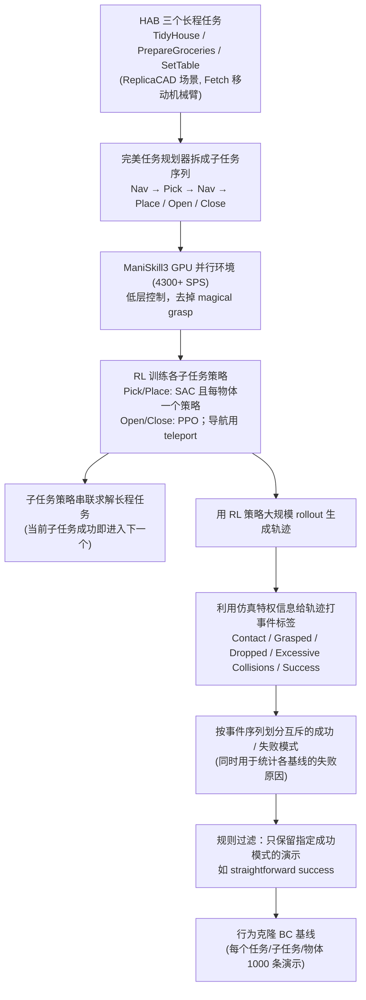
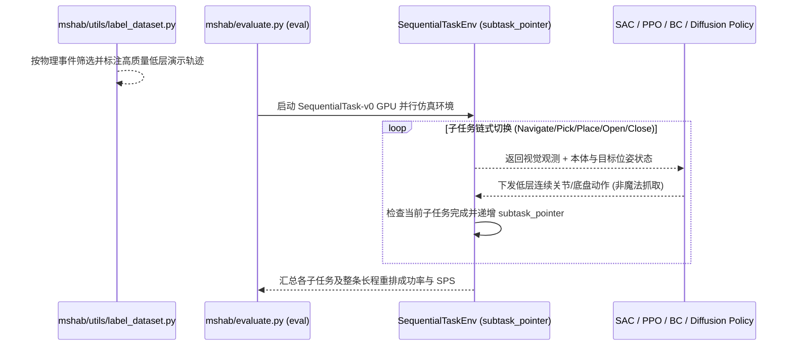

# ManiSkill-HAB

**ManiSkill-HAB: A Benchmark for Low-Level Manipulation in Home Rearrangement Tasks** 收录于 [Robot Learning Paper Notebooks](https://imchong.github.io/Robot_Learning_Paper_Notebooks/index.html)（分类：11_Simulation_Benchmark），深读笔记已完成。本页是 **笔记摘要**：要点编译自深读笔记，细节以笔记原文与论文 PDF 为准。

## 一句话定义

高质量基准是具身 AI 的基础，能推动长时程导航、操作与重排的进展。本文提出 MS-HAB（ManiSkill-HAB）：一个 GPU 加速的家庭助理基准（Home Assistant Benchmark, HAB）实现，提供真实的低层控制，相比此前"魔法抓取（magical grasp）"实现取得 3 倍以上提速且显存更省。作者训练了 RL 与 IL 基线，并开发一个基于规则的轨迹过滤系统，以大规模生成可控的演示数据。这把以往偏抽象/魔法抓取的家务重排基准，落到真实低层操作与高效仿真上。

## 英文缩写速查

| 缩写 | 含义 |
|---|---|
| MS-HAB | ManiSkill-HAB，本文基准 |
| HAB | Home Assistant Benchmark，家庭助理基准 |
| Low-Level Control | 低层控制（真实物理操作，非魔法抓取） |
| Magical Grasp | 魔法抓取，抽象的瞬时抓取 |
| Trajectory Filtering | 轨迹过滤，筛选高质量演示 |
| RL / IL | 强化学习 / 模仿学习 |

## 为什么重要

- **"真实低层 vs 魔法抓取"很关键**：抽象抓取会高估能力，真实操作才有迁移价值；
- **GPU 加速仿真**是规模化训练/采集的前提；
- **规则过滤生成可控演示**是低成本扩数据的实用手段；
- 虽以移动机械臂为主，重排/低层操作经验对人形家务同样适用。

## 流程总览

图依据：论文 §3 预备（任务/子任务/串联）、§4 环境设计、§5.1 RL 策略训练、§5.2 自动轨迹分类与数据集生成

## 解决什么问题

家务**重排**基准常用"**魔法抓取**"（抽象抓取），与真实**低层操作**脱节，且**仿真慢**： - 缺**真实低层控制**的家居重排基准； - 仿真**效率低**，难规模化训练/采集。

ManiSkill-HAB 要：一个 **GPU 加速、真实低层、可大规模生成演示**的家居重排基准。

## 核心机制

1. **真实低层家居重排基准**：取代魔法抓取，落到真实操作；
2. **GPU 加速 >3x、显存更省**：高效仿真；
3. **RL/IL 基线**：提供可比较参考；
4. **规则轨迹过滤大规模生成演示**：支撑模仿学习。

方法拆解（深读笔记小节）：GPU 加速 + 真实低层控制；RL / IL 基线；规则化轨迹过滤生成演示；🧭 整体流程（mermaid）。

## 核心信息

| 字段 | 内容 |
|------|------|
| 分类 | 11_Simulation_Benchmark |
| 深读笔记 | <https://imchong.github.io/Robot_Learning_Paper_Notebooks/papers/11_Simulation_Benchmark/ManiSkill-HAB__A_Benchmark_for_Low-Level_Manipulation_in_Home_Rearrangement_Tasks/ManiSkill-HAB__A_Benchmark_for_Low-Level_Manipulation_in_Home_Rearrangement_Tasks.html> |
| arXiv | <https://arxiv.org/abs/2412.13211> |
| 作者 | Arth Shukla、Stone Tao、Hao Su（UC San Diego） |
| 发表 | 2024 年 12 月 |
| 笔记阅读日期 | 2026-06-21 |

## 实验与评测

- **GPU 并行吞吐与显存优势**：在 4,096 并行环境中，ManiSkill-HAB 实测达到 **`4299.18 ± 26.36 SPS`**（显存 **`15.35 GB`**），较依赖“魔法抓取”的 **Habitat 2.0（`1397.65 ± 11.02 SPS` / `22.60 GB`）**实现 **3 倍以上提速且显存更省**；开启光线追踪渲染后仍达 **`69.90 SPS`**（对比 Behavior-1k **`19.92 SPS`**）。
- **低层控制与数据过滤消融（Tables 1–5）**：
  - **`RL-Per` vs `RL-All` vs `IL`（Table 1）**：按子任务训练的 `RL-Per` 显著领先单一全能策略 `RL-All` 与纯模仿学习（如 `CloseFr` 验证取得 **`0.00%`** 墙体碰撞率）。
  - **演示质量过滤（Tables 2–3）**：以 `mshab/utils/label_dataset.py` 按物理事件规则过滤后，放置—掉落比（Place:Drop）由未过滤时的 **`1:2.22`** 提升至 **`3.17:1`**；但 `Cracker Box` 等复杂几何长程重排仍是多阶段高频失败源。
  - **Diffusion Policy vs BC（Table 5）**：`DP` 在过滤数据集上相比标准 `BC` 对多模态轨迹分布的拟合更稳健，但顺序长程耦合仍受前序误差传导限制。

## 与其他工作对比

| 基准 / 基线 | 物理抓取抽象 | 并行吞吐与显存 / 光线追踪速度 | 核心差异与定位 |
|---|---|---|---|
| **ManiSkill-HAB（本文，arXiv:2412.13211v3）** | **真实低层连续控制**（无魔法抓取） | 4,096 环境 **`4299.18 ± 26.36 SPS` / `15.35 GB`**；光追 **`69.90 SPS`** | GPU 并行加速低层家务重排基准，配套规则事件过滤生成可控演示数据 |
| **Habitat 2.0** | **魔法抓取（magical grasp）**瞬时绑定 | 4,096 环境 `1397.65 ± 11.02 SPS` / `22.60 GB` | 抽象抓取易高估抓握成功率；MS-HAB 实现 **3× 以上提速**且显存占用更低 |
| **Behavior-1k** | 低层家居交互仿真 | 光线追踪渲染 `19.92 SPS` | 光追吞吐低于 ManiSkill-HAB（`69.90 SPS`） |

- **基准内部策略范式对照（Tables 1–5）：**
  - **`RL-Per` vs `RL-All` vs `IL`（Table 1）：** 按子任务/物体分别训练的专长策略 `RL-Per`（Pick/Place 用 SAC、Open/Close 用 PPO）显著优于单一全能策略 `RL-All` 与纯模仿学习（如 `CloseFr` 验证取得 `0.00%` 墙体碰撞率）。
  - **`Diffusion Policy (DP)` vs 标准 `BC`（Table 5）：** 在 `mshab/utils/label_dataset.py` 规则过滤后的高质量轨迹（每任务/子任务/物体 1,000 条，Place:Drop 由 `1:2.22` 提升至 `3.17:1`）上，`DP` 相比标准 `BC` 对多模态动作分布拟合更稳健。

## 结论

**MS-HAB 把家务重排基准从“魔法抓取”拉回真实低层物理控制，并用 GPU 并行加速（`4299.18 SPS` @ 4096 envs）与规则轨迹过滤支撑可复现的 RL/IL 对照。**

- 真正的贡献在评测真实度：用低层关节/末端抓放取代抽象瞬时绑定，避免“看似拿稳、上机即掉”的高估泡沫；且 3 倍以上并发速度让低层重排可规模化训测。
- 子任务分离专长（`RL-Per`）加事件过滤流水线（`label_dataset.py` 将 Place:Drop 由 `1:2.22` 逆转至 `3.17:1`）构成标准高性价比数据与基线配方。
- 官方仓 `arth-shukla/mshab` 开源链路完整（含 `SequentialTaskEnv`、`subtask_pointer`、`evaluate.py` 及 2025-07-26 Navigate 基线更新），可直接接入策略回归测试；适用上仍需注意载体为移动单臂而非双足人形。

## 工程实践

- **按双任务命名区分训练/评测模式**：官方仓 `arth-shukla/mshab` 将顺序多阶段重排评测（`SequentialTask-v0` via `SequentialTaskEnv` + `subtask_pointer`）与单子任务低层策略训练（`[Name]SubtaskTrain-v0`）解耦，并支持从 `mshab_checkpoints` 下载预训练权重直接评测（含 2025-07-26 更新的 Navigate 基线）。
- **高质量数据过滤胜过无差别扩增**：复现模仿学习基线前须先运行 `mshab/utils/label_dataset.py` 做事件级过滤与轨迹清洗；盲目混入低质量或高掉落比演示会直接拉低 BC/DP 上限。

## 源码运行时序图

以下时序基于官方仓库 [arth-shukla/mshab](https://github.com/arth-shukla/mshab)（`main` 分支）实际评测与数据处理源码：

## 局限与风险

- **“感知/导航→低层精细操作”组合泛化仍脆弱**：尽管相比 Habitat 2.0 在 4096 并发环境实现 `4299.18 ± 26.36 SPS / 15.35 GB`（vs `1397.65 ± 11.02 SPS / 22.60 GB`）及光线追踪 `69.90 SPS`（vs Behavior-1k `19.92 SPS`），但闭环中面对杂乱摆位（如 Cracker Box 多阶段失败或 Place:Drop 比差至 `1:2.22`）仍容易断链。
- **策略范式剪刀差显著**：`RL-Per` 专长策略在某些窄容差子任务（如 CloseFr 验证墙体碰撞率 `0.00%`）远胜共享全任务策略 `RL-All`，而纯模仿学习（`BC` / `DP`）在无高质量过滤样本时对长时物理交互敏感。

## 关联页面

- [机器人操作](../tasks/manipulation.md) — 延伸阅读，理解操作任务与工具接口。
- [策略优化](../methods/policy-optimization.md) — 延伸阅读，理解策略训练的优化目标。
- 评测闭环：[具身大模型评测基准选型闭环](../queries/embodied-eval-benchmark-selection-loop.md) — 本页对应其中的 GPU 加速低层家务重排评测与规则过滤演示数据流水线
- 分类父节点：[paper-notebook-category-11-simulation-benchmark](../overview/paper-notebook-category-11-simulation-benchmark.md)
- 总索引：[humanoid-paper-notebooks-index.md](../overview/humanoid-paper-notebooks-index.md)

## 参考来源

- [humanoid_pnb_maniskill-hab.md](../../sources/papers/humanoid_pnb_maniskill-hab.md)
- 深读笔记：<https://imchong.github.io/Robot_Learning_Paper_Notebooks/papers/11_Simulation_Benchmark/ManiSkill-HAB__A_Benchmark_for_Low-Level_Manipulation_in_Home_Rearrangement_Tasks/ManiSkill-HAB__A_Benchmark_for_Low-Level_Manipulation_in_Home_Rearrangement_Tasks.html>
- 论文：<https://arxiv.org/abs/2412.13211>
- [arXiv PDF](https://arxiv.org/pdf/2412.13211)：已全文通读 `arXiv:2412.13211v3`（含 §1–§6、Tables 1–13 与 Appendices A.1–A.6，并核对 `arth-shukla/mshab` 仓库入口）。

## 推荐继续阅读

- [机器人论文阅读笔记：ManiSkill-HAB](https://imchong.github.io/Robot_Learning_Paper_Notebooks/papers/11_Simulation_Benchmark/ManiSkill-HAB__A_Benchmark_for_Low-Level_Manipulation_in_Home_Rearrangement_Tasks/ManiSkill-HAB__A_Benchmark_for_Low-Level_Manipulation_in_Home_Rearrangement_Tasks.html)
