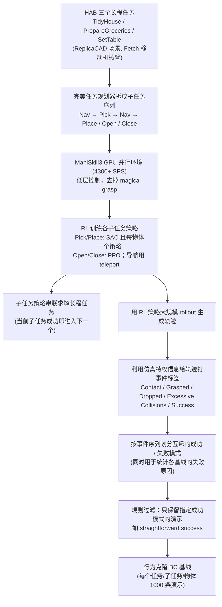

# ManiSkill-HAB

**ManiSkill-HAB: A Benchmark for Low-Level Manipulation in Home Rearrangement Tasks** 收录于 [Robot Learning Paper Notebooks](https://imchong.github.io/Robot_Learning_Paper_Notebooks/index.html)（分类：11_Simulation_Benchmark），深读笔记已完成。本页是 **笔记摘要**：要点编译自深读笔记，细节以笔记原文与论文 PDF 为准。

## 一句话定义

高质量基准是具身 AI 的基础，能推动长时程导航、操作与重排的进展。本文提出 MS-HAB（ManiSkill-HAB）：一个 GPU 加速的家庭助理基准（Home Assistant Benchmark, HAB）实现，提供真实的低层控制，相比此前"魔法抓取（magical grasp）"实现取得 3 倍以上提速且显存更省。作者训练了 RL 与 IL 基线，并开发一个基于规则的轨迹过滤系统，以大规模生成可控的演示数据。这把以往偏抽象/魔法抓取的家务重排基准，落到真实低层操作与高效仿真上。

## 英文缩写速查

| 缩写 | 含义 |
|---|---|
| MS-HAB | ManiSkill-HAB，本文基准 |
| HAB | Home Assistant Benchmark，家庭助理基准 |
| Low-Level Control | 低层控制（真实物理操作，非魔法抓取） |
| Magical Grasp | 魔法抓取，抽象的瞬时抓取 |
| Trajectory Filtering | 轨迹过滤，筛选高质量演示 |
| RL / IL | 强化学习 / 模仿学习 |

## 为什么重要

- **"真实低层 vs 魔法抓取"很关键**：抽象抓取会高估能力，真实操作才有迁移价值；
- **GPU 加速仿真**是规模化训练/采集的前提；
- **规则过滤生成可控演示**是低成本扩数据的实用手段；
- 虽以移动机械臂为主，重排/低层操作经验对人形家务同样适用。

## 流程总览

图依据：论文 §3 预备（任务/子任务/串联）、§4 环境设计、§5.1 RL 策略训练、§5.2 自动轨迹分类与数据集生成

## 解决什么问题

家务**重排**基准常用"**魔法抓取**"（抽象抓取），与真实**低层操作**脱节，且**仿真慢**： - 缺**真实低层控制**的家居重排基准； - 仿真**效率低**，难规模化训练/采集。

ManiSkill-HAB 要：一个 **GPU 加速、真实低层、可大规模生成演示**的家居重排基准。

## 核心机制

1. **真实低层家居重排基准**：取代魔法抓取，落到真实操作；
2. **GPU 加速 >3x、显存更省**：高效仿真；
3. **RL/IL 基线**：提供可比较参考；
4. **规则轨迹过滤大规模生成演示**：支撑模仿学习。

方法拆解（深读笔记小节）：GPU 加速 + 真实低层控制；RL / IL 基线；规则化轨迹过滤生成演示；🧭 整体流程（mermaid）。

## 核心信息

| 字段 | 内容 |
|------|------|
| 分类 | 11_Simulation_Benchmark |
| 深读笔记 | <https://imchong.github.io/Robot_Learning_Paper_Notebooks/papers/11_Simulation_Benchmark/ManiSkill-HAB__A_Benchmark_for_Low-Level_Manipulation_in_Home_Rearrangement_Tasks/ManiSkill-HAB__A_Benchmark_for_Low-Level_Manipulation_in_Home_Rearrangement_Tasks.html> |
| arXiv | <https://arxiv.org/abs/2412.13211> |
| 作者 | Arth Shukla、Stone Tao、Hao Su（UC San Diego） |
| 发表 | 2024 年 12 月 |
| 笔记阅读日期 | 2026-06-21 |

## 实验与评测

- 本页是深读笔记的摘要，没有搬运原文的量化结果；量化 benchmark、消融与实机指标以 **深读笔记与论文 PDF** 为准（链接见 [参考来源](#参考来源)）。

## 结论

**MS-HAB 的价值主张是把家务重排基准从「魔法抓取」拉回真实低层控制，同时用 GPU 加速把这笔额外成本抵消掉。**

- 真正的贡献在评测口径而非算法：魔法抓取这种抽象瞬时抓取会系统性高估能力，换成真实低层操作后基准才具备迁移价值。
- 相比此前实现取得 3 倍以上提速且显存更省，是让「真实低层」这个更贵的设定仍能规模化训练与采集的前提；没有这一条，前一条就落不了地。
- RL / IL 基线加上基于规则的轨迹过滤，把基准从一套任务变成能大规模产出可控演示数据的流水线，这是低成本扩数据的实用手段。
- 适用边界：任务载体是家居重排中的移动机械臂而非人形，指标不能直接搬用；但重排与低层操作的经验对人形家务场景仍然适用。
- 本页为笔记摘要，具体任务集合、基线数值与消融以深读笔记和论文 PDF 为准。

## 与其他页面的关系

- 分类父节点：[paper-notebook-category-11-simulation-benchmark](../overview/paper-notebook-category-11-simulation-benchmark.md)
- 总索引：[humanoid-paper-notebooks-index.md](../overview/humanoid-paper-notebooks-index.md)

## 参考来源

- [humanoid_pnb_maniskill-hab.md](../../sources/papers/humanoid_pnb_maniskill-hab.md)
- 深读笔记：<https://imchong.github.io/Robot_Learning_Paper_Notebooks/papers/11_Simulation_Benchmark/ManiSkill-HAB__A_Benchmark_for_Low-Level_Manipulation_in_Home_Rearrangement_Tasks/ManiSkill-HAB__A_Benchmark_for_Low-Level_Manipulation_in_Home_Rearrangement_Tasks.html>
- 论文：<https://arxiv.org/abs/2412.13211>
- [arXiv PDF](https://arxiv.org/pdf/2412.13211)：已通读方法部分（实验与附录以略读为准）：§1 引言、§3 预备、§4 环境设计与基准、§5 方法（5.1 RL 策略、5.2 轨迹分类与 IL 数据集）

## 推荐继续阅读

- [机器人论文阅读笔记：ManiSkill-HAB](https://imchong.github.io/Robot_Learning_Paper_Notebooks/papers/11_Simulation_Benchmark/ManiSkill-HAB__A_Benchmark_for_Low-Level_Manipulation_in_Home_Rearrangement_Tasks/ManiSkill-HAB__A_Benchmark_for_Low-Level_Manipulation_in_Home_Rearrangement_Tasks.html)
