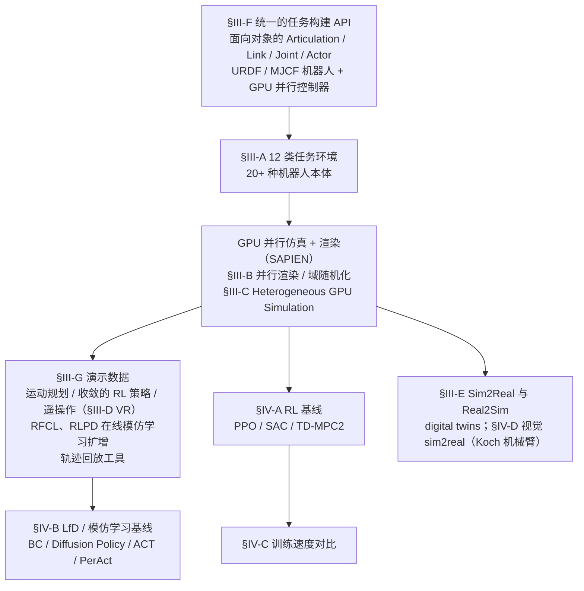

# ManiSkill3

**ManiSkill3: GPU Parallelized Robotics Simulation and Rendering for Generalizable Embodied AI** 已列入 [Robot Learning Paper Notebooks](https://imchong.github.io/Robot_Learning_Paper_Notebooks/index.html) 的 **PROGRESS.md 待深读** 清单（分类：11_Simulation_Benchmark）。本页 **还没有深读笔记**：只给出这篇论文的分类位置与原文入口，方法细节与数据请直接看原文。

## 一句话定义

ManiSkill3 的人形机器人学习论文条目，当前处于 Paper Notebooks 阅读进度（待深读）阶段。

## 英文缩写速查

| 缩写 | 英文全称 | 简要说明 |
|------|----------|----------|
| RL | Reinforcement Learning | 通过与环境交互最大化长期回报来学习策略 |
| WBC | Whole-Body Control | 协调全身关节满足多任务/约束的控制基础设施 |
| Sim2Real | Simulation to Real | 把仿真中学到的策略迁移落地真机的工程主线 |

## 为什么重要

- 这篇已排进 Paper Notebooks 的待读清单，可以从 [机器人学习论文笔记总索引](../overview/humanoid-paper-notebooks-index.md) 与分类页找到同一批工作。
- 在笔记写出来之前，这里只保留分类位置与原文入口；平台组成见上文流程总览（依据论文 §III–§IV），不含对性能数字的结论。

## 流程总览

图依据：仿真基准平台组成与评测流程图（基准 / 系统），论文 §III（Core Features，Fig.2–Fig.8）、§IV（Baselines and Results）；图中不含速度、内存与成功率数字。

## 核心信息

| 字段 | 内容 |
|------|------|
| 分类 | 11_Simulation_Benchmark |
| 深读状态 | 待撰写（[PROGRESS.md](https://github.com/ImChong/Robot_Learning_Paper_Notebooks/blob/main/papers/PROGRESS.md)） |
| 计划文件夹 | `papers/11_Simulation_Benchmark/maniskill3-gpu-parallelized-robotics-simulation` |
| arXiv | <https://arxiv.org/abs/2410.00425> |

## 实验与评测

- 深读笔记尚未完成；量化 benchmark、消融与实机指标待笔记撰写后补充。

## 结论

**本页是 11_Simulation_Benchmark 分类下的待读条目，不是对 ManiSkill3 的归纳：GPU 并行仿真与渲染的具体设计与数据全部待深读笔记补齐。**

- 页面可确证的只有分类归属、PROGRESS.md 上的「待深读」状态与 arXiv 编号 2410.00425；吞吐、渲染能力与任务覆盖等关键卖点均无记录。
- 适用边界：可用于按分类检索，不能当作选型依据——仿真栈选型必须回到论文与官方文档。
- 深读状态以上游 PROGRESS.md 为准；笔记完成后本页需补成完整摘要，并与同分类下已完成深读的条目对齐写法。

## 与其他页面的关系

- 分类页：[paper-notebook-category-11-simulation-benchmark](../overview/paper-notebook-category-11-simulation-benchmark.md)
- 总索引：[humanoid-paper-notebooks-index.md](../overview/humanoid-paper-notebooks-index.md)

## 参考来源

- [humanoid_pnb_maniskill3-gpu-parallelized-robotics-simulation.md](../../sources/papers/humanoid_pnb_maniskill3-gpu-parallelized-robotics-simulation.md)
- [Robot Learning Paper Notebooks · PROGRESS.md](https://github.com/ImChong/Robot_Learning_Paper_Notebooks/blob/main/papers/PROGRESS.md)
- 论文：<https://arxiv.org/abs/2410.00425>
- [arXiv PDF](https://arxiv.org/pdf/2410.00425)：已通读 摘要、§I、§III 全部小节、§IV 开头与 §IV-A/B/D；§IV-C 及附录（环境列表、基线细节、性能基准）仅读标题

## 推荐继续阅读

- [Paper Notebooks 阅读进度（PROGRESS.md）](https://github.com/ImChong/Robot_Learning_Paper_Notebooks/blob/main/papers/PROGRESS.md)
