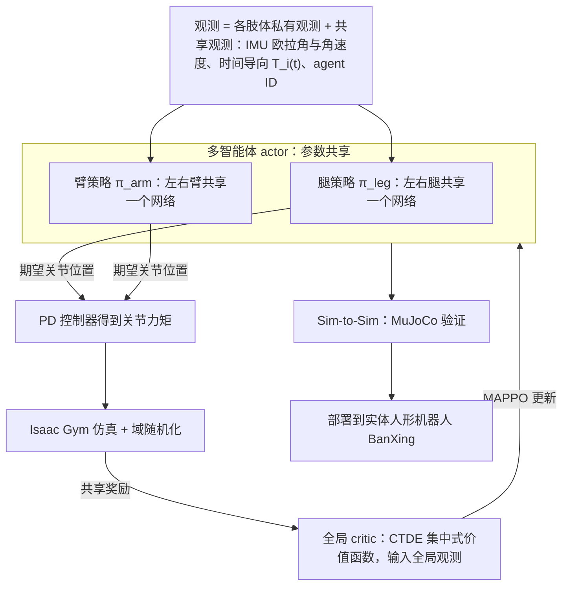

# MASH

**MASH: Cooperative-Heterogeneous Multi-Agent RL for Single Humanoid Robot Locomotion** 已列入 [Robot Learning Paper Notebooks](https://imchong.github.io/Robot_Learning_Paper_Notebooks/index.html) 的 **PROGRESS.md 待深读** 清单（分类：05_Locomotion）。本页 **还没有深读笔记**：只给出这篇论文的分类位置与原文入口，方法细节与数据请直接看原文。

## 一句话定义

MASH 的人形机器人学习论文条目，当前处于 Paper Notebooks 阅读进度（待深读）阶段。

## 英文缩写速查

| 缩写 | 英文全称 | 简要说明 |
|------|----------|----------|
| RL | Reinforcement Learning | 通过与环境交互最大化长期回报来学习策略 |
| WBC | Whole-Body Control | 协调全身关节满足多任务/约束的控制基础设施 |
| Sim2Real | Simulation to Real | 把仿真中学到的策略迁移落地真机的工程主线 |

## 为什么重要

- 这篇已排进 Paper Notebooks 的待读清单，可以从 [机器人学习论文笔记总索引](../overview/humanoid-paper-notebooks-index.md) 与分类页找到同一批工作。
- 在笔记写出来之前，这里只保留分类位置与原文入口；方法流程见下方「流程总览」，实验结论以论文为准。

## 流程总览

图依据：论文 §IV（MASH 框架与多智能体 actor / 全局 critic）、§IV-C Sim-to-Real、§V-A 实验设置 / Fig. 1、Fig. 2。

## 核心信息

| 字段 | 内容 |
|------|------|
| 分类 | 05_Locomotion |
| 深读状态 | 待撰写（[PROGRESS.md](https://github.com/ImChong/Robot_Learning_Paper_Notebooks/blob/main/papers/PROGRESS.md)） |
| 计划文件夹 | `papers/05_Locomotion/mash-cooperative-heterogeneous-multi-agent-rl-fo` |
| arXiv | <https://arxiv.org/abs/2508.10423> |

## 实验与评测

- 深读笔记尚未完成；量化 benchmark、消融与实机指标待笔记撰写后补充。

## 结论

**标题里的张力就是这条目当前的全部看点：多智能体 RL 被用在「单个」人形机器人的行走上；但本页处于待深读，说不清这种拆分具体怎么做。**

- 可确认信息：分类 05_Locomotion、arXiv 2508.10423、深读状态「待撰写」；机制线索仅为「合作-异构的多智能体 RL 用于单人形 locomotion」。
- 本页无法回答的关键问题恰恰是最要紧的几个：智能体如何划分、「异构」体现在哪里、协作信号怎么设计——这些都要等深读笔记或原文。
- 因此当前正当用途只有待读与交叉检索，挂在 [paper-notebook-category-05-locomotion](../overview/paper-notebook-category-05-locomotion.md) 之下；量化 benchmark 与实机指标一律待补。

## 与其他页面的关系

- 分类页：[paper-notebook-category-05-locomotion](../overview/paper-notebook-category-05-locomotion.md)
- 总索引：[humanoid-paper-notebooks-index.md](../overview/humanoid-paper-notebooks-index.md)

## 参考来源

- [humanoid_pnb_mash-cooperative-heterogeneous-multi-agent-rl-fo.md](../../sources/papers/humanoid_pnb_mash-cooperative-heterogeneous-multi-agent-rl-fo.md)
- [Robot Learning Paper Notebooks · PROGRESS.md](https://github.com/ImChong/Robot_Learning_Paper_Notebooks/blob/main/papers/PROGRESS.md)
- 论文：<https://arxiv.org/abs/2508.10423>
- [arXiv PDF](https://arxiv.org/pdf/2508.10423)：已通读方法部分（实验与附录以略读为准）：摘要、§III 背景、§IV MASH 框架（含 actor/critic 网络与 Sim-to-Real）、§V-A 实验设置

## 推荐继续阅读

- [Paper Notebooks 阅读进度（PROGRESS.md）](https://github.com/ImChong/Robot_Learning_Paper_Notebooks/blob/main/papers/PROGRESS.md)
