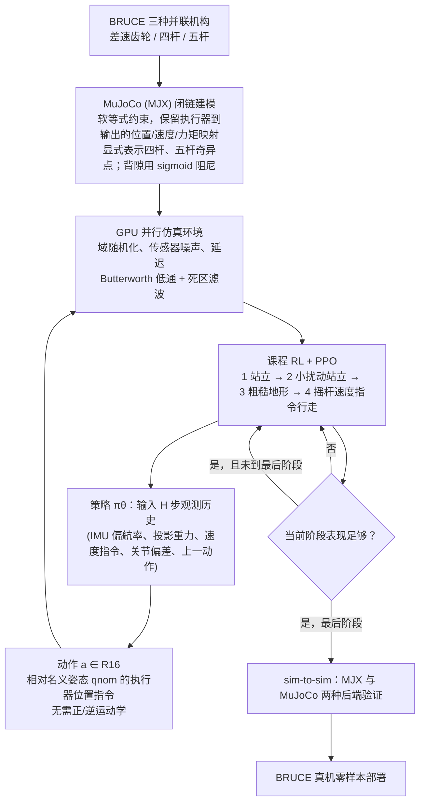

# Mechanical Intelligence-Aware Curriculum RL for Humanoids with Parallel Actuation

**Mechanical Intelligence-Aware Curriculum RL for Humanoids with Parallel Actuation** 已列入 [Robot Learning Paper Notebooks](https://imchong.github.io/Robot_Learning_Paper_Notebooks/index.html) 的 **PROGRESS.md 待深读** 清单（分类：05_Locomotion）。本页 **还没有深读笔记**：只给出这篇论文的分类位置与原文入口，方法细节与数据请直接看原文。

## 一句话定义

Mechanical Intelligence-Aware Curriculum RL for Humanoids with Parallel Actuation 的人形机器人学习论文条目，当前处于 Paper Notebooks 阅读进度（待深读）阶段。

## 英文缩写速查

| 缩写 | 英文全称 | 简要说明 |
|------|----------|----------|
| RL | Reinforcement Learning | 通过与环境交互最大化长期回报来学习策略 |
| WBC | Whole-Body Control | 协调全身关节满足多任务/约束的控制基础设施 |
| Sim2Real | Simulation to Real | 把仿真中学到的策略迁移落地真机的工程主线 |

## 为什么重要

- 这篇已排进 Paper Notebooks 的待读清单，可以从 [机器人学习论文笔记总索引](../overview/humanoid-paper-notebooks-index.md) 与分类页找到同一批工作。
- 深读笔记写出来之前，方法流程见下方「流程总览」（依据论文方法部分），其余方法结论暂不给。

## 流程总览

图依据：论文 §III、§IV-A 至 §IV-D / Fig. 2、Fig. 6

## 核心信息

| 字段 | 内容 |
|------|------|
| 分类 | 05_Locomotion |
| 深读状态 | 待撰写（[PROGRESS.md](https://github.com/ImChong/Robot_Learning_Paper_Notebooks/blob/main/papers/PROGRESS.md)） |
| 计划文件夹 | `papers/05_Locomotion/mechanical-intelligence-aware-curriculum-rl-for` |
| arXiv | <https://arxiv.org/abs/2507.00273> |

## 实验与评测

- 深读笔记尚未完成；量化 benchmark、消融与实机指标待笔记撰写后补充。

## 结论

**本页是 05_Locomotion 下的待读条目：仅登记了这篇「并联驱动 + 课程式 RL」工作的存在，机制与结论整体留白。**

- 页面可确证的只有分类归属、PROGRESS.md 上的「待深读」状态与 arXiv 编号 2507.00273；课程如何设计、并联驱动带来的机械智能如何被利用，页面均未记录。
- 适用边界：可用于分类检索与待读链接，不能作为该工作的技术依据或引用来源。
- 主要风险是被误读成已完成摘要；深读状态以上游 PROGRESS.md 为准，笔记完成后本页会补上笔记链接并重写。

## 与其他页面的关系

- 分类页：[paper-notebook-category-05-locomotion](../overview/paper-notebook-category-05-locomotion.md)
- 总索引：[humanoid-paper-notebooks-index.md](../overview/humanoid-paper-notebooks-index.md)

## 参考来源

- [humanoid_pnb_mechanical-intelligence-aware-curriculum-rl-for.md](../../sources/papers/humanoid_pnb_mechanical-intelligence-aware-curriculum-rl-for.md)
- [Robot Learning Paper Notebooks · PROGRESS.md](https://github.com/ImChong/Robot_Learning_Paper_Notebooks/blob/main/papers/PROGRESS.md)
- 论文：<https://arxiv.org/abs/2507.00273>
- [arXiv PDF](https://arxiv.org/pdf/2507.00273)：已通读方法部分（实验与附录以略读为准）：§III 并联机构与闭链建模、§IV 强化学习（动作/观测空间、奖励、训练课程）；§V 结果仅略读

## 推荐继续阅读

- [Paper Notebooks 阅读进度（PROGRESS.md）](https://github.com/ImChong/Robot_Learning_Paper_Notebooks/blob/main/papers/PROGRESS.md)
