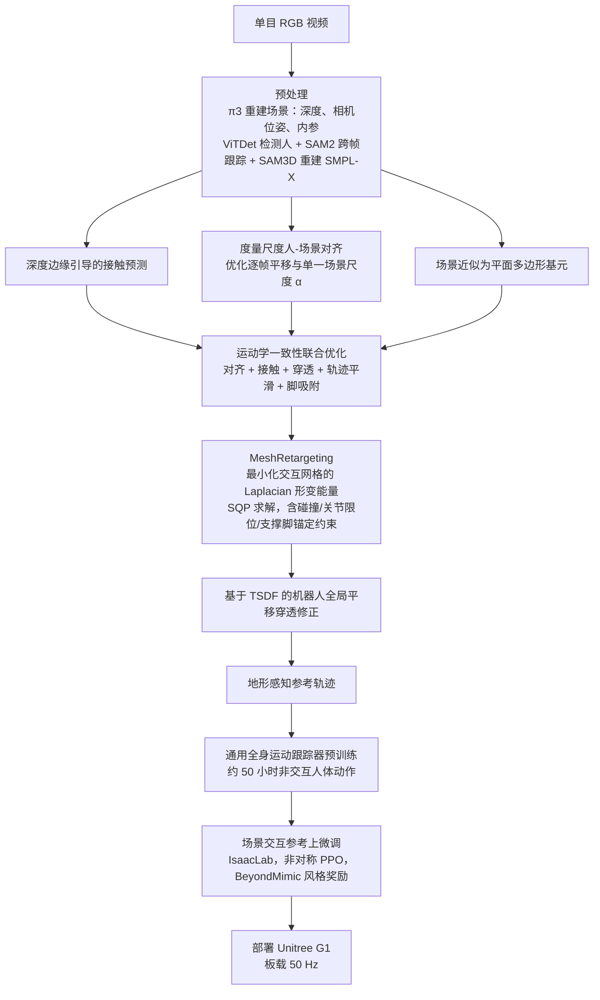

# MeshMimic

**MeshMimic: Geometry-Aware Humanoid Motion Learning through 3D Scene Reconstruction** 收录于 [Robot Learning Paper Notebooks](https://imchong.github.io/Robot_Learning_Paper_Notebooks/index.html)（分类：04_Loco-Manipulation_and_WBC）。本页在原有清单实体上补齐对 arXiv:2602.15733v1 全文的深读，重点检验三维重建、接触约束和真机指标。

## 一句话定义

MeshMimic 把普通单目 RGB 视频变成可训练人形机器人的“运动-地形”耦合数据：先用 3D 视觉重建人体 SMPL-X、场景几何和接触，再通过运动优化与接触不变重定向，将人类在复杂地形上的动作迁移到人形机器人策略中，缓解传统 MoCap 缺少环境几何导致的脚滑、穿模和接触不一致问题。

## 英文缩写速查

| 缩写 | 英文全称 | 简要说明 |
|------|----------|----------|
| RL | Reinforcement Learning | 通过与环境交互最大化长期回报来学习策略 |
| WBC | Whole-Body Control | 协调全身关节满足多任务/约束的控制基础设施 |
| Sim2Real | Simulation to Real | 把仿真中学到的策略迁移落地真机的工程主线 |

## 为什么重要

- 列入 Paper Notebooks 策展清单，便于与全库 [机器人学习论文笔记总索引](../overview/humanoid-paper-notebooks-index.md) 及分类父节点交叉检索。
- 深读笔记提供比摘要更贴近实现的阅读路径，适合作为后续 ingest 深化起点。
- 与 [EgoHTR](./paper-egohtr.md) 对照：MeshMimic 走单目重建路径，EgoHTR 用可穿戴+扫描锚定厘米级，并给出 foothold 精度门槛实证。

## 流程总览

图依据：论文 §3（Fig. 3、Fig. 4）、§4.2。

## 核心信息

| 字段 | 内容 |
|------|------|
| 分类 | 04_Loco-Manipulation_and_WBC |
| 深读笔记 | <https://imchong.github.io/Robot_Learning_Paper_Notebooks/papers/04_Loco-Manipulation_and_WBC/MeshMimic__Geometry-Aware_Humanoid_Motion_Learning_through_3D_Scene_Reconstructi/MeshMimic__Geometry-Aware_Humanoid_Motion_Learning_through_3D_Scene_Reconstructi.html> |
| arXiv | <https://arxiv.org/abs/2602.15733> |

## 源码运行时序图

**不适用**：截至 2026-11-12，论文与官方项目页未提供经核实可运行的完整重建/重定向/策略训练源码入口。上方 Mermaid 是根据论文画出的算法数据流，不是代码执行日志。

## 工程实践

| 部分 | 原文实现与验证 |
|---|---|
| 三维重建 | 单目 RGB 经 π3 估场景与相机、SAM3D-body 恢复 SMPL-X，TSDF 帮助接触/穿透优化 |
| 重定向 | 含局部地形点的 Laplacian 交互网格，SQP 受碰撞、关节及支撑脚限制 |
| 策略训练 | 先在约 50 小时非交互运动上预训练，再在接触场景内以 Isaac Lab 非对称 PPO 微调 |
| 部署 | Unitree G1，Jetson Orin 板载约 50Hz；重建地形与真机测试场景一致 |

## 实验与评测

- §4.3：八项行走、跳箱、攀爬、单/双手撑箱、连续攀越动作测试；真实部署每场景 **10 次**试验，成功须无干预完成全段。
- 对照 VideoMimic：分别替换人体动作重建或场景地形重建；作者报告 MeshMimic 动作 + 地形组合训练奖励和真机成功表现最好（Fig.6）。
- §4.2：采用 2048 并行 Isaac Lab 环境、40k PPO iterations 检验训练奖励；真实 G1 部署前经 Isaac Lab→MuJoCo sim2sim 校验。
- **边界：** Fig.6 的不同任务按柱状图报告，不从图像推断未经准确标注的总成功率。

## 结论

**MeshMimic 押的是数据侧而不是策略侧：它把人形学不好复杂地形动作的根因归到「MoCap 丢了环境几何」，于是用单目视频重建把「运动」和「地形」重新绑回一起。**

- 真正起作用的是两段流水线：先做 3D 视觉重建（人体 SMPL-X、场景几何、接触），再用运动优化 + 接触不变重定向把人类动作搬到人形上。
- 它瞄准的失败模式很具体——脚滑、穿模、接触不一致，这些正是缺少环境几何的传统 MoCap 数据带来的典型问题。
- 取舍是可得性优先：输入只要普通单目 RGB 视频，数据来源门槛极低；对精度更敏感的场景，本页给出的对照是 [EgoHTR](./paper-egohtr.md)——可穿戴+扫描锚定厘米级，并有 foothold 精度门槛实证。
- 边界：本页为清单索引实体，量化 benchmark 与实机指标以深读笔记与论文 PDF 为准（见 [参考来源](#参考来源)）。

## 与其他工作对比

- [EgoHTR](./paper-egohtr.md) 更强调可穿戴/扫描定位的高精度几何锚定，MeshMimic 优先降低人体视频数据门槛。
- VideoMimic 在单目重建场景/运动基线上可直接比；论文在八类场景中分离地形与动作重建误差。
- [SOLO](./paper-solo.md) 直接学习感知地形下的在线行走；MeshMimic 更侧重生成可信的**运动-几何参考数据**与模仿控制。

## 局限与风险

- 单目尺度、深度与人体遮挡误差可能传播到接触优化；平面多边形场景表示无法覆盖所有复杂表面。
- 论文将重建场景带回同一真实环境进行跟踪，不能直接据此声称对完全未知地形的闭环视觉泛化。
- 高动态动作如 Safety Vault 和长段多场景交互仍有真实失败，且完整代码未核实开放。

## 关联页面

- [Loco-Manipulation 与全身控制](../overview/paper-notebook-category-04-loco-manipulation-and-wbc.md)
- [EgoHTR](./paper-egohtr.md)
- [SOLO：感知行走](./paper-solo.md)

## 与其他页面的关系

- 分类父节点：[paper-notebook-category-04-loco-manipulation-and-wbc](../overview/paper-notebook-category-04-loco-manipulation-and-wbc.md)
- 总索引：[humanoid-paper-notebooks-index.md](../overview/humanoid-paper-notebooks-index.md)
- 高精度人–地形数据对照：[EgoHTR](./paper-egohtr.md)

## 参考来源

- [humanoid_pnb_meshmimic.md](../../sources/papers/humanoid_pnb_meshmimic.md)
- 深读笔记：<https://imchong.github.io/Robot_Learning_Paper_Notebooks/papers/04_Loco-Manipulation_and_WBC/MeshMimic__Geometry-Aware_Humanoid_Motion_Learning_through_3D_Scene_Reconstructi/MeshMimic__Geometry-Aware_Humanoid_Motion_Learning_through_3D_Scene_Reconstructi.html>
- 论文：<https://arxiv.org/abs/2602.15733>
- [arXiv PDF](https://arxiv.org/pdf/2602.15733)：已通读方法部分（实验与附录以略读为准）：§3.1-§3.3 方法、§4.2 训练与部署配置

## 推荐继续阅读

- [MeshMimic 官方项目页](https://meshmimic.github.io/) — 视频及发布状态

- [机器人论文阅读笔记：MeshMimic](https://imchong.github.io/Robot_Learning_Paper_Notebooks/papers/04_Loco-Manipulation_and_WBC/MeshMimic__Geometry-Aware_Humanoid_Motion_Learning_through_3D_Scene_Reconstructi/MeshMimic__Geometry-Aware_Humanoid_Motion_Learning_through_3D_Scene_Reconstructi.html)
- [EgoHTR](./paper-egohtr.md) — rough-terrain 可穿戴+扫描 4D 对照（HF 数据已发布，代码待发布）
