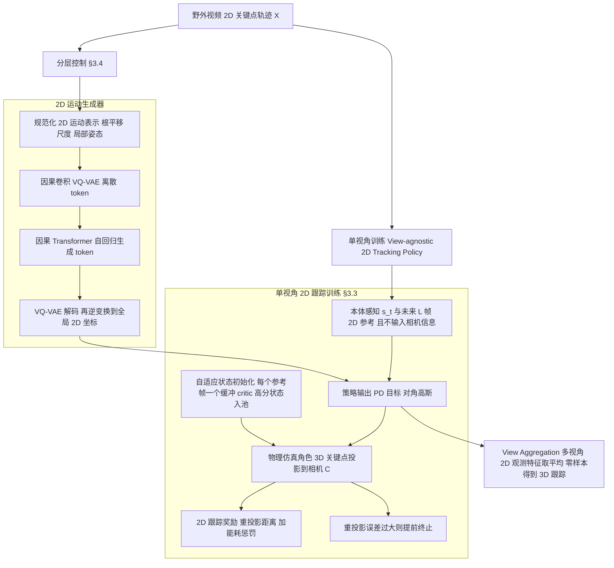

# Mimic2DM

**Mimic2DM: Generating and Mimicking 2D Motions for 3D Character Control** 收录于 [Robot Learning Paper Notebooks](https://imchong.github.io/Robot_Learning_Paper_Notebooks/index.html)（分类：13_Physics-Based_Animation）。本页为 **清单索引实体**，链向深读笔记与原始论文；详细机制待从笔记消化后补充。

## 一句话定义

不再依赖 off-the-shelf 的 3D 重建，直接用从野生视频抽出的 2D 关键点轨迹 + 重投影误差，把"物理仿真中的角色控制器"从训练到生成端到端做穿；多视角聚合后还能涨成 3D 追踪能力 —— 给数据匮乏 / 物理可信度难保证的复杂动作（舞蹈、球类、动物步态）一条便宜得多的路。

## 英文缩写速查

| 缩写 | 英文全称 | 简要说明 |
|------|----------|----------|
| RL | Reinforcement Learning | 通过与环境交互最大化长期回报来学习策略 |
| WBC | Whole-Body Control | 协调全身关节满足多任务/约束的控制基础设施 |
| Sim2Real | Simulation to Real | 把仿真中学到的策略迁移落地真机的工程主线 |

## 为什么重要

- 列入 Paper Notebooks 策展清单，便于与全库 [机器人学习论文笔记总索引](../overview/humanoid-paper-notebooks-index.md) 及分类父节点交叉检索。
- 深读笔记提供比摘要更贴近实现的阅读路径，适合作为后续 ingest 深化起点。

## 流程总览

图依据：论文 §3.1–3.4 / Fig.3

## 核心信息

| 字段 | 内容 |
|------|------|
| 分类 | 13_Physics-Based_Animation |
| 深读笔记 | <https://imchong.github.io/Robot_Learning_Paper_Notebooks/papers/13_Physics-Based_Animation/Mimic2DM__Generating_and_Mimicking_2D_Motions_for_3D_Character_Control/Mimic2DM__Generating_and_Mimicking_2D_Motions_for_3D_Character_Control.html> |
| arXiv | <https://arxiv.org/abs/2512.08500> |

## 实验与评测

- 本页为 **策展清单索引** 摘要；量化 benchmark、消融与实机指标以 **深读笔记与论文 PDF** 为准（链接见 [参考来源](#参考来源)）。

## 结论

**Mimic2DM 的取舍很明确：放弃对现成 3D 重建的依赖，直接拿野生视频的 2D 关键点轨迹加重投影误差当监督，用「便宜」换复杂动作的可得性。**

- 关键机制是监督信号的降级——2D 关键点 + 重投影误差把物理仿真中的角色控制器从训练到生成端到端做穿，绕开了 off-the-shelf 3D 重建这一层的成本与误差。
- 多视角聚合后仍能长出 3D 追踪能力，说明放弃 3D 输入不等于放弃 3D 结果，只是把重建的负担挪到了控制器与多视角约束一侧。
- 适用边界正是它挑的场景：舞蹈、球类、动物步态这类数据匮乏、物理可信度难保证的复杂动作；对已有高质量 3D 动捕的常规动作，这条路的优势并不明显。
- 本页仍是清单索引实体，详细机制待从深读笔记消化后补充，量化对比以笔记与论文 PDF 为准。

## 与其他页面的关系

- 分类父节点：[paper-notebook-category-13-physics-based-animation](../overview/paper-notebook-category-13-physics-based-animation.md)
- 总索引：[humanoid-paper-notebooks-index.md](../overview/humanoid-paper-notebooks-index.md)

## 参考来源

- [humanoid_pnb_mimic2dm.md](../../sources/papers/humanoid_pnb_mimic2dm.md)
- 深读笔记：<https://imchong.github.io/Robot_Learning_Paper_Notebooks/papers/13_Physics-Based_Animation/Mimic2DM__Generating_and_Mimicking_2D_Motions_for_3D_Character_Control/Mimic2DM__Generating_and_Mimicking_2D_Motions_for_3D_Character_Control.html>
- 论文：<https://arxiv.org/abs/2512.08500>
- [arXiv PDF](https://arxiv.org/pdf/2512.08500)：已通读方法部分（实验与附录以略读为准）：§3.1–3.4 Method（含 Fig.3 Overview）、§4.1 实验设定开头

## 推荐继续阅读

- [机器人论文阅读笔记：Mimic2DM](https://imchong.github.io/Robot_Learning_Paper_Notebooks/papers/13_Physics-Based_Animation/Mimic2DM__Generating_and_Mimicking_2D_Motions_for_3D_Character_Control/Mimic2DM__Generating_and_Mimicking_2D_Motions_for_3D_Character_Control.html)
