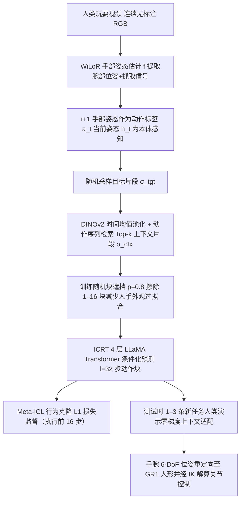
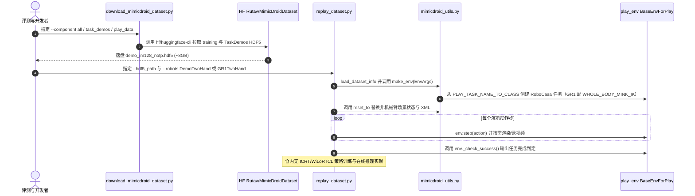

# MimicDroid（arXiv:2509.09769）

**MimicDroid**（*MimicDroid: In-Context Learning for Humanoid Robot Manipulation from Human Play Videos*，Rutav Shah\*, Shuijing Liu\*, Qi Wang\*, Zhenyu Jiang\*, Sateesh Kumar, Mingyo Seo, Roberto Martín-Martín, Yuke Zhu；UT Austin / Amazon / NVIDIA；ICRA 2026 Oral Top-5%；[arXiv:2509.09769](https://arxiv.org/abs/2509.09769)，[项目页](https://ut-austin-rpl.github.io/MimicDroid/)，[基准代码](https://github.com/UT-Austin-RPL/mimicdroid-robocasa/tree/latest)）针对「机器人 ICL 方法严重依赖高成本遥操作数据难以规模化」的痛点，提出**仅从连续无标注人类玩耍视频（human play videos）自监督构造上下文–目标轨迹对训练人形少样本操作策略**。

## 一句话定义

**完全依靠连续无标注的人类玩耍视频，通过 WiLoR 抽取手腕动作与 DINOv2 轨迹相似度检索构造 Meta-ICL 训练样本，并借助随机块遮挡与手腕逆运动学重定向将少样本上下文模仿能力零梯度迁移至人形机器人。**

## 英文缩写速查

| 缩写 | 英文全称 | 简要说明 |
|------|----------|----------|
| ICL | In-Context Learning | 测试时看 1–3 条人类演示即可适配，不更新权重 |
| Meta-ICL | Meta-training for In-Context Learning | 从玩耍长视频检索相似上下文–目标片段对进行元训练 |
| WiLoR | Wild 3D Hand Localization and Reconstruction | 从单目 RGB 帧无穿戴估计 6-DoF 人手腕位姿与抓取信号 |
| PEFT | Parameter-Efficient Fine-Tuning | 对照的测试时微调基线（在 L3 大分布偏移下易遗忘） |
| IK | Inverse Kinematics | 把任务空间人/策略腕部位姿映射为人形关节角 |

## 为什么重要

- **解除上下文学习的遥操作数据瓶颈：** 人类自由探索玩耍视频采集效率约比遥操作快 18 倍，无需按固定任务重置场景，天然覆盖大量跨物体转移与开关操作。
- **极简的跨具身视觉对齐手段：** 随机擦除 1–16 个图像小块（`p=0.8`）以 **不需要 SAM 分割器** 的代价，取得接近 EgoMimic 专有手部掩码（真机 L1 0.53 vs 0.58）的抗过拟合迁移收益。
- **建立人形少样本泛化三级评测坐标系：** 开源 `mimicdroid-robocasa` 清晰拆分 **L1（新位置）→ L2（新物体）→ L3（新环境+新动作机制）**，揭示现有方法与人类意图迁移在高阶物理形态差异下的真实差距。

## 核心信息

| 字段 | 内容 |
|------|------|
| **发表** | ICRA 2026 Oral（Top-5%），[arXiv:2509.09769v1](https://arxiv.org/abs/2509.09769) |
| **骨干与编码** | 基于 **ICRT**（4 层 LLaMA 风格 Transformer，RMSNorm + RoPE，768 维）+ 冻结 **CrossMAE** + 3 层注意力池化 |
| **训练数据规模** | 仿真 Abstract 双手 8h（320k 帧，3 视角，20 min/段）；真机单目人类玩耍 45 min–1h（80k 帧，10 min/段） |
| **基准任务** | RoboCasa 30 物体 8 场景；L1 / L2 / L3 各 4 任务共 12 任务；`DemoTwoHand` & `GR1TwoHand` |
| **开源边界** | **基准与数据集已开源**（`UT-Austin-RPL/mimicdroid-robocasa` + HF `Rutav/MimicDroidDataset`）；**Meta-ICL 策略训练/检索代码尚未公开** |

## 流程总览

## 核心原理

### 1. 从无标注 Play Video 自监督构造 Meta-ICL 轨迹对

玩耍视频既没有动作标签也没有任务边界。MimicDroid 先用现成手部重建 `f = WiLoR` 提取每帧 3D 手腕位姿与夹爪开合状态 $h_t$，将下一帧（$k=1$）手部位姿设为目标动作 $a_t$；随后随机切取目标片段 $\sigma^{\text{tgt}}$，将冻结 `DINOv2`（$g$）逐帧视觉特征的时间均值池化向量与动作序列拼接作为片段签名 $\phi(\sigma) = [\frac{1}{T}\sum g(s_t), a_1, \dots, a_T]$，按余弦相似度检索最相近的 Top-$k$ 片段（默认实现 $k=10$，消融发现 $k=50$ 平衡多样性与噪声最优）组成训练上下文 $\sigma^{\text{ctx}}$。

### 2. 缓解视觉与运动学鸿沟：随机块遮挡与手腕重定向

人类手部纹理与人形机械臂末端差异显著，直接拟合人类 RGB 极易在真机失效。MimicDroid 在训练时以概率 `p=0.8` 对图像随机擦除 `1–16` 个面积占比 `1%–4%` 的局部图像块（Appendix D Table IV 记 `0–16 patches`），迫使策略减少依赖人手外观线索转而注意物体–环境交互结构；运动学上保持在笛卡尔任务空间预测手腕位姿，部署时按人形与人类上肢的运动学相似性重定向至 Fourier GR1 腕部并解算逆运动学（如仿真内采用 `WHOLE_BODY_MINK_IK`）。

### 3. 长上下文 ICRT 骨干与动作块执行（Appendix C）

策略改造自 ICRT：将 3 条上下文演示与 1 条目标演示按 4× 下采样拼接成上下文序列（仿真 `256` 步缩至每段 `64` 帧即 `512` token；真机 `128` 步缩至 `256` token），采用 4 层 768 维 LLaMA 风格 Transformer（RMSNorm + RoPE），冻结 CrossMAE 视觉主干后接 3 层 Visual Attention Pooling（768→256），由 MLP 解码 `l=32` 步未来动作块以 L1 损失监督，实际 rollout 时执行前 `16` 步。

## 实验与评测

仿真基准（RoboCasa Table I）对比 12 个分级任务（Abstract 自由双手 / Fourier GR1 人形）：

| 方法 | Abstract L1 / L2 / L3 | GR1 L1 / L2 / L3 |
|------|------------------------|------------------|
| **H2R（目标图像条件）** | 0.03 / 0.05 / 0.03 | 0.03 / 0.00 / 0.00 |
| **Vid2Robot（视频条件）** | 0.44 / 0.40 / 0.12 | 0.41 / 0.23 / 0.11 |
| **PEFT（测试时微调）** | 0.47 / 0.35 / 0.00 | 0.29 / 0.21 / 0.01 |
| **MimicDroid w/o 视觉遮挡** | 0.59 / **0.51** / 0.22 | 0.37 / 0.35 / 0.09 |
| **MimicDroid（完整）** | **0.73** / 0.39 / **0.27** | **0.59** / **0.44** / **0.26** |

- **真机 GR1 评测（4 任务/级 × 10 rollouts）：** 仅用 45 min–1h 人类玩耍视频训练，L1 / L2 / L3 成功率为 **0.53 / 0.23 / 0.08**，几乎是 Vid2Robot（**0.28 / 0.08 / 0.00**）的两倍。
- **视觉遮挡与数据缩放效应：** 取消随机块遮挡会导致 Abstract→GR1 迁移平均暴跌 **17%**（保留时仅 **3%**）；将训练玩耍帧数从 `128k` 增至 `320k`，L1（35%→59%）、L2（21%→45%）与 L3（16%→27%）同步单调提升。
- **上下文示例数与失败分布：** 上下文示例从 1 增至 3 时性能提升，4–6 个因超出训练上下文长度反而回落；失败主因是 **任务误判（26%）**、**抓取失败（16%）** 与未合拢柜门等其它误差（**8%**），相较 Vid2Robot 显著压低了误判与抓失。

## 结论

**MimicDroid 证明连续无标注的人类玩耍视频足以作为 Meta-ICL 唯一训练源驱动人形操作少样本适应，但也将工程难点集中到了跨具身手部感知精度、上下文长度受限以及 L3 异构新动作泛化上。**

- **相似玩耍片段检索取代昂贵任务标注**：`DINOv2` + 动作拼接索引让自由探索长视频天然生成大量「做中学」上下文对（`k=50` 优于过少或过多上下文噪音）。
- **轻量遮挡优于重型分割流水线**：随机擦除局部小块避免模型死记人手像素特征，效果看齐需额外调用 SAM 的 EgoMimic 手部掩码方案。
- **零梯度适应抗分布偏移遗忘**：面对 L3 新环境时测试时微调（PEFT）成功率跌至 0.00–0.01，而冻结参数的 ICL 保留了底座技能并领先约 +26%–29%。
- **距离可用跨环境泛化仍有明显门槛**：真机 L3 仅 0.08、仿真 GR1 L3 为 0.26，遇到诸如「训练只见左右拨水龙头、测试变为上下扳水龙头」等全新动作原语时依然困难。
- **代码开放聚焦可复现基准，策略端未释放**：社区可直接拉取 L1–L3 RoboCasa 基准与 8 GB 数据集测试新 ICL 算法，但原论文训练与 WiLoR 管线未包含在内。

## 源码运行时序图

**注意开源边界：** 截至 `2026-11-19` 核查，[UT-Austin-RPL/mimicdroid-robocasa](https://github.com/UT-Austin-RPL/mimicdroid-robocasa/tree/latest) 仅公开 **RoboCasa 三级仿真基准环境、数据集下载与轨迹回放入口**（`replay_dataset.py` 中虽保留 `../../../icrt` 路径占位，但 **Meta-ICL 检索与策略训练/推理源码并未发布**）。以下时序图严格对应公开基准仓库的真实运行链路：

## 工程实践

| 实践维度 | 详情与边界 |
|----------|------------|
| **仿真环境搭建** | 须用 Python 3.10 Conda 环境配合专门分支 `ShahRutav/robosuite@abs_robot` 与 `UT-Austin-RPL/mimicdroid-robocasa@latest`，再执行 `download_kitchen_assets.py`（约 5 GB）与 `setup_macros.py` |
| **人形重定向控制器** | 在仿真内将 `DemoTwoHand` 玩耍状态切换到 `GR1TwoHand` 评测时，`replay_dataset.py` 与 `make_env` 自动配置 `controller="WHOLE_BODY_MINK_IK"` |
| **数据规模与分片** | HF `Rutav/MimicDroidDataset` 拆分 `TaskDemos/`（~250 MB，12 个 L1–L3 测试任务示范）与 `training/`（~8 GB 玩耍训练集） |
| **训练超参参考** | 原论文 Meta-ICL 训练使用 `8×A5000` 训 `200 epochs`（`AdamW`、`lr=5e-4`、`batch=256`），推理上下文控制在 `1–3` 条示范内以免超出训练窗口 |

## 局限与风险

- **极端手部遮挡导致伪动作缺失：** 离线标签依赖单目 `WiLoR` 预测，当人手伸入橱柜深处或被家具彻底遮挡时无法提取正确手腕动作。
- **只模仿「怎么动」而不理解「为什么」：** 策略把上下文当低层状态–动作序列，缺乏语言或高层子目标约束，难以泛化到动作形式不同但语义等价的变体（如改换开关机构方向）。
- **手部尺寸过拟合与场景碰撞：** 真机评估中策略会记忆单一操作员手部尺寸与工作空间边距，在杂物桌面易发生轻微碰撞或偏差（如 16% 抓失与 8% 未合拢柜门）。
- **上下文扩展与开源复现受限：** 超过 3 条示范反而掉点；且 `mimicdroid-robocasa` 未放出 Meta-ICL 训练管线，复现策略本体需自行基于 `ICRT` + `WiLoR` + `DINOv2` 搭建。

## 与其他工作对比

| 工作 | 上下文机制 | 数据来源 | 核心差异 |
|------|------------|----------|----------|
| **MimicDroid（本页）** | `DINOv2` 检索玩耍片段对 + 4 层 ICRT + 随机块遮挡 | 连续无标注人类/Abstract 玩耍视频 | 免遥操作训练；真机 GR1 达 Vid2Robot 近两倍；开源 L1–L3 基准 |
| **Vid2Robot / H2R** | 条件于完整演示视频或最终目标图 | 同源玩耍视频 | 上下文缺少「观测–动作」对应关系，无法执行真正少样本 ICL |
| **PEFT（测试时微调）** | 参数梯度适应新任务 | 相同少样本 | 计算慢且在 L3 新环境出现灾难性遗忘（成功率跌至 0.00–0.01） |
| **[OKAMI](./paper-notebook-okami-teaching-humanoid-robots-manipulation-skil.md)** | 单视频 + 物体感知全身重定向生成计划 | 单条人类视频 | 同组前作面向逐任务规划；MimicDroid 统一为一次训练、多任务上下文切换 |
| **[EgoMimic](./paper-ego-03-egomimic.md)** | 第一人称手部数据与机器人联合训练 | Aria 眼镜人类手视 + 机器人数据 | 使用 SAM 分割涂黑人手；MimicDroid 用随机块遮挡免 SAM 取得接近 L1 迁移（0.53 vs 0.58） |

## 关联页面

- 分类父节点：[paper-notebook-category-06-manipulation](../overview/paper-notebook-category-06-manipulation.md)
- 总索引：[humanoid-paper-notebooks-index.md](../overview/humanoid-paper-notebooks-index.md)
- 具身上下文学习纵深路线：[具身上下文学习（ICL）纵深路线](../../roadmap/depth-icl.md)
- 方法与任务底座：[Imitation Learning](../methods/imitation-learning.md)、[Behavior Cloning](../methods/behavior-cloning.md)、[Action Chunking](../methods/action-chunking.md)、[Manipulation](../tasks/manipulation.md)、[Bimanual Manipulation](../tasks/bimanual-manipulation.md)
- 上下文学习概念与工具：[robot-in-context-learning](../concepts/robot-in-context-learning.md)、[WiLoR](../methods/wilor.md)
- 基准与同族对比：[RoboCasa](./paper-notebook-robocasa-large-scale-simulation-of-everyday-task.md)、[OKAMI](./paper-notebook-okami-teaching-humanoid-robots-manipulation-skil.md)、[EgoMimic](./paper-ego-03-egomimic.md)

## 参考来源

- [arXiv 论文全文精读笔记（2509.09769v1）](../../sources/papers/mimicdroid_arxiv_2509_09769.md)
- [MimicDroid 官方项目页核查](../../sources/sites/mimicdroid-ut-austin.md)
- [基准仓库源码归档（UT-Austin-RPL/mimicdroid-robocasa）](../../sources/repos/ut-austin-rpl-mimicdroid-robocasa.md)
- [深读笔记来源归档（Robot Learning Paper Notebooks）](../../sources/papers/humanoid_pnb_mimicdroid.md)

## 推荐继续阅读

- 论文：<https://arxiv.org/abs/2509.09769>
- 项目页：<https://ut-austin-rpl.github.io/MimicDroid/>
- 基准仓库：<https://github.com/UT-Austin-RPL/mimicdroid-robocasa/tree/latest>
- 数据集（Hugging Face）：<https://huggingface.co/datasets/Rutav/MimicDroidDataset>
- [Robot Learning Paper Notebooks：MimicDroid 深读笔记](https://imchong.github.io/Robot_Learning_Paper_Notebooks/papers/06_Manipulation/MimicDroid__In-Context_Learning_for_Humanoid_Manipulation_from_Human_Play_Videos/MimicDroid__In-Context_Learning_for_Humanoid_Manipulation_from_Human_Play_Videos.html)
