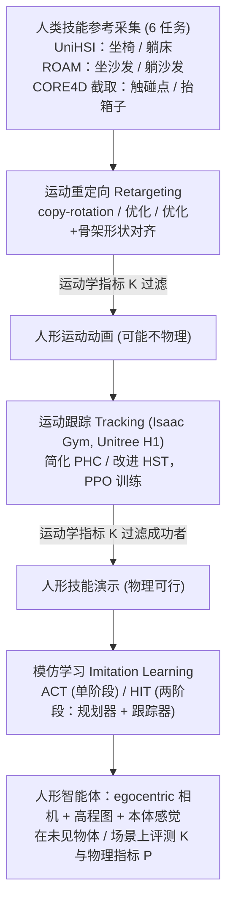

# Mimicking-Bench

**Mimicking-Bench: A Benchmark for Generalizable Humanoid-Scene Interaction Learning via Human Mimicking** 收录于 [Robot Learning Paper Notebooks](https://imchong.github.io/Robot_Learning_Paper_Notebooks/index.html)（分类：11_Simulation_Benchmark），深读笔记已完成。本页是 **笔记摘要**：要点编译自深读笔记，细节以笔记原文与论文 PDF 为准。

## 一句话定义

让人形通过模仿人类数据学会与 3D 场景交互的通用技能，是机器人领域的关键挑战。已有的演示数据集规模小、靠手工采集。Mimicking-Bench 引入一个大规模基准：包含6 个家居（全身）交互任务、11K 多样物体形状、以及 20K 合成 + 3K 真实的人类技能参考。基准系统比较了运动重定向、运动跟踪、模仿学习及其各种组合策略，验证了模仿人类对技能习得的价值，并指出场景几何泛化等关键研究挑战与未来方向。

## 英文缩写速查

| 缩写 | 含义 |
|---|---|
| Humanoid-Scene Interaction | 人形与 3D 场景的交互 |
| Human Mimicking | 模仿人类（数据/动作） |
| Motion Retargeting | 运动重定向 |
| Motion Tracking | 运动跟踪 |
| Imitation Learning | 模仿学习 |
| Scene Geometry Generalization | 场景几何泛化 |

## 为什么重要

- **大规模基准是公平比较的前提**：把"模仿人类"的不同实现放在同一标尺；
- **场景几何泛化**是人形-场景交互的硬骨头，值得持续投入；
- **合成 + 真实**参考混合是扩充数据的实用做法；
- 与本仓 04（从人类视频学技能）方向强相关。

## 流程总览

图依据：论文 §3.3 人类技能参考采集、§4 技能学习范式（4.1 重定向、4.2 跟踪、4.3 模仿学习）/ Fig.3

## 解决什么问题

人形-场景交互学习受限于**数据**： - 现有演示**小规模、手工采集**，难支撑泛化研究； - 缺**统一基准**比较重定向/跟踪/模仿等不同策略； - **场景几何泛化**难。

Mimicking-Bench 要：一个**大规模、统一**的人形-场景交互基准。

## 核心机制

1. **大规模人形-场景交互基准**：6 任务、11K 物体、20K+3K 人类参考；
2. **统一比较多策略**：重定向/跟踪/模仿及组合；
3. **验证模仿人类的价值**；
4. **指出场景几何泛化**等关键挑战与方向。

方法拆解（深读笔记小节）：大规模基准资源；统一比较多种策略；发现；🧭 整体流程（mermaid）。

## 核心信息

| 字段 | 内容 |
|------|------|
| 分类 | 11_Simulation_Benchmark |
| 深读笔记 | <https://imchong.github.io/Robot_Learning_Paper_Notebooks/papers/11_Simulation_Benchmark/Mimicking-Bench__A_Benchmark_for_Generalizable_Humanoid-Scene_Interaction_Learning/Mimicking-Bench__A_Benchmark_for_Generalizable_Humanoid-Scene_Interaction_Learning.html> |
| arXiv | <https://arxiv.org/abs/2412.17730> |
| 作者 | Yun Liu、Bowen Yang、Licheng Zhong、He Wang、Li Yi（清华等） |
| 发表 | 2024 年 12 月 |
| 笔记阅读日期 | 2026-06-21 |

## 实验与评测

- **数据与场景规模**：包含 **6 项全身家居交互任务**、**11K+** 多样物体形状、**23.4K** 人类技能参考（`20K` 条来自 UniHSI+ROAM 的合成交互 + `3K` 条来自 CORE4D 的真实人类示范）；主体为 19-DoF @ 50 Hz 的 **Unitree H1**，配备 4 路 120° FOV `360×480` RGB-D-Seg 视觉与 `128×128` 局部高程图。
- **Stage 1 & Stage 2（运动重定向与物理跟踪）**：基于优化的运动重定向在几何保真与物理可行性上显著优于拷贝旋转（copy-rotation）与 OmniH2O；Stage 2 全身跟踪下，**Improved HST** 取得 **`68/59`** 成功率，领先 **Simplified PHC** 的 **`55/44`**。
- **Stage 3（基于模仿学习的场景交互）**：融合局部高程图的 **`ACT w/ elevation`** 取得 **`54/51%`** 最高成功率，优于 **`OmniH2O`（`41/39%`）**、**`HIT`（`30/25%`）** 与 **`PPO`（`28/13%`）**；而移除地形/几何先验的纯视觉 **`RGBD (C+D)`** 策略仅剩 **`4/4%`**。

## 结论

**Mimicking-Bench 交付的是贯通「重定向 → 跟踪 → 场景交互」三阶段的人形标尺：通过 23.4K 合成+真实人类参考证实模仿学习具备价值，但去掉局部高程先验后的场景几何泛化仍接近瓶颈（纯 RGB-D 仅 4/4%）。**

- 规模是这套基准的立身之本：6 个家居全身交互任务、11K+ 物体形状、20K 合成 + 3K 真实人类技能参考——正面回应已有演示小规模与手工采集局限。
- 三阶段消融揭示核心断层：即便 Stage 2 `Improved HST` 达 `68/59`，在 Stage 3 视觉-场景闭环下 `ACT w/ elevation` 也仅 `54/51%`，纯 `RGBD (C+D)` 更降至 `4/4%`。
- 合成 + 真实混合参考（UniHSI+ROAM + CORE4D）是用低边际成本扩充全身示范的实用范式，比单项排行榜更具方法迁移意义。
- 开源状态边界：官网 V1 数据集已可下载，但 `Code` 入口当前尚未公开，策略复现前须自行补全仿真环境与训练脚手架。

## 与其他工作对比

| 对比维度 | Mimicking-Bench 定位与评测结果 | 基准内基线 / 既有数据集与方法对照 |
|------|------|------|
| **数据与任务规模** | 6 项全身家居交互任务、11K+ 物体形状、23.4K 人类技能参考（20K UniHSI+ROAM 合成 + 3K CORE4D 真实示范） | 既有演示数据集规模小且主要依赖手工采集，缺少统一的大规模全身—3D 场景交互测试台 |
| **Stage 1：运动重定向** | 基于优化与骨架形状对齐的重定向在几何保真与物理可行性上表现最佳 | 优于拷贝旋转（copy-rotation）与 OmniH2O 重定向基线 |
| **Stage 2：全身运动跟踪** | Improved HST 在 Unitree H1（19-DoF @ 50 Hz）全身跟踪上达到 `68/59` 成功率 | 领先 Simplified PHC 基线（`55/44`） |
| **Stage 3：视觉场景交互策略** | 融合 `128×128` 局部高程图的 `ACT w/ elevation` 取得 `54/51%` 最高成功率 | 优于 `OmniH2O`（`41/39%`）、`HIT`（`30/25%`）与 `PPO`（`28/13%`）；移除地形/几何先验的纯视觉 `RGBD (C+D)` 仅剩 `4/4%` |

## 工程实践

- **分阶段数据与观测栈对齐**：基准统一采用 Unitree H1（19-DoF，50 Hz 控制），观测流融合 4 路 120° FOV `360×480` RGB-D-Seg 图像与 `128×128` 局部高程图；对比实验需确保与该多模态观测对齐。
- **开源边界与复现准备**：官网 `mimicking-bench.github.io` 已通过 OneDrive / Dropbox 发布 V1 数据集（11K+ 物体、20K UniHSI+ROAM 合成 + 3K CORE4D 真实参考），但页面 `Code` 按钮当前仍处于 HTML 注释未公开状态，暂无法直接拉取端到端训练/评测脚本。

## 局限与风险

- **高层视觉操作与低层全身跟踪之间存在显著断层**：Stage 2 重定向跟踪（Improved HST `68/59` vs Simplified PHC `55/44`）虽优于纯拷贝旋转，但进入 Stage 3 全身视觉-场景闭环交互后，`ACT w/ elevation` 仅达 `54/51%`，而纯 `RGBD C+D` 更是暴跌至 `4/4%`。
- **强依赖高程图先验与特权几何**：去掉局部高程图或纯依赖多视角 RGB-D 时策略性能大幅滑坡，且目前公开源码尚未随 V1 数据集同步释放。

## 源码运行时序图

**不适用** — 项目页 [mimicking-bench.github.io](https://mimicking-bench.github.io/) 截至 2026-11-21 仅开放 V1 数据集下载（OneDrive / Dropbox），页面 `Code` 入口仍为未启用状态，无可核对的官方可运行源码。

## 关联页面

- 评测闭环：[具身大模型评测基准选型闭环](../queries/embodied-eval-benchmark-selection-loop.md) — 本页对应其中的全身人形—场景交互基准节点
- 分类父节点：[paper-notebook-category-11-simulation-benchmark](../overview/paper-notebook-category-11-simulation-benchmark.md)
- 总索引：[humanoid-paper-notebooks-index.md](../overview/humanoid-paper-notebooks-index.md)

## 参考来源

- [humanoid_pnb_mimicking-bench.md](../../sources/papers/humanoid_pnb_mimicking-bench.md)
- 深读笔记：<https://imchong.github.io/Robot_Learning_Paper_Notebooks/papers/11_Simulation_Benchmark/Mimicking-Bench__A_Benchmark_for_Generalizable_Humanoid-Scene_Interaction_Learning/Mimicking-Bench__A_Benchmark_for_Generalizable_Humanoid-Scene_Interaction_Learning.html>
- 论文：<https://arxiv.org/abs/2412.17730>
- [arXiv PDF](https://arxiv.org/pdf/2412.17730)：已全文通读 `arXiv:2412.17730`（含 6 项任务、11K+ 物体、23.4K 参考、Stage 1–3 定量消融与 Appendix D.2，并核对项目页 V1 数据发布状态）。

## 推荐继续阅读

- [机器人论文阅读笔记：Mimicking-Bench](https://imchong.github.io/Robot_Learning_Paper_Notebooks/papers/11_Simulation_Benchmark/Mimicking-Bench__A_Benchmark_for_Generalizable_Humanoid-Scene_Interaction_Learning/Mimicking-Bench__A_Benchmark_for_Generalizable_Humanoid-Scene_Interaction_Learning.html)
