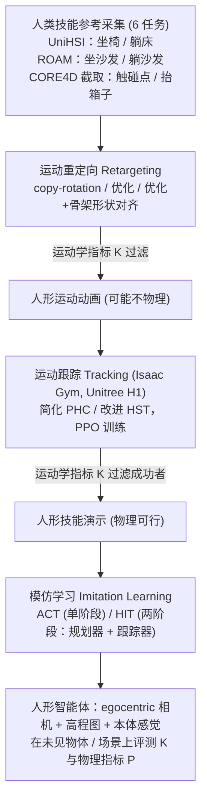

# Mimicking-Bench

**Mimicking-Bench: A Benchmark for Generalizable Humanoid-Scene Interaction Learning via Human Mimicking** 收录于 [Robot Learning Paper Notebooks](https://imchong.github.io/Robot_Learning_Paper_Notebooks/index.html)（分类：11_Simulation_Benchmark），深读笔记已完成。本页是 **笔记摘要**：要点编译自深读笔记，细节以笔记原文与论文 PDF 为准。

## 一句话定义

让人形通过模仿人类数据学会与 3D 场景交互的通用技能，是机器人领域的关键挑战。已有的演示数据集规模小、靠手工采集。Mimicking-Bench 引入一个大规模基准：包含6 个家居（全身）交互任务、11K 多样物体形状、以及 20K 合成 + 3K 真实的人类技能参考。基准系统比较了运动重定向、运动跟踪、模仿学习及其各种组合策略，验证了模仿人类对技能习得的价值，并指出场景几何泛化等关键研究挑战与未来方向。

## 英文缩写速查

| 缩写 | 含义 |
|---|---|
| Humanoid-Scene Interaction | 人形与 3D 场景的交互 |
| Human Mimicking | 模仿人类（数据/动作） |
| Motion Retargeting | 运动重定向 |
| Motion Tracking | 运动跟踪 |
| Imitation Learning | 模仿学习 |
| Scene Geometry Generalization | 场景几何泛化 |

## 为什么重要

- **大规模基准是公平比较的前提**：把"模仿人类"的不同实现放在同一标尺；
- **场景几何泛化**是人形-场景交互的硬骨头，值得持续投入；
- **合成 + 真实**参考混合是扩充数据的实用做法；
- 与本仓 04（从人类视频学技能）方向强相关。

## 流程总览

图依据：论文 §3.3 人类技能参考采集、§4 技能学习范式（4.1 重定向、4.2 跟踪、4.3 模仿学习）/ Fig.3

## 解决什么问题

人形-场景交互学习受限于**数据**： - 现有演示**小规模、手工采集**，难支撑泛化研究； - 缺**统一基准**比较重定向/跟踪/模仿等不同策略； - **场景几何泛化**难。

Mimicking-Bench 要：一个**大规模、统一**的人形-场景交互基准。

## 核心机制

1. **大规模人形-场景交互基准**：6 任务、11K 物体、20K+3K 人类参考；
2. **统一比较多策略**：重定向/跟踪/模仿及组合；
3. **验证模仿人类的价值**；
4. **指出场景几何泛化**等关键挑战与方向。

方法拆解（深读笔记小节）：大规模基准资源；统一比较多种策略；发现；🧭 整体流程（mermaid）。

## 核心信息

| 字段 | 内容 |
|------|------|
| 分类 | 11_Simulation_Benchmark |
| 深读笔记 | <https://imchong.github.io/Robot_Learning_Paper_Notebooks/papers/11_Simulation_Benchmark/Mimicking-Bench__A_Benchmark_for_Generalizable_Humanoid-Scene_Interaction_Learning/Mimicking-Bench__A_Benchmark_for_Generalizable_Humanoid-Scene_Interaction_Learning.html> |
| arXiv | <https://arxiv.org/abs/2412.17730> |
| 作者 | Yun Liu、Bowen Yang、Licheng Zhong、He Wang、Li Yi（清华等） |
| 发表 | 2024 年 12 月 |
| 笔记阅读日期 | 2026-06-21 |

## 实验与评测

- 本页是深读笔记的摘要，没有搬运原文的量化结果；量化 benchmark、消融与实机指标以 **深读笔记与论文 PDF** 为准（链接见 [参考来源](#参考来源)）。

## 结论

**Mimicking-Bench 交付的是「标尺」而不是「方法」：它把重定向、跟踪、模仿学习及其组合放进同一套任务与资产里比较，得出的结论是模仿人类确实有用，但场景几何泛化仍然没解决。**

- 规模是这套基准的立身之本：6 个家居全身交互任务、11K 物体形状、20K 合成 + 3K 真实人类技能参考——规模本身就是对「现有演示小规模、靠手工采集」的正面回应。
- 被检验的对象不是单个算法，而是策略组合：运动重定向 / 运动跟踪 / 模仿学习及其各种搭配在同一标尺下的相对表现。
- 合成 + 真实混合参考是它给出的实用做法：用合成量补真实数据的稀缺，这一点比任何单项分数更容易迁移到别的项目。
- 它明确留下的开放问题是场景几何泛化——基准把它标成硬骨头与未来方向，而不是宣称已经解决。
- 边界：本页是深读笔记编译的笔记摘要，具体分数与消融以深读笔记和论文 PDF 为准（见 [参考来源](#参考来源)）。

## 与其他页面的关系

- 分类父节点：[paper-notebook-category-11-simulation-benchmark](../overview/paper-notebook-category-11-simulation-benchmark.md)
- 总索引：[humanoid-paper-notebooks-index.md](../overview/humanoid-paper-notebooks-index.md)

## 参考来源

- [humanoid_pnb_mimicking-bench.md](../../sources/papers/humanoid_pnb_mimicking-bench.md)
- 深读笔记：<https://imchong.github.io/Robot_Learning_Paper_Notebooks/papers/11_Simulation_Benchmark/Mimicking-Bench__A_Benchmark_for_Generalizable_Humanoid-Scene_Interaction_Learning/Mimicking-Bench__A_Benchmark_for_Generalizable_Humanoid-Scene_Interaction_Learning.html>
- 论文：<https://arxiv.org/abs/2412.17730>
- [arXiv PDF](https://arxiv.org/pdf/2412.17730)：已通读方法部分（实验与附录以略读为准）：§3 Mimicking-Bench（3.1 仿真环境、3.2 任务与指标、3.3 参考采集）、§4 技能学习范式、§5 开头的最佳组合设定

## 推荐继续阅读

- [机器人论文阅读笔记：Mimicking-Bench](https://imchong.github.io/Robot_Learning_Paper_Notebooks/papers/11_Simulation_Benchmark/Mimicking-Bench__A_Benchmark_for_Generalizable_Humanoid-Scene_Interaction_Learning/Mimicking-Bench__A_Benchmark_for_Generalizable_Humanoid-Scene_Interaction_Learning.html)
