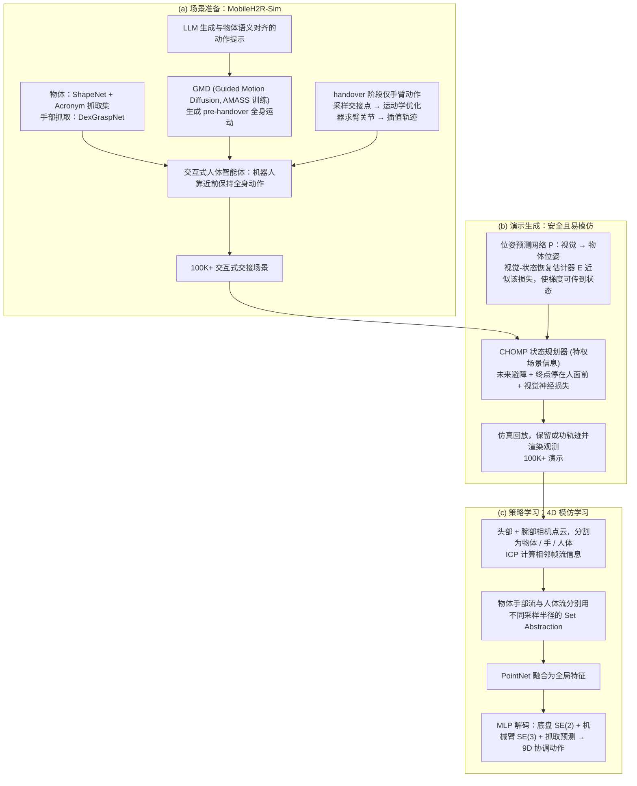

# MobileH2R

**MobileH2R: Learning Generalizable Human to Mobile Robot Handover Exclusively from Scalable and Diverse Synthetic Data** 收录于 [Robot Learning Paper Notebooks](https://imchong.github.io/Robot_Learning_Paper_Notebooks/index.html)（分类：06_Manipulation），深读笔记已完成。本页编译自深读笔记与 arXiv 论文正文（实验数字、开源状态于 2026-09-28 核对），细节以论文 PDF 为准。

## 一句话定义

MobileH2R 是一个学习泛化的、基于视觉的「人到移动机器人（H2MR）递交」技能的框架。不同于传统固定底座递交，该任务要求移动机器人借移动性在大工作空间里可靠接物。MobileH2R 完全用可扩展、多样的合成数据学习，开发了三类技术：① 可扩展地生成多样的全身人体运动数据；② 自动造安全、易模仿的演示；③ 高效的 4D 模仿学习，协调机器人底盘与机械臂的运动。在仿真与真实世界评测中，相比基线，各情形成功率至少 +15%。

## 英文缩写速查

| 缩写 | 含义 |
|---|---|
| H2MR | Human-to-Mobile-Robot 人到移动机器人 |
| Handover | 递交，把物体交给机器人 |
| Synthetic Data | 合成数据（全身人体运动） |
| 4D Imitation | 4D 模仿学习（含时间的轨迹） |
| Base-Arm Coordination | 底盘-机械臂协调 |
| Mobile Robot | 移动机器人 |

## 为什么重要

- **移动递交需底盘-臂协调**，对人形（移动 + 操作）直接相关；
- **完全合成数据**是绕开真实采集的可扩展路线，呼应 DexMimicGen/DreamGen；
- **自动造安全演示**降低数据工程；
- 人机递交是人形服务场景的高频交互。

## 流程总览

图依据：论文 §3 方法（§3.1 MobileH2R-Sim、§3.2 安全且易模仿的演示、§3.3 协调底盘-机械臂模仿）/ Fig.2、Fig.3

## 解决什么问题

**移动机器人接人递来的物体**比固定底座难： - 需在**大工作空间**移动接物，**底盘 + 臂**要协调； - 真实递交数据**难采**； - 要对**多样人类递交动作**泛化。

MobileH2R 要：**仅用合成数据**学出泛化的视觉 H2MR 递交。

## 核心机制

1. **H2MR 递交框架**：移动机器人大工作空间可靠接物；
2. **完全合成数据**：可扩展生成全身人体运动 + 自动安全演示；
3. **4D 模仿学习**：协调底盘与机械臂；
4. **≥ +15%**：仿真与真机均超基线。

方法拆解（深读笔记小节）：可扩展合成全身人体运动数据；自动造安全易模仿的演示；高效 4D 模仿学习（底盘-臂协调）；结果；🧭 整体流程（mermaid）。

## 核心信息

| 字段 | 内容 |
|------|------|
| 分类 | 06_Manipulation |
| 深读笔记 | <https://imchong.github.io/Robot_Learning_Paper_Notebooks/papers/06_Manipulation/MobileH2R__Learning_Generalizable_Human_to_Mobile_Robot_Handover_from_Synthetic_Data/MobileH2R__Learning_Generalizable_Human_to_Mobile_Robot_Handover_from_Synthetic_Data.html> |
| arXiv | <https://arxiv.org/abs/2501.04595> |
| 源码 | **未开源**：项目页 <https://mobileh2r.github.io/> 的 Code 按钮指向前作 [GenH2R 仓库](https://github.com/chenjy2003/genh2r)，其 README 只含 GenH2R（固定底座）的评测脚本与预训练模型；截至 2026-09-28 未见 MobileH2R 本身的代码 |
| 作者 | Zifan Wang、Ziqing Chen、Junyu Chen、Yunze Liu、Xueyi Liu、He Wang、Li Yi 等（清华等） |
| 发表 | 2025 年 1 月 |
| 笔记阅读日期 | 2026-06-21 |

## 实验与评测

**数据**：合成递交场景使用自定义人体动画 + 8836 个 ShapeNet 物体，分两种设置：m0（人直接走近递物）与 n0（人坐下、跑动、下楼、跳舞等复杂动作），各 10 万训练场景、1000 测试场景；另把 DexYCB（HandoverSim）的 1000 个真实递交场景补上人体模型作为 s0（720 训练 / 144 测试）。每次递交含 6 s 递交前阶段 + 1.05 s 递交阶段。指标沿用 GenH2R：无碰撞地从人手中稳定接到物体才算成功，人接触、掉落、超时（15 s）为失败；另报告时间与平均成功 AS。

| 方法（在 1 万条 n0 上训练） | m0 成功 / AS | n0 成功 / AS | s0 成功 / AS |
|------|------|------|------|
| 抓取选择 + 轨迹规划 | 40.20 / 8.70 | 34.80 / 5.02 | 40.97 / 14.71 |
| GenH2R（预训练） | 4.80 / 2.58 | 3.10 / 1.31 | 40.97 / 27.5 |
| GenH2R（在 n0 上重训） | 46.80 / 26.27 | 32.90 / 17.48 | 61.11 / 42.09 |
| **MobileH2R** | **63.80 / 34.81** | **53.40 / 28.68** | **77.78 / 50.65** |

- 相比「抓取选择 + 规划」平均成功率 +26.3%、时间 −5.06 s；策略推理约 0.003 s，运动规划通常 >0.1 s。
- **数据规模**：演示从 1 万增加到 10 万平均 +3.3%，减到 1000 平均 −13.9%；只用动捕数据 s0 训练平均 −34.6%；用简单的 m0 训练在复杂场景降 8.1%。
- **演示策略消融**：完整配置 63.8 / 53.4 / 77.8；去掉未来避障、去掉终止位姿约束、去掉易模仿损失都会下降（如去掉易模仿损失 s0 降到 56.9）。
- **策略设计消融**：去掉光流、去掉人体信息、去掉底盘–手臂协调动作分别降到 58.0 / 51.3 / 51.0（m0）。
- **真机**（Galbot G1：全向轮底盘 + 7-DoF 臂 + 头部与腕部深度相机，SAM2 分割点云，输出 9 维底盘 + 左臂动作）：6 种物体，简单设置 **24/30（80.0%）** vs 重训 GenH2R 12/30；复杂设置（坐、下楼、对抗动作）**19/30（63.3%）** vs 9/30。

## 与其他工作对比

| 方法 | 底盘 | 与 MobileH2R 的差异 |
|------|------|------|
| 抓取选择 + 轨迹规划 | 移动（全身 IK） | 每步重规划、不预判人运动，常与人碰撞，计算慢 |
| GenH2R（前作，CVPR 2024） | 固定底座 | 只输出 6D 手臂动作；移到移动平台后需 IK 补底盘，缺少人体运动感知 |
| [DreamGen](./paper-notebook-dreamgen-unlocking-generalization-in-robot-learn.md) 等合成数据方法 | — | 同为合成数据扩展；MobileH2R 的任务含实时人在回路交互 |

## 结论

**MobileH2R 把「人到机器人递交」从固定底座推到移动底盘，代价是必须解决底盘-臂协调，解法则是完全用合成数据绕开真实采集。**

- 难点转移在于工作空间：移动性让机器人能在大范围内可靠接物，但也把问题从纯臂控变成底盘与机械臂的联合协调，这正是 4D 模仿学习要吃下的部分。
- 数据侧三件套支撑了「完全合成」这个激进选择——可扩展生成多样全身人体运动、自动构造安全且易模仿的演示、再喂给高效 4D 模仿；其中「易模仿」是让合成数据真能被学会的关键。
- 收益稳健而非爆炸：仿真三个测试集成功率 63.8% / 53.4% / 77.8%，真机 Galbot 上简单 / 复杂设置 80.0% / 63.3%（重训 GenH2R 为 40.0% / 30.0%），合成到真实的迁移基本闭环。
- 适用边界与风险：泛化目标是多样的人类递交动作，而训练分布完全来自合成人体运动，真人递交中超出该分布的行为仍是主要风险面。
- 与本页提到的 DexMimicGen / DreamGen 同属合成数据路线；差异点在于本页的任务本身含移动性与人在回路的实时交互。

## 局限与风险

- **只验证一种移动平台**：Galbot（3-DoF 全向底盘 + 7-DoF 臂），双足人形等平台可能需要调整网络结构（论文附录自述）。
- **仿真成功率仍有限**：复杂场景 n0 只有 53.4%；真机复杂设置 63.3%。
- **训练分布完全合成**：人体动作来自程序化生成，真人超出分布的行为是主要风险。
- **真机评测规模小**：6 种物体、每设置 30 次，用户研究形式。
- **开源边界**：只有前作 GenH2R 的评测代码；源码运行时序图 **不适用**。

## 与其他页面的关系

- 分类父节点：[paper-notebook-category-06-manipulation](../overview/paper-notebook-category-06-manipulation.md)
- 总索引：[humanoid-paper-notebooks-index.md](../overview/humanoid-paper-notebooks-index.md)
- 移动操作任务语境：[loco-manipulation](../tasks/loco-manipulation.md)
- 模仿学习：[imitation-learning](../methods/imitation-learning.md)
- 真机平台 Galbot 的 SDK：[cn-os-galbotsdk](./cn-os-galbotsdk.md)
- 合成数据扩增：[generative-data-augmentation](../methods/generative-data-augmentation.md)
- 合成数据路线对照：[paper-notebook-dreamgen-unlocking-generalization-in-robot-learn](./paper-notebook-dreamgen-unlocking-generalization-in-robot-learn.md)

## 参考来源

- [humanoid_pnb_mobileh2r.md](../../sources/papers/humanoid_pnb_mobileh2r.md)
- 深读笔记：<https://imchong.github.io/Robot_Learning_Paper_Notebooks/papers/06_Manipulation/MobileH2R__Learning_Generalizable_Human_to_Mobile_Robot_Handover_from_Synthetic_Data/MobileH2R__Learning_Generalizable_Human_to_Mobile_Robot_Handover_from_Synthetic_Data.html>
- 论文：<https://arxiv.org/abs/2501.04595>
- 论文正文（Table 1–5、附录局限）：<https://arxiv.org/html/2501.04595>
- [arXiv PDF](https://arxiv.org/pdf/2501.04595)：已通读方法部分（实验与附录以略读为准）：§1 引言、§2 相关工作、§3 方法（3.1–3.3）及 Fig.2/3；实验与补充材料未细读

## 推荐继续阅读

- [机器人论文阅读笔记：MobileH2R](https://imchong.github.io/Robot_Learning_Paper_Notebooks/papers/06_Manipulation/MobileH2R__Learning_Generalizable_Human_to_Mobile_Robot_Handover_from_Synthetic_Data/MobileH2R__Learning_Generalizable_Human_to_Mobile_Robot_Handover_from_Synthetic_Data.html)
- 项目页：<https://mobileh2r.github.io/>
- 前作 GenH2R 代码：<https://github.com/chenjy2003/genh2r>
