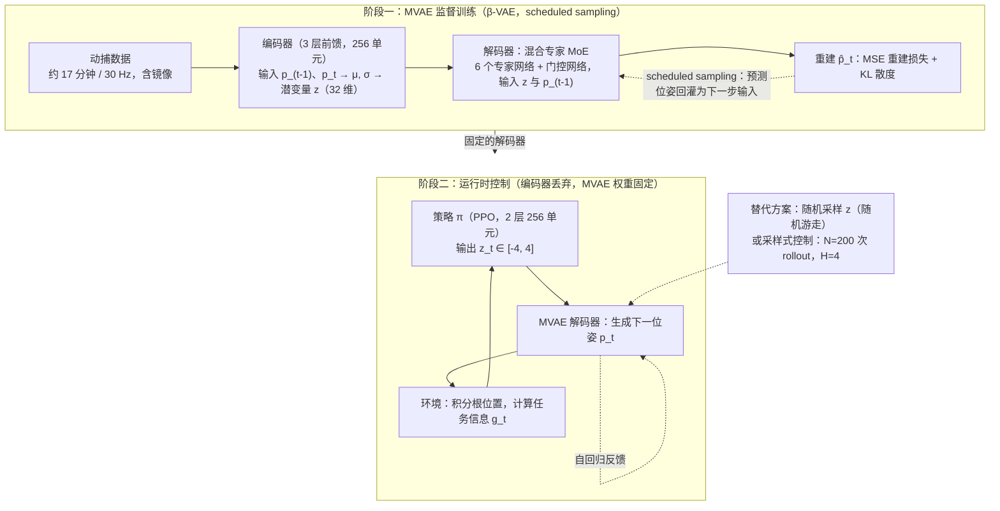

# Character Controllers using Motion VAEs

**Character Controllers using Motion VAEs** 收录于 [Robot Learning Paper Notebooks](https://imchong.github.io/Robot_Learning_Paper_Notebooks/index.html)（分类：13_Physics-Based_Animation）。本页为 **清单索引实体**，链向深读笔记与原始论文；详细机制待从笔记消化后补充。

## 一句话定义

MotionVAE 通过自回归条件变分自编码器（CVAE）构建了一个结构化的运动潜空间，使高层控制器（如 RL）能够通过采样潜变量来生成平滑、逼真且可控的角色动作。

## 英文缩写速查

| 缩写 | 英文全称 | 简要说明 |
|------|----------|----------|
| RL | Reinforcement Learning | 通过与环境交互最大化长期回报来学习策略 |
| WBC | Whole-Body Control | 协调全身关节满足多任务/约束的控制基础设施 |
| Sim2Real | Simulation to Real | 把仿真中学到的策略迁移落地真机的工程主线 |

## 为什么重要

- 列入 Paper Notebooks 策展清单，便于与全库 [机器人学习论文笔记总索引](../overview/humanoid-paper-notebooks-index.md) 及分类父节点交叉检索。
- 深读笔记提供比摘要更贴近实现的阅读路径，适合作为后续 ingest 深化起点。

## 流程总览

图依据：论文 §3（MVAE 结构与训练）、§4（随机游走 / 采样式控制）、§5（RL 控制策略）与 Fig.2 / Fig.6。

## 核心信息

| 字段 | 内容 |
|------|------|
| 分类 | 13_Physics-Based_Animation |
| 深读笔记 | <https://imchong.github.io/Robot_Learning_Paper_Notebooks/papers/13_Physics-Based_Animation/MotionVAE/MotionVAE.html> |
| arXiv | <https://arxiv.org/abs/2103.14274> |

## 实验与评测

- 本页为 **策展清单索引** 摘要；量化 benchmark、消融与实机指标以 **深读笔记与论文 PDF** 为准（链接见 [参考来源](#参考来源)）。

## 结论

**MotionVAE 的关键动作是把「生成什么动作」与「何时选哪个动作」解耦：自回归 CVAE 先学出结构化的运动潜空间，高层控制器只在这个潜空间里做决策。**

- 真正起作用的是潜空间本身——平滑与逼真由潜空间的结构保证，高层控制器（如 RL）只需采样潜变量即可获得可控动作，无需靠奖励项硬凑动作质量。
- 定位在 13_Physics-Based_Animation，面向角色动作的可控生成；本页未涉及真机迁移或 Sim2Real 层面的结论。
- 本页仅为策展清单索引实体，机制细节与量化结论待从深读笔记消化后补充，引用请以笔记页与论文 PDF 为准。

## 与其他页面的关系

- 分类父节点：[paper-notebook-category-13-physics-based-animation](../overview/paper-notebook-category-13-physics-based-animation.md)
- 总索引：[humanoid-paper-notebooks-index.md](../overview/humanoid-paper-notebooks-index.md)

## 参考来源

- [humanoid_pnb_motionvae.md](../../sources/papers/humanoid_pnb_motionvae.md)
- 深读笔记：<https://imchong.github.io/Robot_Learning_Paper_Notebooks/papers/13_Physics-Based_Animation/MotionVAE/MotionVAE.html>
- 论文：<https://arxiv.org/abs/2103.14274>
- [arXiv PDF](https://arxiv.org/pdf/2103.14274)：已通读方法部分（实验与附录以略读为准）：§3 Motion VAEs、§4 Motion Synthesis、§5 Learning Control Policies（含 §5.1 控制器网络）

## 推荐继续阅读

- [机器人论文阅读笔记：Character Controllers using Motion VAEs](https://imchong.github.io/Robot_Learning_Paper_Notebooks/papers/13_Physics-Based_Animation/MotionVAE/MotionVAE.html)
