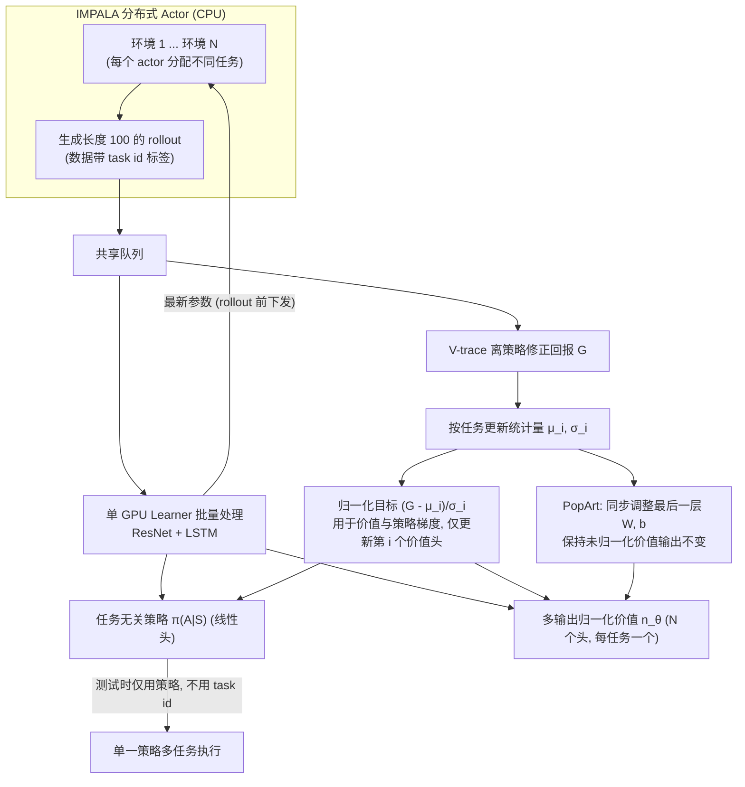

# Multi-task Deep Reinforcement Learning with PopArt

**Multi-task Deep Reinforcement Learning with PopArt** 已列入 [Robot Learning Paper Notebooks](https://imchong.github.io/Robot_Learning_Paper_Notebooks/index.html) 的 **PROGRESS.md 待深读** 清单（分类：13_Physics-Based_Animation）。本页 **还没有深读笔记**：只给出这篇论文的分类位置与原文入口，方法细节与数据请直接看原文。

## 一句话定义

Multi-task Deep Reinforcement Learning with PopArt 的人形机器人学习论文条目，当前处于 Paper Notebooks 阅读进度（待深读）阶段。

## 英文缩写速查

| 缩写 | 英文全称 | 简要说明 |
|------|----------|----------|
| RL | Reinforcement Learning | 通过与环境交互最大化长期回报来学习策略 |
| WBC | Whole-Body Control | 协调全身关节满足多任务/约束的控制基础设施 |
| Sim2Real | Simulation to Real | 把仿真中学到的策略迁移落地真机的工程主线 |

## 为什么重要

- 这篇已排进 Paper Notebooks 的待读清单，可以从 [机器人学习论文笔记总索引](../overview/humanoid-paper-notebooks-index.md) 与分类页找到同一批工作。
- 在笔记写出来之前，这里只保留分类位置、原文入口与依据论文方法部分的「流程总览」，不给指标结论。

## 流程总览

图依据：论文 Background（Actor-critic / IMPALA / 离策略修正）与 Adaptive normalisation（Eq.5–13）

## 核心信息

| 字段 | 内容 |
|------|------|
| 分类 | 13_Physics-Based_Animation |
| 深读状态 | 待撰写（[PROGRESS.md](https://github.com/ImChong/Robot_Learning_Paper_Notebooks/blob/main/papers/PROGRESS.md)） |
| 计划文件夹 | `papers/13_Physics-Based_Animation/multi-task-deep-reinforcement-learning-with-popa` |
| arXiv | <https://arxiv.org/abs/1809.04474> |

## 实验与评测

- 深读笔记尚未完成；量化 benchmark、消融与实机指标待笔记撰写后补充。

## 结论

**这条目的信息量集中在归类本身：一篇多任务深度强化学习的方法论文被挂在 13_Physics-Based_Animation 之下，本库是把它当作该方向的上游方法参考来待读的。**

- 可确认的只有分类 13_Physics-Based_Animation、arXiv 1809.04474、深读状态「待撰写」；标题之外本页没有任何机制描述。
- 它与本库多数条目的性质不同：这是训练方法层面的工作，而非某个具体的人形控制系统，读它的价值在于方法迁移而不是照搬结论。
- 本页「实验与评测」已声明量化与实机指标待笔记补充，因此当前只应作为 [humanoid-paper-notebooks-index.md](../overview/humanoid-paper-notebooks-index.md) 下的检索入口使用。

## 与其他页面的关系

- 分类页：[paper-notebook-category-13-physics-based-animation](../overview/paper-notebook-category-13-physics-based-animation.md)
- 总索引：[humanoid-paper-notebooks-index.md](../overview/humanoid-paper-notebooks-index.md)

## 参考来源

- [humanoid_pnb_multi-task-deep-reinforcement-learning-with-popa.md](../../sources/papers/humanoid_pnb_multi-task-deep-reinforcement-learning-with-popa.md)
- [Robot Learning Paper Notebooks · PROGRESS.md](https://github.com/ImChong/Robot_Learning_Paper_Notebooks/blob/main/papers/PROGRESS.md)
- 论文：<https://arxiv.org/abs/1809.04474>
- [arXiv PDF](https://arxiv.org/pdf/1809.04474)：已通读方法部分（实验与附录以略读为准）：Introduction、Background、Adaptive normalisation（含多任务缩放不变更新）；Experiments 与附录略读

## 推荐继续阅读

- [Paper Notebooks 阅读进度（PROGRESS.md）](https://github.com/ImChong/Robot_Learning_Paper_Notebooks/blob/main/papers/PROGRESS.md)
