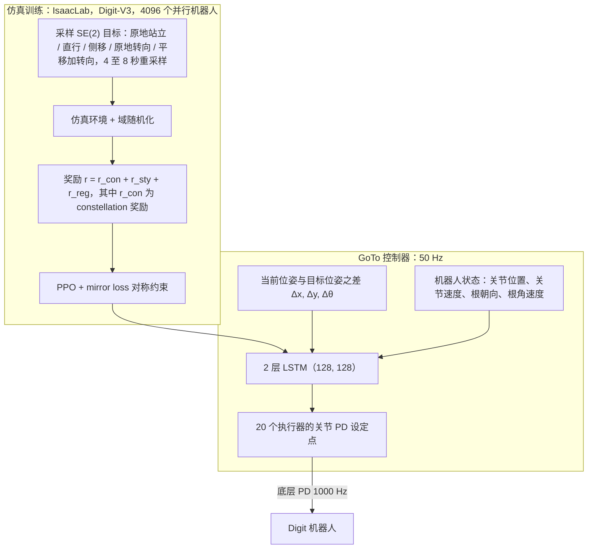

# No More Marching

**No More Marching: Learning Humanoid Locomotion for Short-Range SE(2) Targets** 已列入 [Robot Learning Paper Notebooks](https://imchong.github.io/Robot_Learning_Paper_Notebooks/index.html) 的 **PROGRESS.md 待深读** 清单（分类：05_Locomotion）。本页 **还没有深读笔记**：只给出这篇论文的分类位置与原文入口，方法细节与数据请直接看原文。

## 一句话定义

No More Marching 的人形机器人学习论文条目，当前处于 Paper Notebooks 阅读进度（待深读）阶段。

## 英文缩写速查

| 缩写 | 英文全称 | 简要说明 |
|------|----------|----------|
| RL | Reinforcement Learning | 通过与环境交互最大化长期回报来学习策略 |
| WBC | Whole-Body Control | 协调全身关节满足多任务/约束的控制基础设施 |
| Sim2Real | Simulation to Real | 把仿真中学到的策略迁移落地真机的工程主线 |

## 为什么重要

- 这篇已排进 Paper Notebooks 的待读清单，可以从 [机器人学习论文笔记总索引](../overview/humanoid-paper-notebooks-index.md) 与分类页找到同一批工作。
- 在笔记写出来之前，这里只保留分类位置与原文入口；方法流程见下方「流程总览」，实验结论以论文为准。

## 流程总览

图依据：论文 §IV（奖励）、§V-A / §V-B（网络结构与训练）/ Fig. 1。

## 核心信息

| 字段 | 内容 |
|------|------|
| 分类 | 05_Locomotion |
| 深读状态 | 待撰写（[PROGRESS.md](https://github.com/ImChong/Robot_Learning_Paper_Notebooks/blob/main/papers/PROGRESS.md)） |
| 计划文件夹 | `papers/05_Locomotion/no-more-marching-learning-humanoid-locomotion-fo` |
| arXiv | <https://arxiv.org/abs/2508.14098> |

## 实验与评测

- 深读笔记尚未完成；量化 benchmark、消融与实机指标待笔记撰写后补充。

## 结论

**本页是尚未深读的待读条目：它保证 No More Marching 在清单里有这么一条，但还不构成对这篇工作的判断。**

- 该条目已列入 Paper Notebooks 的 PROGRESS.md 待深读清单，分类为 05_Locomotion，可从总索引与分类页检索到。
- 深读笔记尚未撰写，本页不含机制拆解、量化 benchmark 或实机指标；技术结论请直接回到 arXiv 原文。
- 深读笔记完成后，本页会补上笔记链接与实质要点。

## 与其他页面的关系

- 分类页：[paper-notebook-category-05-locomotion](../overview/paper-notebook-category-05-locomotion.md)
- 总索引：[humanoid-paper-notebooks-index.md](../overview/humanoid-paper-notebooks-index.md)

## 参考来源

- [humanoid_pnb_no-more-marching-learning-humanoid-locomotion-fo.md](../../sources/papers/humanoid_pnb_no-more-marching-learning-humanoid-locomotion-fo.md)
- [Robot Learning Paper Notebooks · PROGRESS.md](https://github.com/ImChong/Robot_Learning_Paper_Notebooks/blob/main/papers/PROGRESS.md)
- 论文：<https://arxiv.org/abs/2508.14098>
- [arXiv PDF](https://arxiv.org/pdf/2508.14098)：已通读方法部分（实验与附录以略读为准）：摘要、§III 问题定义、§IV 奖励设计、§V 控制器结构与训练设置

## 推荐继续阅读

- [Paper Notebooks 阅读进度（PROGRESS.md）](https://github.com/ImChong/Robot_Learning_Paper_Notebooks/blob/main/papers/PROGRESS.md)
