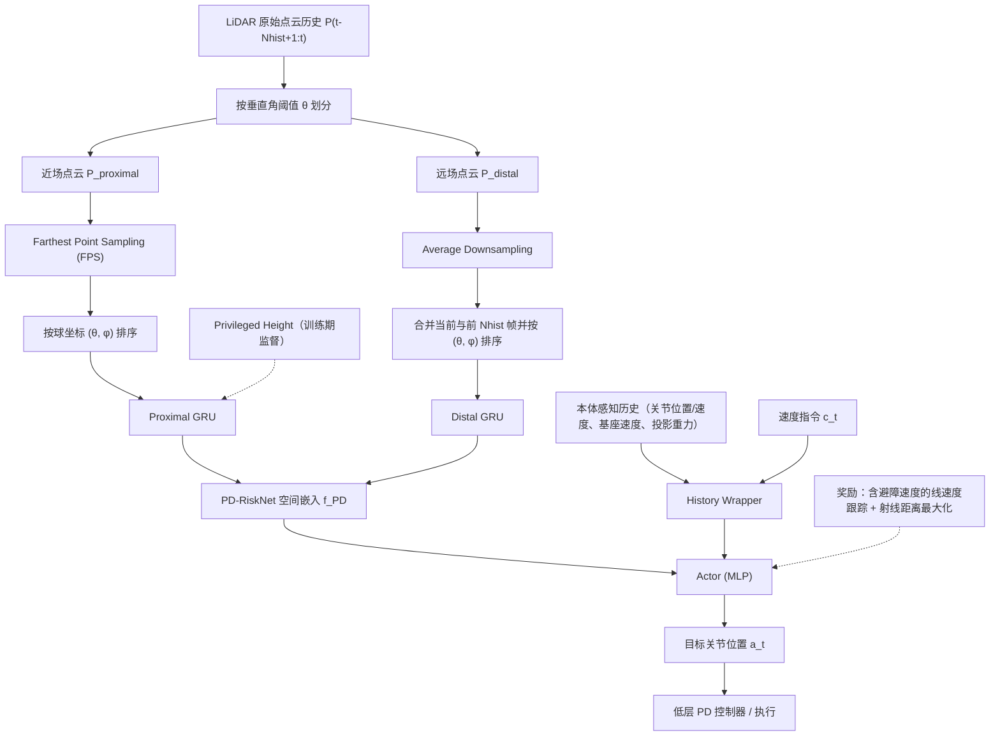

# Omni-Perception

**Omni-Perception: Omnidirectional Collision Avoidance for Legged Locomotion in Dynamic Environments** 已列入 [Robot Learning Paper Notebooks](https://imchong.github.io/Robot_Learning_Paper_Notebooks/index.html) 的 **PROGRESS.md 待深读** 清单（分类：05_Locomotion）。本页 **还没有深读笔记**：只给出这篇论文的分类位置与原文入口，方法细节与数据请直接看原文。

## 一句话定义

Omni-Perception 的人形机器人学习论文条目，当前处于 Paper Notebooks 阅读进度（待深读）阶段。

## 英文缩写速查

| 缩写 | 英文全称 | 简要说明 |
|------|----------|----------|
| RL | Reinforcement Learning | 通过与环境交互最大化长期回报来学习策略 |
| WBC | Whole-Body Control | 协调全身关节满足多任务/约束的控制基础设施 |
| Sim2Real | Simulation to Real | 把仿真中学到的策略迁移落地真机的工程主线 |

## 为什么重要

- 这篇已排进 Paper Notebooks 的待读清单，可以从 [机器人学习论文笔记总索引](../overview/humanoid-paper-notebooks-index.md) 与分类页找到同一批工作。
- 在深读笔记写出来之前，本页只保留分类位置与原文入口；方法模块与数据流见下方「流程总览」（仅依据论文方法部分，不含实验结论）。

## 流程总览

图依据：论文 §3.1 / §3.3.1 / §3.3.2 / Fig.2

## 核心信息

| 字段 | 内容 |
|------|------|
| 分类 | 05_Locomotion |
| 深读状态 | 待撰写（[PROGRESS.md](https://github.com/ImChong/Robot_Learning_Paper_Notebooks/blob/main/papers/PROGRESS.md)） |
| 计划文件夹 | `papers/05_Locomotion/omni-perception-omnidirectional-collision-avoida` |
| arXiv | <https://arxiv.org/abs/2505.19214> |

## 实验与评测

- 深读笔记尚未完成；量化 benchmark、消融与实机指标待笔记撰写后补充。

## 结论

**这条目的两个关键词是「全向」和「动态环境」：标题把腿足避障从前向视野推到 360°、从静态地形推到会移动的障碍；但本页尚未深读，代价一侧完全空白。**

- 可确认信息：分类 05_Locomotion、arXiv 2505.19214、深读状态「待撰写」；机制线索仅有「腿足运动的全向碰撞规避」。
- 本页无法回答的恰是最要紧的几个问题：用什么传感配置实现全向覆盖、动态障碍下的反应延迟与成功率如何、是否真机验证。
- 因此当前只能作为待读与检索入口，挂在 [paper-notebook-category-05-locomotion](../overview/paper-notebook-category-05-locomotion.md) 之下；量化 benchmark 与实机指标待深读笔记补充。

## 与其他页面的关系

- 分类页：[paper-notebook-category-05-locomotion](../overview/paper-notebook-category-05-locomotion.md)
- 总索引：[humanoid-paper-notebooks-index.md](../overview/humanoid-paper-notebooks-index.md)

## 参考来源

- [humanoid_pnb_omni-perception-omnidirectional-collision-avoida.md](../../sources/papers/humanoid_pnb_omni-perception-omnidirectional-collision-avoida.md)
- [Robot Learning Paper Notebooks · PROGRESS.md](https://github.com/ImChong/Robot_Learning_Paper_Notebooks/blob/main/papers/PROGRESS.md)
- 论文：<https://arxiv.org/abs/2505.19214>
- [arXiv PDF](https://arxiv.org/pdf/2505.19214)：已通读方法部分（实验与附录以略读为准）：§3.1 问题定义、§3.3 Omni-Perception Framework（PD-RiskNet 与 Risk-Aware Locomotion Policy）、Fig.2

## 推荐继续阅读

- [Paper Notebooks 阅读进度（PROGRESS.md）](https://github.com/ImChong/Robot_Learning_Paper_Notebooks/blob/main/papers/PROGRESS.md)
