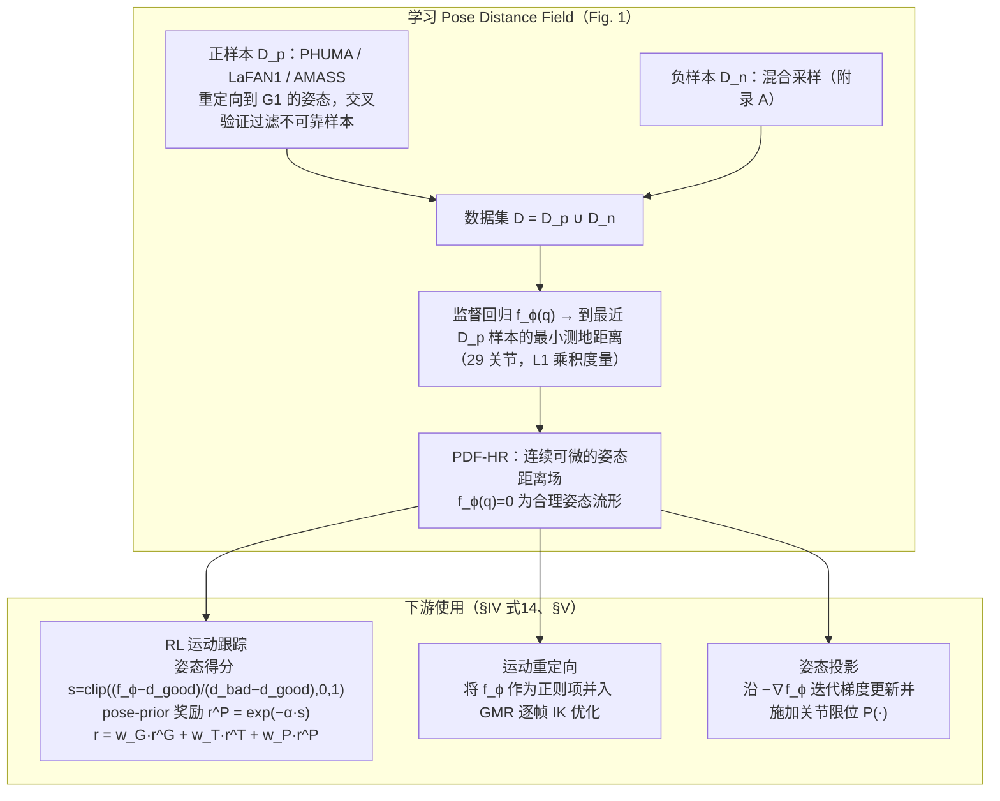

# PDF-HR

**PDF-HR: Pose Distance Fields for Humanoid Robots** 收录于 [Robot Learning Paper Notebooks](https://imchong.github.io/Robot_Learning_Paper_Notebooks/index.html)（分类：04_Loco-Manipulation_and_WBC）。本页为 **清单索引实体**，链向深读笔记与原始论文；详细机制待从笔记消化后补充。

## 一句话定义

PDF-HR 训练一个神经距离场：输入一个机器人姿态，输出它到"已知合理姿态语料库"的最短距离；这个连续可微的"姿态可信度"可以直接当作 RL 的奖励整形项、模仿学习的正则项，或作为运动重定向时的姿态打分器，几乎零成本接入到现有 humanoid 任务流水线。

## 英文缩写速查

| 缩写 | 英文全称 | 简要说明 |
|------|----------|----------|
| RL | Reinforcement Learning | 通过与环境交互最大化长期回报来学习策略 |
| WBC | Whole-Body Control | 协调全身关节满足多任务/约束的控制基础设施 |
| Sim2Real | Simulation to Real | 把仿真中学到的策略迁移落地真机的工程主线 |

## 为什么重要

- 列入 Paper Notebooks 策展清单，便于与全库 [机器人学习论文笔记总索引](../overview/humanoid-paper-notebooks-index.md) 及分类父节点交叉检索。
- 深读笔记提供比摘要更贴近实现的阅读路径，适合作为后续 ingest 深化起点。

## 流程总览

图依据：论文 §IV（式 13–14）、§V-A/B（式 15–18）、Fig. 1（重定向中正则项的具体形式未逐式核对，仅按文中“作为正则项引入优化环”绘制）

## 核心信息

| 字段 | 内容 |
|------|------|
| 分类 | 04_Loco-Manipulation_and_WBC |
| 深读笔记 | <https://imchong.github.io/Robot_Learning_Paper_Notebooks/papers/04_Loco-Manipulation_and_WBC/PDF-HR__Pose_Distance_Fields_for_Humanoid_Robots/PDF-HR__Pose_Distance_Fields_for_Humanoid_Robots.html> |
| arXiv | <https://arxiv.org/abs/2602.04851> |

## 实验与评测

- 本页为 **策展清单索引** 摘要；量化 benchmark、消融与实机指标以 **深读笔记与论文 PDF** 为准（链接见 [参考来源](#参考来源)）。

## 结论

**PDF-HR 把「这个姿态合不合理」从写死的约束变成一个连续可微的标量距离场，代价是可信度完全由语料库定义，收益是几乎零成本插进现有 humanoid 流水线。**

- 真正起作用的是「连续可微」这一性质：同一个距离场能同时充当 RL 的奖励整形项、模仿学习的正则项与运动重定向的姿态打分器，不必为每种用法各写一套约束。
- 它学的是「到已知合理姿态语料库的最短距离」，因此能力上限由语料库覆盖度决定——语料未覆盖的姿态会被一律判为低可信，这是它的适用边界。
- 定位是旁挂组件而非新控制架构：不改动策略结构，收益也因此偏向姿态可信度与约束满足，而不是任务成功率本身。
- 本页属 04_Loco-Manipulation_and_WBC 类目下的策展清单索引条目，量化 benchmark 与消融以深读笔记和论文 PDF 为准，不宜直接引本页下指标结论。

## 与其他页面的关系

- 分类父节点：[paper-notebook-category-04-loco-manipulation-and-wbc](../overview/paper-notebook-category-04-loco-manipulation-and-wbc.md)
- 总索引：[humanoid-paper-notebooks-index.md](../overview/humanoid-paper-notebooks-index.md)
- 后续冻结姿态先验：[PFM-HR](./paper-pfm-hr.md) — 同团队线用 Flow Matching + Pose Geometry Score 评关节差分（相对本页「单姿态距离」）；论文同骨干对照 ADD w/ PDF-HR。
- 同组上下文先验：[CMP](./paper-cmp.md) — 重叠作者（Mo / Gu / Zhou / Xu）；改 AMP/SMP 的 clip 级参考监督，不评单姿态距离。

## 参考来源

- [humanoid_pnb_pdf-hr.md](../../sources/papers/humanoid_pnb_pdf-hr.md)
- 深读笔记：<https://imchong.github.io/Robot_Learning_Paper_Notebooks/papers/04_Loco-Manipulation_and_WBC/PDF-HR__Pose_Distance_Fields_for_Humanoid_Robots/PDF-HR__Pose_Distance_Fields_for_Humanoid_Robots.html>
- 论文：<https://arxiv.org/abs/2602.04851>
- [arXiv PDF](https://arxiv.org/pdf/2602.04851)：已通读方法部分（实验与附录以略读为准）：§I–III 引言/相关工作/背景、§IV Methods、§V-A/B 应用；§VI 实验仅读设定与指标定义，其余略读

## 推荐继续阅读

- [机器人论文阅读笔记：PDF-HR](https://imchong.github.io/Robot_Learning_Paper_Notebooks/papers/04_Loco-Manipulation_and_WBC/PDF-HR__Pose_Distance_Fields_for_Humanoid_Robots/PDF-HR__Pose_Distance_Fields_for_Humanoid_Robots.html)
