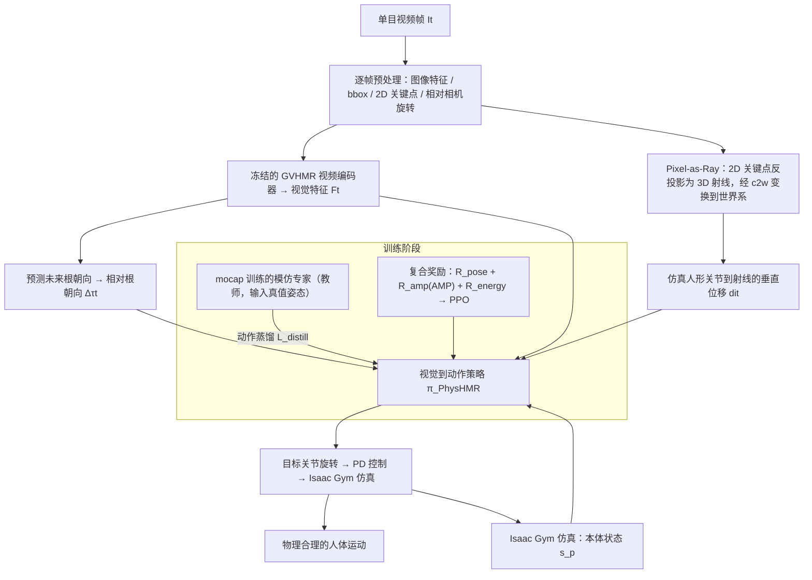

# PhysHMR

**PhysHMR: Learning Humanoid Control Policies from Vision for Physically Plausible Human Motion Reconstruction** 收录于 [Robot Learning Paper Notebooks](https://imchong.github.io/Robot_Learning_Paper_Notebooks/index.html)（分类：13_Physics-Based_Animation）。本页为 **清单索引实体**，链向深读笔记与原始论文；详细机制待从笔记消化后补充。

## 一句话定义

把 HMR 从"先估姿态、再做物理后修"的两段式拼接，压缩成一个端到端的视觉条件 RL 策略：用 GVHMR 抽到的视觉特征做局部 pose 推理，加上把 2D 关键点抬成"3D 射线"的 pixel-as-ray 软全局对齐，再叠一层从 MoCap 专家蒸馏来的运动先验 + 物理 reward 微调；输出直接是物理仿真中跑得动、又对齐视频的人体动作。

## 英文缩写速查

| 缩写 | 英文全称 | 简要说明 |
|------|----------|----------|
| RL | Reinforcement Learning | 通过与环境交互最大化长期回报来学习策略 |
| WBC | Whole-Body Control | 协调全身关节满足多任务/约束的控制基础设施 |
| Sim2Real | Simulation to Real | 把仿真中学到的策略迁移落地真机的工程主线 |

## 为什么重要

- 列入 Paper Notebooks 策展清单，便于与全库 [机器人学习论文笔记总索引](../overview/humanoid-paper-notebooks-index.md) 及分类父节点交叉检索。
- 深读笔记提供比摘要更贴近实现的阅读路径，适合作为后续 ingest 深化起点。

## 流程总览

图依据：论文 §4 / Fig. 2、§4.1-4.3

## 核心信息

| 字段 | 内容 |
|------|------|
| 分类 | 13_Physics-Based_Animation |
| 深读笔记 | <https://imchong.github.io/Robot_Learning_Paper_Notebooks/papers/13_Physics-Based_Animation/PhysHMR__Learning_Humanoid_Control_Policies_from_Vision_for_Physical_HMR/PhysHMR__Learning_Humanoid_Control_Policies_from_Vision_for_Physical_HMR.html> |
| arXiv | <https://arxiv.org/abs/2510.02566> |

## 实验与评测

- 本页为 **策展清单索引** 摘要；量化 benchmark、消融与实机指标以 **深读笔记与论文 PDF** 为准（链接见 [参考来源](#参考来源)）。

## 结论

**PhysHMR 的关键取舍是把「物理合理」从后处理约束变成策略自身的训练目标：一个视觉条件 RL 策略同时承担 pose 推理与物理执行，代价是必须用射线软对齐加 MoCap 蒸馏先验，补上端到端训练缺失的监督。**

- 真正起作用的是三件事叠加：GVHMR 视觉特征做局部 pose、pixel-as-ray 把 2D 关键点抬成 3D 射线做全局对齐、MoCap 专家蒸馏的运动先验 + 物理 reward 微调；单拿任何一项都撑不住「既对齐视频又在仿真里跑得动」。
- 全局对齐刻意做成「软」的：不强拟合绝对 3D 位置，而以射线约束保留深度歧义的自由度，把最终解交给物理与运动先验裁决。
- 输出直接是物理仿真中可执行的动作，省掉了两段式里「物理后修」那一段；相应地，结果好坏与仿真环境的保真度绑定。
- 定位属 13_Physics-Based_Animation，是「视频 → 物理可执行人体动作」这条链路上的工作，而非直接面向真机的控制策略。
- 本页为策展清单索引实体：量化 benchmark、消融与实机指标未在此给出，须以深读笔记与论文 PDF 为准。

## 与其他页面的关系

- 分类父节点：[paper-notebook-category-13-physics-based-animation](../overview/paper-notebook-category-13-physics-based-animation.md)
- 总索引：[humanoid-paper-notebooks-index.md](../overview/humanoid-paper-notebooks-index.md)

## 参考来源

- [humanoid_pnb_physhmr.md](../../sources/papers/humanoid_pnb_physhmr.md)
- 深读笔记：<https://imchong.github.io/Robot_Learning_Paper_Notebooks/papers/13_Physics-Based_Animation/PhysHMR__Learning_Humanoid_Control_Policies_from_Vision_for_Physical_HMR/PhysHMR__Learning_Humanoid_Control_Policies_from_Vision_for_Physical_HMR.html>
- 论文：<https://arxiv.org/abs/2510.02566>
- [arXiv PDF](https://arxiv.org/pdf/2510.02566)：已通读方法部分（实验与附录以略读为准）：摘要、§1 引言、§3 预备知识、§4 方法（4.1 局部视觉参考、4.2 Pixel-as-Ray 全局引导、4.3 蒸馏与总损失/奖励）；实验与附录仅略读。

## 推荐继续阅读

- [机器人论文阅读笔记：PhysHMR](https://imchong.github.io/Robot_Learning_Paper_Notebooks/papers/13_Physics-Based_Animation/PhysHMR__Learning_Humanoid_Control_Policies_from_Vision_for_Physical_HMR/PhysHMR__Learning_Humanoid_Control_Policies_from_Vision_for_Physical_HMR.html)
