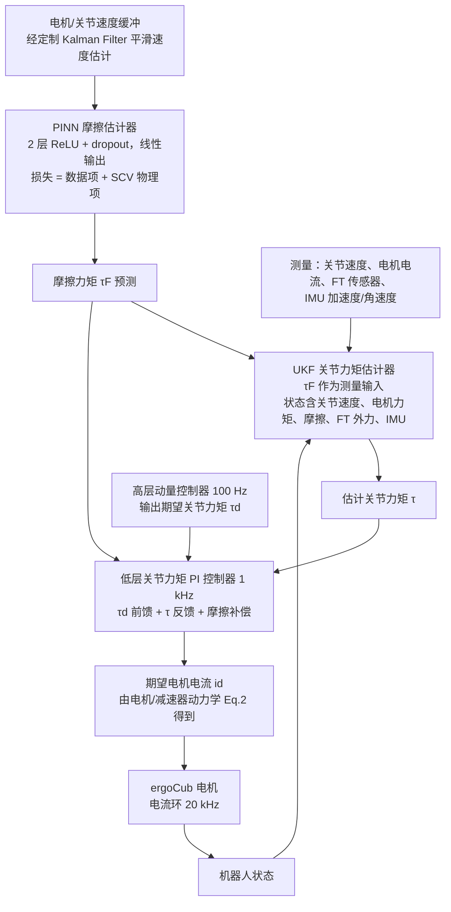

# Physics-Informed Neural Networks with Unscented Kalman Filter for Sensorless Joint Torque Estimation in Humanoid Robots

**Physics-Informed Neural Networks with Unscented Kalman Filter for Sensorless Joint Torque Estimation in Humanoid Robots** 收录于 [Robot Learning Paper Notebooks](https://imchong.github.io/Robot_Learning_Paper_Notebooks/index.html)（分类：09_State_Estimation）。本页为 **清单索引实体**，链向深读笔记与原始论文；详细机制待从笔记消化后补充。

## 一句话定义

要让一台没有关节力矩传感器的人形机器人也能做力矩控制，就必须把"力矩"从其他传感器里估出来；论文的做法是：先用 PINN 把谐波减速器最难刻画的非线性摩擦学下来，再把 PINN 的摩擦估计当作 UKF 的一个测量量喂进去，最终在 ergoCub 真机平衡实验上让腿部 6 个关节的力矩跟踪 RMSE 落到 0.08–1.41 Nm，整体优于工业界默认基线 RNEA。

## 英文缩写速查

| 缩写 | 英文全称 | 简要说明 |
|------|----------|----------|
| RL | Reinforcement Learning | 通过与环境交互最大化长期回报来学习策略 |
| WBC | Whole-Body Control | 协调全身关节满足多任务/约束的控制基础设施 |
| Sim2Real | Simulation to Real | 把仿真中学到的策略迁移落地真机的工程主线 |

## 为什么重要

- 列入 Paper Notebooks 策展清单，便于与全库 [机器人学习论文笔记总索引](../overview/humanoid-paper-notebooks-index.md) 及分类父节点交叉检索。
- 深读笔记提供比摘要更贴近实现的阅读路径，适合作为后续 ingest 深化起点。

## 流程总览

图依据：论文 §III-A、§III-B、§IV-A / Fig. 2

## 核心信息

| 字段 | 内容 |
|------|------|
| 分类 | 09_State_Estimation |
| 深读笔记 | <https://imchong.github.io/Robot_Learning_Paper_Notebooks/papers/09_State_Estimation/Physics-Informed_Neural_Networks_with_UKF_for_Sensorless_Joint_Torque_Estimation/Physics-Informed_Neural_Networks_with_UKF_for_Sensorless_Joint_Torque_Estimation.html> |
| arXiv | <https://arxiv.org/abs/2507.10105> |

## 实验与评测

- 本页为 **策展清单索引** 摘要；量化 benchmark、消融与实机指标以 **深读笔记与论文 PDF** 为准（链接见 [参考来源](#参考来源)）。

## 结论

**这篇工作的取舍是「只把最难建模的那一段交给神经网络」：摩擦交给 PINN、其余仍由物理模型与 UKF 承担，从而让没有关节力矩传感器的人形也能做力矩控制。**

- 关键设计不是端到端回归力矩，而是把 PINN 的摩擦估计降级成 UKF 的一个测量量，滤波器仍保有物理模型结构。
- 摩擦之所以被单独挑出来学，是因为谐波减速器的非线性摩擦恰是解析模型最难刻画的部分；这也意味着方法的收益与传动形式强相关。
- 有效性判据是力矩跟踪 RMSE：ergoCub 腿部 6 个关节落到 0.08–1.41 Nm，整体优于工业界默认基线 RNEA。
- 证据来自 ergoCub 真机平衡实验，超出该场景（例如高动态步态或落地冲击）的表现本页无据可依。
- 本页为 09_State_Estimation 类目下的笔记摘要，完整消融与实现细节以深读笔记和论文 PDF 为准。

## 与其他页面的关系

- 分类父节点：[paper-notebook-category-09-state-estimation](../overview/paper-notebook-category-09-state-estimation.md)
- 总索引：[humanoid-paper-notebooks-index.md](../overview/humanoid-paper-notebooks-index.md)

## 参考来源

- [humanoid_pnb_physics-informed-neural-networks-with-ukf-for-se.md](../../sources/papers/humanoid_pnb_physics-informed-neural-networks-with-ukf-for-se.md)
- 深读笔记：<https://imchong.github.io/Robot_Learning_Paper_Notebooks/papers/09_State_Estimation/Physics-Informed_Neural_Networks_with_UKF_for_Sensorless_Joint_Torque_Estimation/Physics-Informed_Neural_Networks_with_UKF_for_Sensorless_Joint_Torque_Estimation.html>
- 论文：<https://arxiv.org/abs/2507.10105>
- [arXiv PDF](https://arxiv.org/pdf/2507.10105)：已通读方法部分（实验与附录以略读为准）：§II-C 电机与减速器动力学、§III 方法（PINN 架构、UKF）、§IV-A 控制器架构

## 推荐继续阅读

- [机器人论文阅读笔记：Physics-Informed Neural Networks with Unscented Kalman Filter for Sensorless Joint Torque Estimation in Humanoid Robots](https://imchong.github.io/Robot_Learning_Paper_Notebooks/papers/09_State_Estimation/Physics-Informed_Neural_Networks_with_UKF_for_Sensorless_Joint_Torque_Estimation/Physics-Informed_Neural_Networks_with_UKF_for_Sensorless_Joint_Torque_Estimation.html)
