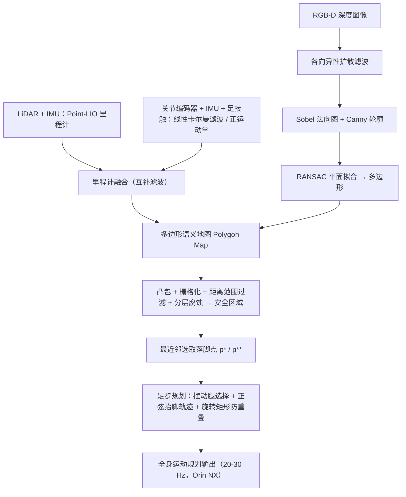

# PolygMap

**PolygMap: A Perceptive Locomotion Framework for Humanoid Robot Stair Climbing** 已列入 [Robot Learning Paper Notebooks](https://imchong.github.io/Robot_Learning_Paper_Notebooks/index.html) 的 **PROGRESS.md 待深读** 清单（分类：05_Locomotion）。本页 **还没有深读笔记**：只给出这篇论文的分类位置与原文入口，方法细节与数据请直接看原文。

## 一句话定义

PolygMap 的人形机器人学习论文条目，当前处于 Paper Notebooks 阅读进度（待深读）阶段。

## 英文缩写速查

| 缩写 | 英文全称 | 简要说明 |
|------|----------|----------|
| RL | Reinforcement Learning | 通过与环境交互最大化长期回报来学习策略 |
| WBC | Whole-Body Control | 协调全身关节满足多任务/约束的控制基础设施 |
| Sim2Real | Simulation to Real | 把仿真中学到的策略迁移落地真机的工程主线 |

## 为什么重要

- 这篇已排进 Paper Notebooks 的待读清单，可以从 [机器人学习论文笔记总索引](../overview/humanoid-paper-notebooks-index.md) 与分类页找到同一批工作。
- 在笔记写出来之前，这里只保留分类位置与原文入口；方法流程见下方「流程总览」，效果结论仍待深读。

## 流程总览

图依据：论文 §III（Fig. 2 / Fig. 3 / §III-A~C）

## 核心信息

| 字段 | 内容 |
|------|------|
| 分类 | 05_Locomotion |
| 深读状态 | 待撰写（[PROGRESS.md](https://github.com/ImChong/Robot_Learning_Paper_Notebooks/blob/main/papers/PROGRESS.md)） |
| 计划文件夹 | `papers/05_Locomotion/polygmap-a-perceptive-locomotion-framework-for-h` |
| arXiv | <https://arxiv.org/abs/2510.12346> |

## 实验与评测

- 深读笔记尚未完成；量化 benchmark、消融与实机指标待笔记撰写后补充。

## 结论

**本页是 PolygMap（面向人形爬楼的感知型运动框架）的待读条目：论文已排入待深读队列，本库尚未形成对其方法与效果的独立判断。**

- 可确认的只有定位——05_Locomotion 之下的 **感知型爬楼** 框架——以及 arXiv 出处；核心机制与量化指标待深读补齐。
- 当前价值只是可检索：这篇挂在分类页与总索引之下。
- 本页不含任何实验数据，涉及爬楼成功率或泛化能力的说法都须回到论文原文。

## 与其他页面的关系

- 分类页：[paper-notebook-category-05-locomotion](../overview/paper-notebook-category-05-locomotion.md)
- 总索引：[humanoid-paper-notebooks-index.md](../overview/humanoid-paper-notebooks-index.md)

## 参考来源

- [humanoid_pnb_polygmap-a-perceptive-locomotion-framework-for-h.md](../../sources/papers/humanoid_pnb_polygmap-a-perceptive-locomotion-framework-for-h.md)
- [Robot Learning Paper Notebooks · PROGRESS.md](https://github.com/ImChong/Robot_Learning_Paper_Notebooks/blob/main/papers/PROGRESS.md)
- 论文：<https://arxiv.org/abs/2510.12346>
- [arXiv PDF](https://arxiv.org/pdf/2510.12346)：已通读方法部分（实验与附录以略读为准）：摘要、§III 方法（A 多传感器融合状态估计、B 落脚点生成、C 足步规划）、Fig. 2/3；§IV 实验仅略读。

## 推荐继续阅读

- [Paper Notebooks 阅读进度（PROGRESS.md）](https://github.com/ImChong/Robot_Learning_Paper_Notebooks/blob/main/papers/PROGRESS.md)
