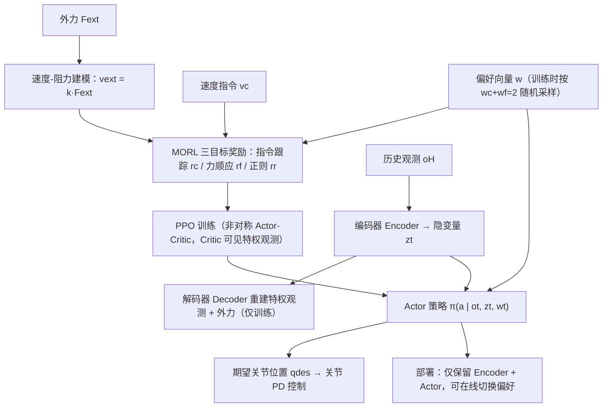

# Preference-Conditioned Multi-Objective RL for Integrated Command Tracking and Force Compliance in Humanoid Locomotion

**Preference-Conditioned Multi-Objective RL for Integrated Command Tracking and Force Compliance in Humanoid Locomotion** 已列入 [Robot Learning Paper Notebooks](https://imchong.github.io/Robot_Learning_Paper_Notebooks/index.html) 的 **PROGRESS.md 待深读** 清单（分类：05_Locomotion）。本页 **还没有深读笔记**：只给出这篇论文的分类位置与原文入口，方法细节与数据请直接看原文。

## 一句话定义

Preference-Conditioned Multi-Objective RL for Integrated Command Tracking and Force Compliance in Humanoid Locomotion 的人形机器人学习论文条目，当前处于 Paper Notebooks 阅读进度（待深读）阶段。

## 英文缩写速查

| 缩写 | 英文全称 | 简要说明 |
|------|----------|----------|
| RL | Reinforcement Learning | 通过与环境交互最大化长期回报来学习策略 |
| WBC | Whole-Body Control | 协调全身关节满足多任务/约束的控制基础设施 |
| Sim2Real | Simulation to Real | 把仿真中学到的策略迁移落地真机的工程主线 |

## 为什么重要

- 这篇已排进 Paper Notebooks 的待读清单，可以从 [机器人学习论文笔记总索引](../overview/humanoid-paper-notebooks-index.md) 与分类页找到同一批工作。
- 在笔记写出来之前，这里只保留分类位置与原文入口；方法流程见下方「流程总览」，效果结论仍待深读。

## 流程总览

图依据：论文 §III-A~C / Fig. 2

## 核心信息

| 字段 | 内容 |
|------|------|
| 分类 | 05_Locomotion |
| 深读状态 | 待撰写（[PROGRESS.md](https://github.com/ImChong/Robot_Learning_Paper_Notebooks/blob/main/papers/PROGRESS.md)） |
| 计划文件夹 | `papers/05_Locomotion/preference-conditioned-multi-objective-rl-for-in` |
| arXiv | <https://arxiv.org/abs/2510.10851> |

## 实验与评测

- 深读笔记尚未完成；量化 benchmark、消融与实机指标待笔记撰写后补充。

## 结论

**本页是「指令跟踪 vs. 力顺应」这一多目标权衡议题在待读条目，尚不构成对该方法的判断。**

- 页面上唯一确定的信息是归类与计划路径：分类 05_Locomotion、计划文件夹 `papers/05_Locomotion/preference-conditioned-multi-objective-rl-for-in`，深读状态仍为「待撰写」。
- 适用边界：可用于按分类检索与交叉链接，不可当作该论文机制或指标的依据——本页未给出偏好条件化的具体形式，也没有任何量化结果。
- 主要风险是被误当成已消化的笔记：本页「实验与评测」已明确 benchmark、消融与实机指标待补，引用前应回到 PROGRESS.md 与 <https://arxiv.org/abs/2510.10851>。

## 与其他页面的关系

- 分类页：[paper-notebook-category-05-locomotion](../overview/paper-notebook-category-05-locomotion.md)
- 总索引：[humanoid-paper-notebooks-index.md](../overview/humanoid-paper-notebooks-index.md)

## 参考来源

- [humanoid_pnb_preference-conditioned-multi-objective-rl-for-in.md](../../sources/papers/humanoid_pnb_preference-conditioned-multi-objective-rl-for-in.md)
- [Robot Learning Paper Notebooks · PROGRESS.md](https://github.com/ImChong/Robot_Learning_Paper_Notebooks/blob/main/papers/PROGRESS.md)
- 论文：<https://arxiv.org/abs/2510.10851>
- [arXiv PDF](https://arxiv.org/pdf/2510.10851)：已通读方法部分（实验与附录以略读为准）：摘要、§III 方法（A 速度-阻力建模、B MORL 形式化、C 特权重建训练）、Fig. 2；§IV 实验仅略读。

## 推荐继续阅读

- [Paper Notebooks 阅读进度（PROGRESS.md）](https://github.com/ImChong/Robot_Learning_Paper_Notebooks/blob/main/papers/PROGRESS.md)
