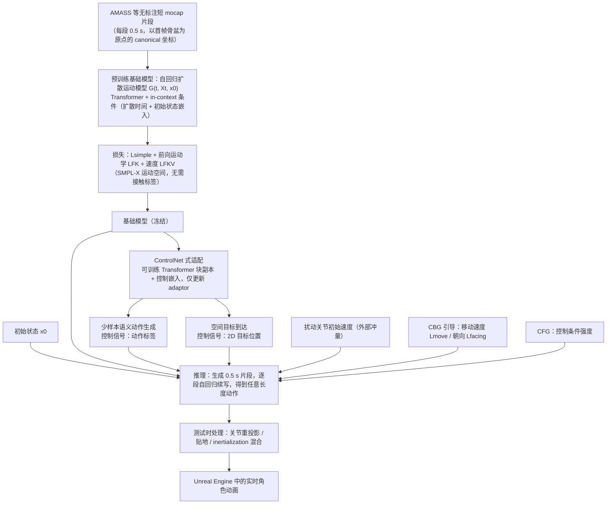

# PRIMAL

**PRIMAL: Physically Reactive and Interactive Motor Model for Avatar Learning** 收录于 [Robot Learning Paper Notebooks](https://imchong.github.io/Robot_Learning_Paper_Notebooks/index.html)（分类：14_Human_Motion），深读笔记已完成。本页是 **笔记摘要**：要点编译自深读笔记，细节以笔记原文与论文 PDF 为准。

## 一句话定义

把交互式化身的运动系统（motor system）建成一个生成式动作模型，实现持续（perpetual）、逼真、可控、可响应的 3D 运动。沿基础模型范式，PRIMAL 用两阶段训练：先在无监督的亚秒级动作片段上预训练，再用类 ControlNet 微调做个性化动作与空间目标到达。从单帧出发即可生成无界限的逼真动作，同时实时响应外部冲量（impulses）。并集成 Unreal Engine 做角色动画。实验中优于 SOTA 基线，支持少样本个性化动作生成与目标到达。

## 英文缩写速查

| 缩写 | 含义 |
|---|---|
| PRIMAL | 本文化身运动模型 |
| Motor Model | 运动系统的生成式模型 |
| Perpetual | 持续/无界限地生成 |
| ControlNet-like | 类 ControlNet 的条件微调 |
| Impulse | 外部冲量（实时响应） |
| Few-shot | 少样本个性化 |

## 为什么重要

- **"持续生成 + 实时响应冲量"与人形抗扰恢复目标一致**，呼应 Heracles 等"扰动下自然恢复"；
- **基础模型式两阶段（预训练 + ControlNet 微调）**是动作生成的通用范式；
- **从单帧续写**对在线控制友好；
- 角色动画的生成式运动经验可迁移到人形（本仓 13 物理动画方向）。

## 流程总览

图依据：论文 §3.2–3.4 Motion Representation / Neural Networks / Inference、§4 Model Adaptation / Fig.2、Fig.3。

## 解决什么问题

交互式化身需要**持续、逼真、可控、可响应**的运动： - 单纯回放/生成难**实时响应物理冲量**； - 难**个性化**且**到达空间目标**。

PRIMAL 要：一个**生成式运动模型**，从单帧持续生成、实时响应冲量、可个性化与目标到达。

## 核心机制

1. **生成式运动系统 PRIMAL**：持续、逼真、可控、可响应；
2. **两阶段训练**：无监督预训练 + 类 ControlNet 微调；
3. **实时响应冲量 + 单帧续写**：自然交互；
4. **少样本个性化 + 目标到达 + 引擎集成**。

方法拆解（深读笔记小节）：两阶段训练（基础模型范式）；持续生成 + 实时响应冲量；引擎集成 + 结果；🧭 整体流程（mermaid）。

## 核心信息

| 字段 | 内容 |
|------|------|
| 分类 | 14_Human_Motion |
| 深读笔记 | <https://imchong.github.io/Robot_Learning_Paper_Notebooks/papers/14_Human_Motion/PRIMAL__Physically_Reactive_and_Interactive_Motor_Model_for_Avatar_Learning/PRIMAL__Physically_Reactive_and_Interactive_Motor_Model_for_Avatar_Learning.html> |
| arXiv | <https://arxiv.org/abs/2503.17544> |
| 作者 | Yan Zhang、Yao Feng、Alpár Cseke、Nitin Saini、Nathan Bajandas、Michael J. Black（Meshcapade / MPI） |
| 发表 | 2025 年 3 月 |
| 笔记阅读日期 | 2026-06-21 |

## 实验与评测

- 本页是深读笔记的摘要，没有搬运原文的量化结果；量化 benchmark、消融与实机指标以 **深读笔记与论文 PDF** 为准（链接见 [参考来源](#参考来源)）。

## 结论

**PRIMAL 把「化身的运动系统」当成一个可持续续写、可被外力打断的生成模型来做：走的是基础模型的两阶段路线，押注的是实时响应能力而非离线动作质量。**

- 真正起作用的是 **两阶段训练**：无监督亚秒级片段预训练给出通用运动先验，类 ControlNet 微调再挂上个性化动作与空间目标到达。
- 从 **单帧续写** 加上 **实时响应外部冲量**，这两条才是它对在线控制友好的原因，也是与纯离线动作生成路线的分界。
- 适用边界是交互式角色动画：集成 Unreal Engine 做角色动画、对比的是动作生成 SOTA 基线，而非真机控制器；迁移到人形仍需补物理与硬件层的工作。
- 与人形关切的对照：其「持续生成 + 抗冲量恢复」与人形扰动下自然恢复同向，可作为本仓 13 物理动画方向的方法源。
- 本页为 **深读笔记编译** 的笔记摘要，量化 benchmark 与消融以笔记页和论文 PDF 为准。

## 与其他页面的关系

- 分类父节点：[paper-notebook-category-14-human-motion](../overview/paper-notebook-category-14-human-motion.md)
- 总索引：[humanoid-paper-notebooks-index.md](../overview/humanoid-paper-notebooks-index.md)

## 参考来源

- [humanoid_pnb_primal.md](../../sources/papers/humanoid_pnb_primal.md)
- 深读笔记：<https://imchong.github.io/Robot_Learning_Paper_Notebooks/papers/14_Human_Motion/PRIMAL__Physically_Reactive_and_Interactive_Motor_Model_for_Avatar_Learning/PRIMAL__Physically_Reactive_and_Interactive_Motor_Model_for_Avatar_Learning.html>
- 论文：<https://arxiv.org/abs/2503.17544>
- [arXiv PDF](https://arxiv.org/pdf/2503.17544)：已通读方法部分（实验与附录以略读为准）：§3 Autoregressive Diffusion Motion Models（3.1–3.4）、§4 Model Adaptation、§5 实验中的适配任务设定

## 推荐继续阅读

- [机器人论文阅读笔记：PRIMAL](https://imchong.github.io/Robot_Learning_Paper_Notebooks/papers/14_Human_Motion/PRIMAL__Physically_Reactive_and_Interactive_Motor_Model_for_Avatar_Learning/PRIMAL__Physically_Reactive_and_Interactive_Motor_Model_for_Avatar_Learning.html)
