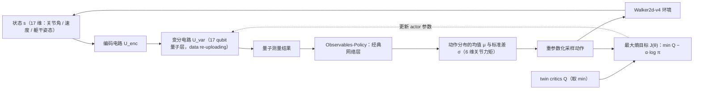

# Quantum deep reinforcement learning for humanoid robot navigation task

**Quantum deep reinforcement learning for humanoid robot navigation task** 收录于 [Robot Learning Paper Notebooks](https://imchong.github.io/Robot_Learning_Paper_Notebooks/index.html)（分类：08_Navigation）。本页为 **清单索引实体**，链向深读笔记与原始论文；详细机制待从笔记消化后补充。

## 一句话定义

本文提出 变分量子 Soft Actor-Critic（QuantumSAC）：在经典 SAC 框架里，把 actor 的核心网络换成参数化量子电路（PQC，编码电路 + 变分电路），再用一层经典网络把量子测量结果映射成连续动作的均值与方差，从而不依赖传统建图 / 规划，直接在高维状态空间里学控制——并在 MuJoCo 的 Walker2d-v4 双足任务上跑通量子深度 RL（摘要点名 Humanoid-v4 / Walker2d-v4，但正文仅训练 Walker2d-v4，Humanoid-v4 因计算量大未训练；依据 arXiv:2509.11388 §III）。

## 英文缩写速查

| 缩写 | 英文全称 | 简要说明 |
|------|----------|----------|
| RL | Reinforcement Learning | 通过与环境交互最大化长期回报来学习策略 |
| WBC | Whole-Body Control | 协调全身关节满足多任务/约束的控制基础设施 |
| Sim2Real | Simulation to Real | 把仿真中学到的策略迁移落地真机的工程主线 |

## 为什么重要

- 列入 Paper Notebooks 策展清单，便于与全库 [机器人学习论文笔记总索引](../overview/humanoid-paper-notebooks-index.md) 及分类父节点交叉检索。
- 深读笔记提供比摘要更贴近实现的阅读路径，适合作为后续 ingest 深化起点。

## 流程总览

图依据：论文 §IV-C / Fig. 2、Fig. 3 与式 (1)。

## 核心信息

| 字段 | 内容 |
|------|------|
| 分类 | 08_Navigation |
| 深读笔记 | <https://imchong.github.io/Robot_Learning_Paper_Notebooks/papers/08_Navigation/Quantum_Deep_RL_for_Humanoid_Robot_Navigation/Quantum_Deep_RL_for_Humanoid_Robot_Navigation.html> |
| arXiv | <https://arxiv.org/abs/2509.11388> |

## 实验与评测

- 本页为 **策展清单索引** 摘要；量化 benchmark、消融与实机指标以 **深读笔记与论文 PDF** 为准（链接见 [参考来源](#参考来源)）。

## 结论

**QuantumSAC 的实际贡献是「把参数化量子电路塞进 SAC 的 actor 并在大观测/大动作任务上跑通」，而不是主张量子在人形导航上已经取得优势。**

- 真正起作用的是替换范围的克制：只把 actor 的核心网络换成 PQC（编码电路 + 变分电路），量子测量结果仍由一层经典网络映射成连续动作的均值与方差，SAC 框架的其余部分不动。
- 定位上它绕开传统建图 / 规划，直接在高维状态空间里学控制；这也意味着它继承的是 SAC 的训练特性，而非量子算法本身带来的保证。
- 适用边界由基准决定：实际只在 MuJoCo Walker2d-v4（仿真双足）上验证，Humanoid-v4 未训练，本页未涉及真机导航，不能据此推断 Sim2Real 可用性。
- 本页为 **策展清单索引** 摘要（分类 08_Navigation），量化 benchmark、消融与实机指标以深读笔记与论文 PDF 为准（见 [参考来源](#参考来源)）。

## 与其他页面的关系

- 分类父节点：[paper-notebook-category-08-navigation](../overview/paper-notebook-category-08-navigation.md)
- 总索引：[humanoid-paper-notebooks-index.md](../overview/humanoid-paper-notebooks-index.md)

## 参考来源

- [humanoid_pnb_quantum-deep-rl-for-humanoid-robot-navigation.md](../../sources/papers/humanoid_pnb_quantum-deep-rl-for-humanoid-robot-navigation.md)
- 深读笔记：<https://imchong.github.io/Robot_Learning_Paper_Notebooks/papers/08_Navigation/Quantum_Deep_RL_for_Humanoid_Robot_Navigation/Quantum_Deep_RL_for_Humanoid_Robot_Navigation.html>
- 论文：<https://arxiv.org/abs/2509.11388>
- [arXiv PDF](https://arxiv.org/pdf/2509.11388)：已通读方法部分（实验与附录以略读为准）：§III 问题陈述、§IV Approach（A–C）、§V 实验设定
- 核对（2026-11-02）：对照 arXiv:2509.11388 摘要与 §III（Walker2d-v4 实验、Humanoid-v4 因计算量大未训练），把「在 Humanoid-v4 / Walker2d-v4 上跑通」改为仅 Walker2d-v4。

## 推荐继续阅读

- [机器人论文阅读笔记：Quantum deep reinforcement learning for humanoid robot navigation task](https://imchong.github.io/Robot_Learning_Paper_Notebooks/papers/08_Navigation/Quantum_Deep_RL_for_Humanoid_Robot_Navigation/Quantum_Deep_RL_for_Humanoid_Robot_Navigation.html)
