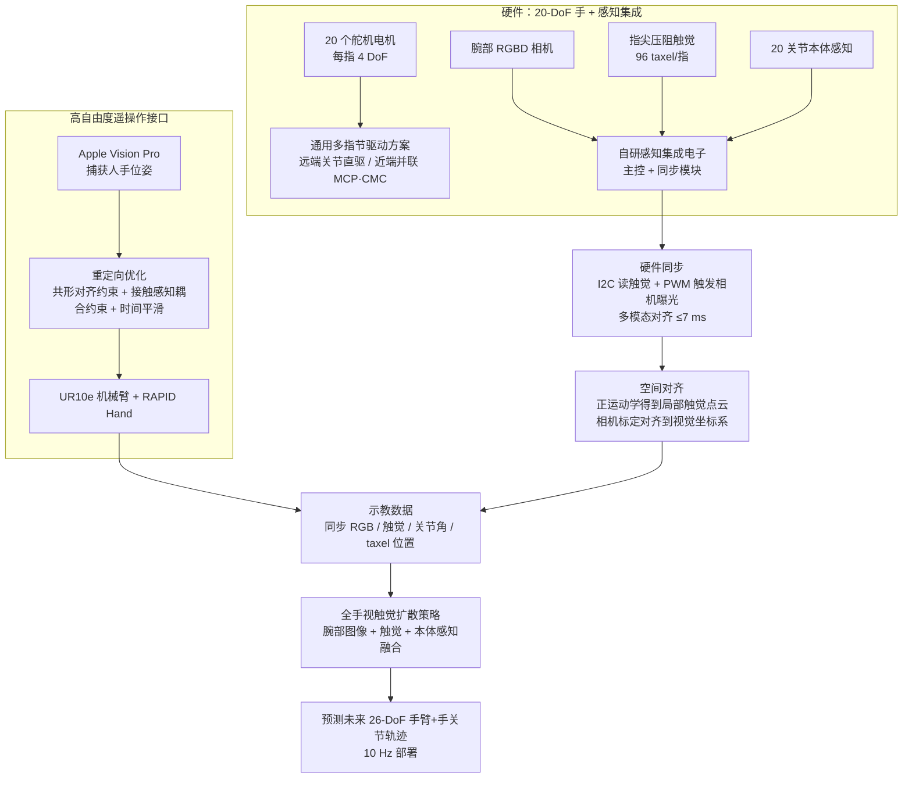

# RAPID Hand

**RAPID Hand: A Robust, Affordable, Perception-Integrated, Dexterous Manipulation Platform for Generalist Robot Autonomy** 已列入 [Robot Learning Paper Notebooks](https://imchong.github.io/Robot_Learning_Paper_Notebooks/index.html) 的 **PROGRESS.md 待深读** 清单（分类：12_Hardware_Design）。本页 **还没有深读笔记**：只给出这篇论文的分类位置与原文入口，方法细节与数据请直接看原文。

## 一句话定义

RAPID Hand 的人形机器人学习论文条目，当前处于 Paper Notebooks 阅读进度（待深读）阶段。

## 英文缩写速查

| 缩写 | 英文全称 | 简要说明 |
|------|----------|----------|
| RL | Reinforcement Learning | 通过与环境交互最大化长期回报来学习策略 |
| WBC | Whole-Body Control | 协调全身关节满足多任务/约束的控制基础设施 |
| Sim2Real | Simulation to Real | 把仿真中学到的策略迁移落地真机的工程主线 |

## 为什么重要

- 这篇已排进 Paper Notebooks 的待读清单，可以从 [机器人学习论文笔记总索引](../overview/humanoid-paper-notebooks-index.md) 与分类页找到同一批工作。
- 在笔记写出来之前，这里只保留分类位置与原文入口，不给方法结论；论文方法的模块流程见下方「流程总览」。

## 流程总览

图依据：论文 §3.2 / §4.1 / §4.2 / Fig. 4–5

## 核心信息

| 字段 | 内容 |
|------|------|
| 分类 | 12_Hardware_Design |
| 深读状态 | 待撰写（[PROGRESS.md](https://github.com/ImChong/Robot_Learning_Paper_Notebooks/blob/main/papers/PROGRESS.md)） |
| 计划文件夹 | `papers/12_Hardware_Design/rapid-hand-a-robust-affordable-perception-integr` |
| arXiv | <https://arxiv.org/abs/2506.07490> |

## 实验与评测

- 深读笔记尚未完成；量化 benchmark、消融与实机指标待笔记撰写后补充。

## 结论

**本页是 RAPID Hand 的待读条目：一个面向通用机器人自主性的「鲁棒 + 可负担 + 感知一体化」灵巧操作平台，但本库尚未深读其硬件取舍与实测表现。**

- 可确认的只有定位：12_Hardware_Design 之下的灵巧手／操作平台工作，标题自陈的三个卖点是鲁棒性、成本可负担与感知集成。
- 这类硬件平台真正的看点是取舍——成本 vs 自由度 vs 传感覆盖——而本页尚未记录任何取舍细节与实测数据。
- 当前价值只是可检索；引用硬件参数或成本结论前请回到论文原文。

## 与其他页面的关系

- 分类页：[paper-notebook-category-12-hardware-design](../overview/paper-notebook-category-12-hardware-design.md)
- 总索引：[humanoid-paper-notebooks-index.md](../overview/humanoid-paper-notebooks-index.md)

## 参考来源

- [humanoid_pnb_rapid-hand-a-robust-affordable-perception-integr.md](../../sources/papers/humanoid_pnb_rapid-hand-a-robust-affordable-perception-integr.md)
- [Robot Learning Paper Notebooks · PROGRESS.md](https://github.com/ImChong/Robot_Learning_Paper_Notebooks/blob/main/papers/PROGRESS.md)
- 论文：<https://arxiv.org/abs/2506.07490>
- [arXiv PDF](https://arxiv.org/pdf/2506.07490)：已通读方法部分（实验与附录以略读为准）：§1 引言、§3 平台（§3.1 手部本体、§3.2 感知框架）、§4 学习灵巧技能（§4.1 遥操作、§4.2 视触觉策略）；§5 实验仅略读

## 推荐继续阅读

- [Paper Notebooks 阅读进度（PROGRESS.md）](https://github.com/ImChong/Robot_Learning_Paper_Notebooks/blob/main/papers/PROGRESS.md)
