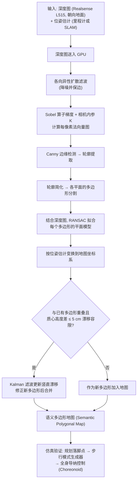

# Real-Time Polygonal Semantic Mapping for Humanoid Robot Stair Climbing

**Real-Time Polygonal Semantic Mapping for Humanoid Robot Stair Climbing** 已列入 [Robot Learning Paper Notebooks](https://imchong.github.io/Robot_Learning_Paper_Notebooks/index.html) 的 **PROGRESS.md 待深读** 清单（分类：05_Locomotion）。本页 **还没有深读笔记**：只给出这篇论文的分类位置与原文入口，方法细节与数据请直接看原文。

## 一句话定义

Real-Time Polygonal Semantic Mapping for Humanoid Robot Stair Climbing 的人形机器人学习论文条目，当前处于 Paper Notebooks 阅读进度（待深读）阶段。

## 英文缩写速查

| 缩写 | 英文全称 | 简要说明 |
|------|----------|----------|
| RL | Reinforcement Learning | 通过与环境交互最大化长期回报来学习策略 |
| WBC | Whole-Body Control | 协调全身关节满足多任务/约束的控制基础设施 |
| Sim2Real | Simulation to Real | 把仿真中学到的策略迁移落地真机的工程主线 |

## 为什么重要

- 这篇已排进 Paper Notebooks 的待读清单，可以从 [机器人学习论文笔记总索引](../overview/humanoid-paper-notebooks-index.md) 与分类页找到同一批工作。
- 在笔记写出来之前，这里只保留分类位置与原文入口，不给方法结论（论文方法数据流见下方「流程总览」）。

## 流程总览

图依据：论文 §III-A Overview（Fig.3）、§III-C 各向异性扩散与法向量（Alg.1）、§III-D 平面分割、§III-E 多边形整合与漂移补偿、§IV-D 运动规划仿真。

## 核心信息

| 字段 | 内容 |
|------|------|
| 分类 | 05_Locomotion |
| 深读状态 | 待撰写（[PROGRESS.md](https://github.com/ImChong/Robot_Learning_Paper_Notebooks/blob/main/papers/PROGRESS.md)） |
| 计划文件夹 | `papers/05_Locomotion/real-time-polygonal-semantic-mapping-for-humanoi` |
| arXiv | <https://arxiv.org/abs/2411.01919> |

## 实验与评测

- 深读笔记尚未完成；量化 benchmark、消融与实机指标待笔记撰写后补充。

## 结论

**本页是「人形爬楼实时多边形语义建图」一文的待读条目，它当前最有用的信息其实是一条消歧指引，而不是方法归纳。**

- 已确定的定位信息只有分类 05_Locomotion 与 arXiv 2411.01919；方法与指标尚未消化，「实验与评测」明确留空。
- 页面显式给出消歧：若实际问题是 GO2 运动点云质量与 SAM 2D→3D，应改读 [GO2 三维语义建图与 SAM 流水线](../queries/go2-3d-semantic-mapping-sam-pipeline.md)，而不是把本页当答案。
- 论文被放进 05_Locomotion 而非感知类目，提示本库关注的是「语义建图服务于爬楼落脚」这条线；深读笔记完成后本页应按该视角重写。

## 与其他页面的关系

- 分类页：[paper-notebook-category-05-locomotion](../overview/paper-notebook-category-05-locomotion.md)
- 总索引：[humanoid-paper-notebooks-index.md](../overview/humanoid-paper-notebooks-index.md)
- **勿与 GO2+SAM 流水线混同**：本页仍是「待深读」待读；若问题是 **GO2 运动点云质量 + SAM 2D→3D**，先读 [GO2 三维语义建图与 SAM 流水线](../queries/go2-3d-semantic-mapping-sam-pipeline.md)。

## 参考来源

- [humanoid_pnb_real-time-polygonal-semantic-mapping-for-humanoi.md](../../sources/papers/humanoid_pnb_real-time-polygonal-semantic-mapping-for-humanoi.md)
- [Robot Learning Paper Notebooks · PROGRESS.md](https://github.com/ImChong/Robot_Learning_Paper_Notebooks/blob/main/papers/PROGRESS.md)
- 论文：<https://arxiv.org/abs/2411.01919>
- [arXiv PDF](https://arxiv.org/pdf/2411.01919)：已通读方法部分（实验与附录以略读为准）：§III System Framework and Methods（A–E）、§IV-D Motion Planning Simulation

## 推荐继续阅读

- [Paper Notebooks 阅读进度（PROGRESS.md）](https://github.com/ImChong/Robot_Learning_Paper_Notebooks/blob/main/papers/PROGRESS.md)
