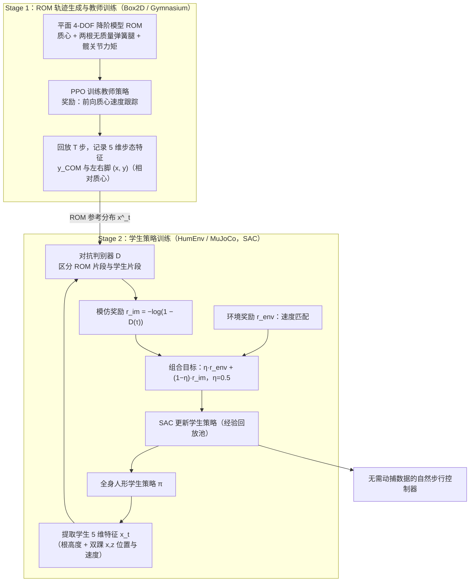

# Reduced-Order Model-Guided RL for Demonstration-Free Humanoid Locomotion

**Reduced-Order Model-Guided RL for Demonstration-Free Humanoid Locomotion** 已列入 [Robot Learning Paper Notebooks](https://imchong.github.io/Robot_Learning_Paper_Notebooks/index.html) 的 **PROGRESS.md 待深读** 清单（分类：05_Locomotion）。本页 **还没有深读笔记**：只给出这篇论文的分类位置与原文入口，方法细节与数据请直接看原文。

## 一句话定义

Reduced-Order Model-Guided RL for Demonstration-Free Humanoid Locomotion 的人形机器人学习论文条目，当前处于 Paper Notebooks 阅读进度（待深读）阶段。

## 英文缩写速查

| 缩写 | 英文全称 | 简要说明 |
|------|----------|----------|
| RL | Reinforcement Learning | 通过与环境交互最大化长期回报来学习策略 |
| WBC | Whole-Body Control | 协调全身关节满足多任务/约束的控制基础设施 |
| Sim2Real | Simulation to Real | 把仿真中学到的策略迁移落地真机的工程主线 |

## 为什么重要

- 这篇已排进 Paper Notebooks 的待读清单，可以从 [机器人学习论文笔记总索引](../overview/humanoid-paper-notebooks-index.md) 与分类页找到同一批工作。
- 在笔记写出来之前，这里只保留分类位置与原文入口；方法流程见下方「流程总览」，不含实验结论。

## 流程总览

图依据：论文 §3.1–3.3 / Fig.1、Fig.2，§4.1 实验设置。

## 核心信息

| 字段 | 内容 |
|------|------|
| 分类 | 05_Locomotion |
| 深读状态 | 待撰写（[PROGRESS.md](https://github.com/ImChong/Robot_Learning_Paper_Notebooks/blob/main/papers/PROGRESS.md)） |
| 计划文件夹 | `papers/05_Locomotion/reduced-order-model-guided-rl-for-demonstration` |
| arXiv | <https://arxiv.org/abs/2509.19023> |

## 实验与评测

- 深读笔记尚未完成；量化 benchmark、消融与实机指标待笔记撰写后补充。

## 结论

**本页目前是待读条目而非内容实体：这篇「降阶模型引导、免示范的人形行走 RL」已进入 Paper Notebooks 待深读清单，但页面尚未承载任何机制级归纳。**

- 现阶段可确认的只有策展元数据：分类 05_Locomotion、arXiv 2509.19023、深读笔记待撰写。
- 从标题可读出的定位是「用降阶模型代替动作示范来引导 RL」，但引导的具体形式与代价本页没有展开，不能据此下判断。
- 页面的作用是让你能按分类找到它；机制、实验与适用边界须等深读笔记完成后回填。

## 与其他页面的关系

- 分类页：[paper-notebook-category-05-locomotion](../overview/paper-notebook-category-05-locomotion.md)
- 总索引：[humanoid-paper-notebooks-index.md](../overview/humanoid-paper-notebooks-index.md)

## 参考来源

- [humanoid_pnb_reduced-order-model-guided-rl-for-demonstration.md](../../sources/papers/humanoid_pnb_reduced-order-model-guided-rl-for-demonstration.md)
- [Robot Learning Paper Notebooks · PROGRESS.md](https://github.com/ImChong/Robot_Learning_Paper_Notebooks/blob/main/papers/PROGRESS.md)
- 论文：<https://arxiv.org/abs/2509.19023>
- [arXiv PDF](https://arxiv.org/pdf/2509.19023)：已通读方法部分（实验与附录以略读为准）：§1 引言、§2 相关工作、§3 方法（3.1–3.3）、§4.1 实验设置、§4.2 结果略读

## 推荐继续阅读

- [Paper Notebooks 阅读进度（PROGRESS.md）](https://github.com/ImChong/Robot_Learning_Paper_Notebooks/blob/main/papers/PROGRESS.md)
