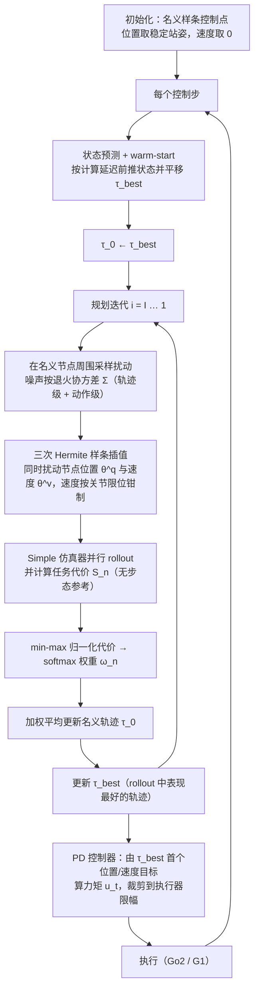

# Reference-Free Sampling-Based Model Predictive Control

**Reference-Free Sampling-Based Model Predictive Control** 已列入 [Robot Learning Paper Notebooks](https://imchong.github.io/Robot_Learning_Paper_Notebooks/index.html) 的 **PROGRESS.md 待深读** 清单（分类：03_High_Impact_Selection）。本页 **还没有深读笔记**：只给出这篇论文的分类位置与原文入口，方法细节与数据请直接看原文。

## 一句话定义

Reference-Free Sampling-Based Model Predictive Control 的人形机器人学习论文条目，当前处于 Paper Notebooks 阅读进度（待深读）阶段。

## 英文缩写速查

| 缩写 | 英文全称 | 简要说明 |
|------|----------|----------|
| RL | Reinforcement Learning | 通过与环境交互最大化长期回报来学习策略 |
| WBC | Whole-Body Control | 协调全身关节满足多任务/约束的控制基础设施 |
| Sim2Real | Simulation to Real | 把仿真中学到的策略迁移落地真机的工程主线 |

## 为什么重要

- 这篇已排进 Paper Notebooks 的待读清单，可以从 [机器人学习论文笔记总索引](../overview/humanoid-paper-notebooks-index.md) 与分类页找到同一批工作。
- 在笔记写出来之前，这里保留分类位置与原文入口，方法流程见下方「流程总览」，其余结论不给出。

## 流程总览

图依据：论文 §III-A 至 §III-E / Alg.1 / Fig.1。

## 核心信息

| 字段 | 内容 |
|------|------|
| 分类 | 03_High_Impact_Selection |
| 深读状态 | 待撰写（[PROGRESS.md](https://github.com/ImChong/Robot_Learning_Paper_Notebooks/blob/main/papers/PROGRESS.md)） |
| 计划文件夹 | `papers/03_High_Impact_Selection/reference-free-sampling-based-model-predictive-c` |
| arXiv | <https://arxiv.org/abs/2511.19204> |

## 实验与评测

- 深读笔记尚未完成；量化 benchmark、消融与实机指标待笔记撰写后补充。

## 结论

**本页是这篇「无参考采样式 MPC」的待读条目：它被放进 03_High_Impact_Selection 说明策展上认为值得优先深读，但页面本身还没有可引用的结论。**

- 页面上唯一确定的信息是归类与计划路径：分类 03_High_Impact_Selection、计划文件夹 `papers/03_High_Impact_Selection/reference-free-sampling-based-model-predictive-c`，深读状态仍为「待撰写」。
- 适用边界：可用于分类检索与优先级排序，不可当作方法或指标依据——本页未给出采样策略、代价设计或实机结果。
- 主要风险是被误当成已消化的笔记：本页「实验与评测」已明确 benchmark、消融与实机指标待补，引用前应回到 PROGRESS.md 与 <https://arxiv.org/abs/2511.19204>。

## 与其他页面的关系

- 分类页：[paper-notebook-category-03-high-impact-selection](../overview/paper-notebook-category-03-high-impact-selection.md)
- 总索引：[humanoid-paper-notebooks-index.md](../overview/humanoid-paper-notebooks-index.md)

## 参考来源

- [humanoid_pnb_reference-free-sampling-based-model-predictive-c.md](../../sources/papers/humanoid_pnb_reference-free-sampling-based-model-predictive-c.md)
- [Robot Learning Paper Notebooks · PROGRESS.md](https://github.com/ImChong/Robot_Learning_Paper_Notebooks/blob/main/papers/PROGRESS.md)
- 论文：<https://arxiv.org/abs/2511.19204>
- [arXiv PDF](https://arxiv.org/pdf/2511.19204)：已通读方法部分（实验与附录以略读为准）：§III-A 至 §III-E（含 Alg.1）

## 推荐继续阅读

- [Paper Notebooks 阅读进度（PROGRESS.md）](https://github.com/ImChong/Robot_Learning_Paper_Notebooks/blob/main/papers/PROGRESS.md)
