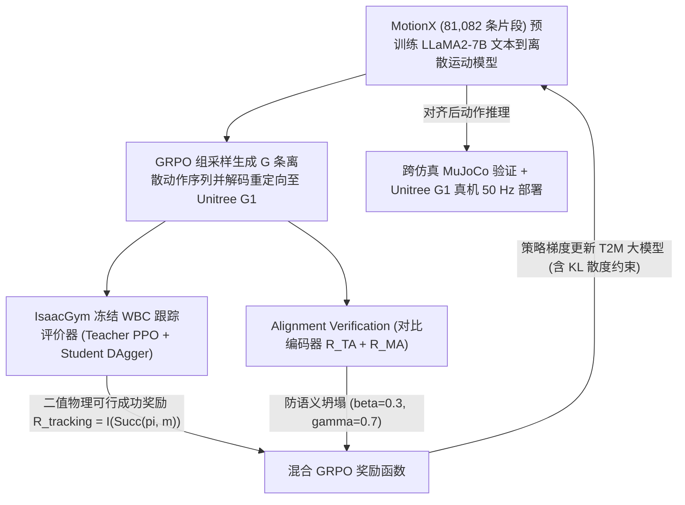

# RL from Physical Feedback: Aligning Large Motion Models with Humanoid Control (RLPF)

## 一句话定义

**RLPF**（`arXiv:2506.12769`，ECCV 2026）是智在无界（BeingBeyond）提出的「物理反馈强化学习对齐」框架：先训练基于 **LLaMA2-7B** 的离散运动生成大模型，再在物理仿真器中由冻结的全身跟踪策略充当物理裁判，使用 **GRPO** 联合优化跟踪成功率奖励与语义对齐检验奖励，从而生成兼顾语义忠实度与真机可站立性的高可行人形参考动作。

## 英文缩写速查

| 缩写 | 英文全称 | 简要说明 |
|------|----------|----------|
| RLPF | Reinforcement Learning from Physical Feedback | 以物理引擎跟踪可执行性作为在线反馈的强化学习对齐范式 |
| GRPO | Group Relative Policy Optimization | 免单独 Critic 网络、组内优势归一化的策略梯度强化学习算法 |
| WBC | Whole-Body Control | 负责将运动学参考轨迹跟踪并保持重力与接触平衡的人形底层控制 |
| LCM | Lightweight Communications and Marshalling | Unitree G1 真机端实现 200 Hz 状态与指令通信的轻量总线 |

## 为什么重要

1. **填补「生成运动看得懂但机器人做不出来」的物理鸿沟**：以 MotionX 等视频重建语料预训练的大动作模型常产生重心悬空、脚底打滑或高频不可跟踪关节跃变；RLPF 直接把仿真器内真实全身控制器的成败回传给文本到动作（T2M）大模型。
2. **用语义双验证防止物理奖励诱发「静止躺平坍塌」**：若只奖励不摔倒，模型会迅速退化为「不论什么文本都输出原地微晃站立」；引入文本-动作（$R_{\text{TA}}$）与原动作-对齐动作（$R_{\text{MA}}$）对比奖励保住表达多样性。

## 核心原理

1. **两阶段核心流水线**：
   - **Stage 1（物理可跟踪器 & 文本生成基座准备）**：在 MotionX（81,082 条人体动作）上预训练 LLaMA2-7B 离散 T2M 基座；同时仿照 ExBody2 用 Teacher PPO + Student DAgger 在 IsaacGym 训出鲁棒的 Unitree G1 全身动作跟踪策略 $\pi$ 并冻结；
   - **Stage 2（GRPO 物理反馈微调）**：对同一文本提示采样一组候选运动，重定向为 Unitree G1 关节参考并交由冻结策略 $\pi$ 并行仿真打分。
2. **三项奖励协同避免策略退化**：
   - $R_{\text{tracking}} = \mathbb{I}(\text{Succ}(\pi, m))$：衡量机器人能否全程跟踪完且不倾倒；
   - **Alignment Verification**：冻结对比编码器计算生成动作与输入文本的对齐度 $R_{\text{TA}}$（权重 $\beta=0.3$）以及与初始生成分布参考动作的相似度 $R_{\text{MA}}$（权重 $\gamma=0.7$）。消融证实移除对齐项后，尽管追踪率飙升但生成分布语义严重坍塌（FID 恶化至 `32.53 / 41.97`）。

## 工程实践

- **训练配置与部署栈**：基于在 MotionX（81,082 条片段）上预训练的 LLaMA2-7B 离散 T2M 基座做 GRPO 后训练；Unitree G1 真机端通过机载 Jetson Orin NX 运行对齐后的运动模型与 Student WBC 跟踪策略，策略推理控制频率 **50 Hz**、通过 **LCM @ 200 Hz** 收发关节指令。
- **开源状态核查**：**源码运行时序图：不适用**（截至 2026-11-21，官方仓库 [BeingBeyond/RLPF](https://github.com/BeingBeyond/RLPF) commit `4e49492` 仅含占位 `README.md` 与 `docs/` 展示图，README 声明 *"We will release our code soon."*，尚未开源可运行代码）。

## 实验与评测

- **IsaacGym 物理跟踪成功率（Unitree G1）**：在未对齐的预训练 Base 模型上，CMU / AMASS 物理跟踪成功率仅 **0.43 / 0.48**；经 RLPF 对齐后分别跃升至 **0.95 / 0.97（CMU）与 0.92 / 0.90（AMASS）**。
- **跨物理引擎 MuJoCo 零样本迁移**：从 IsaacGym 裁判对齐后的模型直接迁移至 MuJoCo 评测，成功率达 **0.75 / 0.61（CMU）与 0.63 / 0.66（AMASS）**，同时保持与预训练基线相当的文本-动作语义指标。
- **Alignment Verification 消融**：去掉文本-动作对比奖励 $R_{\text{TA}}$（$\beta=0.3$）与参考-对齐动作对比奖励 $R_{\text{MA}}$（$\gamma=0.7$）后，模型会退化为静止或原地微晃站立，导致 FID 恶化至 **`32.53 / 41.97`**。
- **真机实测**：在 Unitree G1 上完成 50 Hz 策略推理与 200 Hz LCM 闭环控制部署，验证对齐后参考动作的实机站立与可执行性。

## 结论

**RLPF 建立了类似语言模型 RLHF 的「仿真物理反馈强化学习（RL from Physical Feedback）」闭环，将文本生成人形动作的物理可执行成功率翻倍至 90%–97% 且不丧失文本语义多样性。**
- 冻结 WBC 裁判 + GRPO 免除了复杂梯度反向穿透非可微物理引擎的难题；
- 文本-动作与动作-动作双重对比校验是防止站立偏好导致「动作僵死」的关键；
- 跨仿真器迁移与 Unitree G1 50 Hz 实机运行证实其生成的参考动作具备实用鲁棒性。

## 与其他工作对比

| 对比对象 | 核心差异与实验读法 |
|------|------|
| **未对齐离散 T2M 基座（Base LLaMA2-7B）** | 仅从文本-动作对学习易出现重心悬空、脚底打滑与高频关节跃变，IsaacGym 跟踪成功率仅 `0.43`（CMU）/ `0.48`（AMASS）；RLPF 通过冻结 WBC 物理反馈 + GRPO 将成功率提升至 `0.95/0.97`（CMU）与 `0.92/0.90`（AMASS） |
| **纯物理奖励（无 Alignment Verification）** | 只奖励仿真器不摔倒会诱发语义坍塌（退化为原地站立），FID 恶化至 `32.53 / 41.97`；RLPF 引入 $R_{\text{TA}} + R_{\text{MA}}$ 双对比验证保住生成多样性 |
| [Being-M0](./paper-notebook-scaling-large-motion-models-with-million-level-h.md) / [Being-M0.5](./paper-notebook-being-m0-5-a-real-time-controllable-vision-langu.md) | 同团队上游大模型路线聚焦百万/亿级语料（MotionLib / HuMo100M）与运动学/部位可控生成（Being-M0 仅在数据层做 `π_refine` 平滑）；RLPF 则在后训练阶段直接接入物理仿真器跟踪成败信号，打通真机可站立闭环 |
| **底层全身跟踪控制（ExBody2 风格 WBC / [BumbleBee](./paper-notebook-from-experts-to-a-generalist.md)）** | 下游 WBC 解决「给定参考轨迹如何在真机稳态跟踪」；RLPF 位于上游，利用冻结 WBC 当裁判去改进「文本生成参考动作本身的可跟踪性」 |

## 局限与风险

1. **受制于冻结跟踪策略的能力天花板**：物理奖励完全取决于预设冻结 WBC 的跟踪极限，若参考动作需极高动态（如空翻或高跳跃）但跟踪器本身无法驾驭，则生成器也会抑制该类动作探索。
2. **针对静态/纯人类动作数据偏置**：跟踪评价器主要在无环境交互的 AMASS/CMU 上训练，未覆盖推箱子或物体交互接触约束。
3. **源码未释出**：仓库仅包含项目图文，需待作者释出 GRPO 训练框架后方可独立复现。

## 关联页面

- 所属机构实体：[智在无界（BeingBeyond）](beingbeyond.md)
- 上游大运动基座：[Being-M0：百万级人类运动预训练](paper-notebook-scaling-large-motion-models-with-million-level-h.md) 与 [Being-M0.5](paper-notebook-being-m0-5-a-real-time-controllable-vision-langu.md)
- 全身控制平行方向：[BumbleBee：专家到通才全身控制](paper-notebook-from-experts-to-a-generalist.md) 与 [FAST](cn-os-fast.md)

- [强化学习](../methods/reinforcement-learning.md)：了解奖励驱动的策略学习。
- [策略优化](../methods/policy-optimization.md)：了解策略更新的目标与方法。

## 参考来源

- 一手论文：`arXiv:2506.12769v1`（ECCV 2026）全文归档（[rlpf_arxiv_2506_12769.md](../../sources/papers/rlpf_arxiv_2506_12769.md)）
- 论文精读笔记摘要：[humanoid_pnb_rl-from-physical-feedback-aligning-large-motion.md](../../sources/papers/humanoid_pnb_rl-from-physical-feedback-aligning-large-motion.md)

## 继续阅读

- [arXiv:2506.12769 论文页面](https://arxiv.org/abs/2506.12769)
- [RLPF 官方项目主页](https://beingbeyond.github.io/RLPF)
- [BeingBeyond/RLPF GitHub 仓库](https://github.com/BeingBeyond/RLPF)
