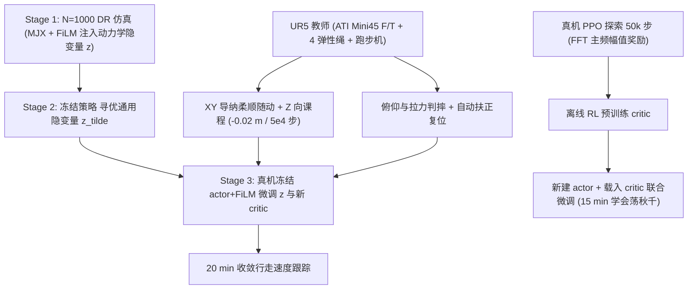
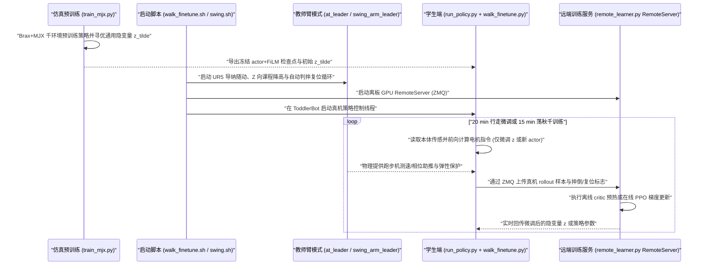

# Robot Trains Robot

**Robot Trains Robot: Automatic Real-World Policy Adaptation and Learning for Humanoids** 收录于 [Robot Learning Paper Notebooks](https://imchong.github.io/Robot_Learning_Paper_Notebooks/index.html)（分类：10_Sim-to-Real）。本页已对照 CoRL 2025 原文（arXiv:2508.12252）与官方代码仓库 `hukz18/Robot-Trains-Robot` 通读核对。

## 一句话定义

Robot Trains Robot（RTR）是一种真机强化学习基础设施与适配框架，由外部协作机械臂（UR5 + 力/力矩传感 + 弹性悬挂）充当「教师」全自动完成人形学生的安全保护、物理课程撤力与摔倒复位，让极轻量的动力学隐变量真机微调和从零技能学习能在 15–20 分钟内无人值守跑通。

## 英文缩写速查

| 缩写 | 英文全称 | 简要说明 |
|---|---|---|
| RTR | Robot Trains Robot | 本文框架：外部机械臂教师全自动监督并训练人形学生 |
| FiLM | Feature-wise Linear Modulation | 特征级线性调制，用于把环境动力学隐变量注入 actor 网络层 |
| MJX / Brax | MuJoCo XLA / Brax Physics Engine | JAX 加速可微/批量物理仿真栈，支撑 Stage 1 千环境并行预训练 |
| F/T Sensor | Force/Torque Sensor | 六维力/力矩传感器（ATI Mini45），驱动机械臂 XY 导纳柔顺跟随与判摔 |
| ZMQ | ZeroMQ Messaging Library | 机载策略执行端与离板 GPU 学习服务（`RemoteServer`）之间的低延迟通信总线 |

## 为什么重要

- **打通真机 RL 无人值守闭环**：真机长训真正的工程卡点往往不是算法收敛，而是谁来盯着防摔、判失败与扶正复位；UR5 + F/T 传感把全部人工守卫变成可编程控制环。
- **Z 向物理课程直接调制动力学难度**：悬吊高度随训练步数线性下降（每 `5×10^4` 步降低 `0.02 m`），自然实现从「部分承重辅助」到「完全自主承重」的平滑物理课程。
- **极轻可调参数面防止真机过拟合**：先在 1,000 个域随机化仿真环境把物理参数压进单个隐变量 $z$，真机只冻结主干微调 $z$ 与新 critic，避免在有限真机样本下破坏已学步态流形。

## 核心原理

### 硬件教师-学生架构

- **机械臂教师系统**：Universal Robots UR5（负载 `5 kg`）末端安装 `ATI Mini45` 六维 F/T 传感器，通过 4 根弹性吊绳连接人形躯干，配合可编程跑步机与控制 Mini PC 构成封闭训练站。
- **学生平台**：斯坦福开源小型双足 [ToddlerBot](paper-loco-manip-161-141-toddlerbot.md)（高 `0.56 m`、重 `3.4 kg`、`30 DoF`、BOM 低于 6,000 美元）。

### 两条真机训练路线（§3）

1. **三阶段行走策略 Sim-to-Real 微调（约 20 分钟真机训练）**：
   - **Stage 1（仿真 DR 预训练）**：在 `N = 1000` 个域随机化 MJX 环境中，用 MLP 编码器将环境物理参数 $\mu^{(i)}$ 映射为隐变量 $z$，经 FiLM 层调制 actor 并与 PPO 联合训练（`train_mjx.py`）。
   - **Stage 2（通用先验隐变量优化）**：冻结 actor 与 FiLM 参数，从所有仿真环境 $z$ 的均值出发用 PPO 寻优单个通用初始隐变量 $\tilde{z}$。
   - **Stage 3（真机在环微调）**：在真机中继续冻结 actor 与 FiLM，仅以 $\tilde{z}$ 为初值微调隐变量 $z$ 并从头重训 critic。UR5 以导纳控制在 XY 平面柔顺随动、按 `-0.02 m / 5×10^4 步` 撤掉 Z 向吊重，依机身俯仰角与拉力自动判摔复位，并以跑步机测速提供速度跟踪监督。
2. **纯真机从零技能学习——荡秋千 Swing-Up（约 15 分钟真机训练）**：
   - 无法或无需高保真建模的场景下，由机械臂教师按秋千运动相位区间施加助推与可控扰动，学生基于 FFT 主频摆动幅值作为奖励信号。
   - 先运行 `50k` 步在线 PPO 收集次优探索轨迹 -> 用离线 RL 预训练 critic（减少初期随机策略方差冲击） -> 重置新 actor 并加载预训练 critic 联合微调至稳态摆起。

图依据：论文 §3.1–§3.3（Fig. 2–3）与 `toddlerbot/locomotion/train_mjx.py`、`toddlerbot/finetuning/remote_learner.py` 源码。

## 实验与对比评测

**1. 真机行走适配性能对比（Table 1，0.15 m/s 目标速度下稳定性指标）**：

| 指标（越低越稳 / 越少依赖外力） | RTR 表现与观察 |
|---|---|
| 躯干横滚偏差 Roll | **0.093**（全表最低，稳态行走躯干晃动最小） |
| 躯干俯仰偏差 Pitch | **0.053**（明显优于 Zero-shot 迁移及无物理课程微调基线） |
| 末端竖直支撑力 EE Force Z | **0.954 N**（吊绳几乎不再承重，证明学生独立支撑步态稳定） |

**2. 两类任务时间效率验证（§4–§5）**：

- **行走适配**：20 分钟真机交互内完成在未建模地面与跑步机动力学下的精确速度跟踪适配，且全程自动复位无需人工搀扶。
- **从零学习荡秋千**：15 分钟真机运行内经历「50k 探索 -> 离线 critic 预热 -> 联合 PPO 精调」学会大摆幅起振，消融显示若略去离线 critic 预热或机械臂相位引导，单纯在线 PPO 难以稳定抬升振幅。

## 结论

**RTR 的核心洞见是「真机人形 RL 首先需要的是安全且能自动复位的物理基础设施，其次才是更复杂的算法」：用一台工业臂把防摔、课程撤力、交互奖励和复位全部接管后，真机微调和从零技能学习在 20 分钟内就能成为可无人值守的标准化流程。**

1. **硬件物理课程高度有效**：相比在仿真里精心手工调整噪声谱，真机上用机械臂 Z 向渐进降低承重结合 XY 导纳随动，能直接让学生在真实接触动力学中「先保平衡、再学自主抗扰」。
2. **冻干网调隐变量显著压缩真机样本需求**：仅更新动力学隐变量 $z$ 与 critic 让策略不会因真机早期低回报样本而灾难性遗忘仿真步态，Table 1 的 `0.954 N` 残余拉力证明真机最终摆脱了吊绳依赖。
3. **跨任务代码架构清晰可运行**：MIT 开源仓库完整覆盖从 Stage 1/2 `train_mjx.py` 仿真预训练到真机双机协同脚本（`launch/walk_finetune.sh` / `launch/swing.sh`），经 ZMQ 将机器人与离板 GPU `RemoteServer` 解耦。
4. **物理负载限制决定硬件适用半径**：该范式强依赖「机械臂能稳定托举并快速拉回学生」，对于 ToddlerBot（3.4 kg）配合 UR5（5 kg 负载）十分轻松，但直接照搬到 35–70 kg 全尺寸双足人形时需要龙门或高负载工业吊装系统替代，无法仅用桌面级协作臂实现。

## 源码运行时序图

以下时序严格依据 `launch/walk_finetune.sh`、`launch/swing.sh`、`toddlerbot/locomotion/train_mjx.py`、`toddlerbot/policies/run_policy.py`、`toddlerbot/policies/walk_finetune.py` 与 `toddlerbot/finetuning/remote_learner.py` 源码梳理：

## 工程实践

| 工程项 | 论文 / 官方仓库核对细节 |
|---|---|
| 开源协议与技术栈 | MIT；Brax + MuJoCo MJX（`train_mjx.py`）、PyTorch / RSL-RL 风格通信训练、`ZeroMQ` 遥测分发 |
| 硬件搭配 | 教师：UR5（5 kg）+ ATI Mini45 F/T + 跑步机；学生：ToddlerBot（0.56 m，3.4 kg，30 DoF） |
| 核心启动入口 | 仿真：`toddlerbot/locomotion/train_mjx.py`；真机微调：`launch/walk_finetune.sh`；真机荡秋千：`launch/swing.sh` |
| 运行模式参数 | `run_policy.py` 通过参数切分学生策略（`walk_finetune` / `swing`）与 UR5 引导教师（`at_leader` / `swing_arm_leader`） |
| 课程与复位调度 | 行走阶段每 `5×10^4` 步降低吊点 `0.02 m`；摔倒后由 UR5 自动回提并重启跑步机阶段 |

## 常见误区与局限

- **负载规模难以平移至全尺寸人形**：ToddlerBot 仅 3.4 kg，UR5 机械臂足以高带宽柔顺托举与瞬间拉回；面向 Unitree H1 或同类 40–70 kg 全尺寸人形机器人时，桌面级协作臂完全无法承受跌落冲击与复位载荷，需重新设计大型伺服天车或龙门保护装置。
- **训练场地局限与外部测速耦合**：行走微调依托可编程跑步机速度及末端传感器作为代理奖励与状态反馈，尚不能直接等同于室外复杂非结构化地面的全自主无人训练。
- **教师臂空间活动半径约束**：4 根吊绳与机械臂工作空间限制了水平位移边界，无法直接训练大尺度跑跳或翻滚等大空间迁移技能。
- **未微调的感知与上肢耦合验证有限**：本文真机实验聚焦于平地/跑步机行走与动态摆荡起振两类任务，尚未将同套框架验证到精细视觉操作类全身任务中。

## 关联页面

- 分类父节点：[paper-notebook-category-10-sim-to-real](../overview/paper-notebook-category-10-sim-to-real.md)
- 总索引：[humanoid-paper-notebooks-index.md](../overview/humanoid-paper-notebooks-index.md)
- 评测选型：[具身评测与基准选型闭环](../queries/embodied-eval-benchmark-selection-loop.md)
- 学生平台：[ToddlerBot 硬件与控制实体](paper-loco-manip-161-141-toddlerbot.md)
- 真机安全与控制核心：[Safe Real-World RL Fine-Tuning](../concepts/safe-real-world-rl-fine-tuning.md) · [Admittance Control](../methods/admittance-control.md) · [PPO](../methods/ppo.md)
- Sim2Real 基础：[Sim2Real 概念页](../concepts/sim2real.md) · [Domain Randomization](../concepts/domain-randomization.md) · [Privileged Training](../concepts/privileged-training.md)

## 参考来源

- [robot_trains_robot_reading.md](../../sources/papers/robot_trains_robot_reading.md)（arXiv:2508.12252 全文与深读笔记归档）
- [humanoid_pnb_robot-trains-robot-automatic-real-world-policy-a.md](../../sources/papers/humanoid_pnb_robot-trains-robot-automatic-real-world-policy-a.md)（Robot Learning Paper Notebooks 原条索引归档）
- [hukz18_robot_trains_robot.md](../../sources/repos/hukz18_robot_trains_robot.md)（GitHub 官方仓库源码核对归档）
- 论文：<https://arxiv.org/abs/2508.12252>（CoRL 2025）
- 项目主页：<https://robot-trains-robot.github.io/>
- 源码仓库：<https://github.com/hukz18/Robot-Trains-Robot>

## 推荐继续阅读

- [Robot Trains Robot 论文 PDF（arXiv:2508.12252）](https://arxiv.org/pdf/2508.12252)：查看 §3 导纳控制公式与 Table 1 行走稳定性消融细节
- [Robot-Trains-Robot 官方代码库（hukz18/Robot-Trains-Robot）](https://github.com/hukz18/Robot-Trains-Robot)：阅读 `toddlerbot/finetuning/remote_learner.py` 的 ZMQ 与 AB-PPO 实现
- [机器人论文阅读笔记：Robot Trains Robot](https://imchong.github.io/Robot_Learning_Paper_Notebooks/papers/10_Sim-to-Real/Robot_Trains_Robot_Automatic_Real-World_Policy_Adaptation_and_Learning/Robot_Trains_Robot_Automatic_Real-World_Policy_Adaptation_and_Learning.html)
