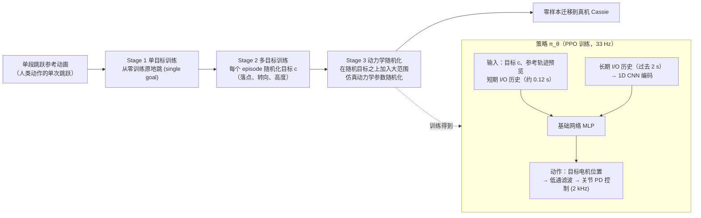

# Robust and Versatile Bipedal Jumping Control through Reinforcement Learning

**Robust and Versatile Bipedal Jumping Control through Reinforcement Learning** 已列入 [Robot Learning Paper Notebooks](https://imchong.github.io/Robot_Learning_Paper_Notebooks/index.html) 的 **PROGRESS.md 待深读** 清单（分类：05_Locomotion）。本页 **还没有深读笔记**：只给出这篇论文的分类位置与原文入口，方法细节与数据请直接看原文。

## 一句话定义

Robust and Versatile Bipedal Jumping Control through Reinforcement Learning 的人形机器人学习论文条目，当前处于 Paper Notebooks 阅读进度（待深读）阶段。

## 英文缩写速查

| 缩写 | 英文全称 | 简要说明 |
|------|----------|----------|
| RL | Reinforcement Learning | 通过与环境交互最大化长期回报来学习策略 |
| WBC | Whole-Body Control | 协调全身关节满足多任务/约束的控制基础设施 |
| Sim2Real | Simulation to Real | 把仿真中学到的策略迁移落地真机的工程主线 |

## 为什么重要

- 这篇已排进 Paper Notebooks 的待读清单，可以从 [机器人学习论文笔记总索引](../overview/humanoid-paper-notebooks-index.md) 与分类页找到同一批工作。
- 在笔记写出来之前，这里只保留分类位置与原文入口，并在「流程总览」给出据论文方法部分整理的训练与策略流程，不给实验结论。

## 流程总览

图依据：论文 §IV-A（Fig. 2 多阶段训练）、§V-A（Fig. 3 策略结构）、§V-B。

## 核心信息

| 字段 | 内容 |
|------|------|
| 分类 | 05_Locomotion |
| 深读状态 | 待撰写（[PROGRESS.md](https://github.com/ImChong/Robot_Learning_Paper_Notebooks/blob/main/papers/PROGRESS.md)） |
| 计划文件夹 | `papers/05_Locomotion/robust-and-versatile-bipedal-jumping-control-thr` |
| arXiv | <https://arxiv.org/abs/2302.09450> |

## 实验与评测

- 深读笔记尚未完成；量化 benchmark、消融与实机指标待笔记撰写后补充。

## 结论

**本页是该论文的待读条目：一篇用 RL 做双足跳跃控制、同时主打「鲁棒」与「多样」的工作，但本库尚未深读其奖励设计与迁移细节。**

- 可确认的是分类归属（05_Locomotion）、arXiv 出处与「流程总览」所述训练/策略流程；消融与实机指标待深读补齐。
- 跳跃是高动态、对 Sim2Real 差异最敏感的技能之一，「鲁棒」与「多样」如何同时达成正是该被追问的地方——本页尚无答案。
- 当前价值只是可检索；引用任何跳跃距离或成功率数字前请回到论文原文。

## 与其他页面的关系

- 分类页：[paper-notebook-category-05-locomotion](../overview/paper-notebook-category-05-locomotion.md)
- 总索引：[humanoid-paper-notebooks-index.md](../overview/humanoid-paper-notebooks-index.md)

## 参考来源

- [humanoid_pnb_robust-and-versatile-bipedal-jumping-control-thr.md](../../sources/papers/humanoid_pnb_robust-and-versatile-bipedal-jumping-control-thr.md)
- [Robot Learning Paper Notebooks · PROGRESS.md](https://github.com/ImChong/Robot_Learning_Paper_Notebooks/blob/main/papers/PROGRESS.md)
- 论文：<https://arxiv.org/abs/2302.09450>
- [arXiv PDF](https://arxiv.org/pdf/2302.09450)：已通读方法部分（实验与附录以略读为准）：§I 引言、§IV Multi-Stage Training、§V Training Setup

## 推荐继续阅读

- [Paper Notebooks 阅读进度（PROGRESS.md）](https://github.com/ImChong/Robot_Learning_Paper_Notebooks/blob/main/papers/PROGRESS.md)
