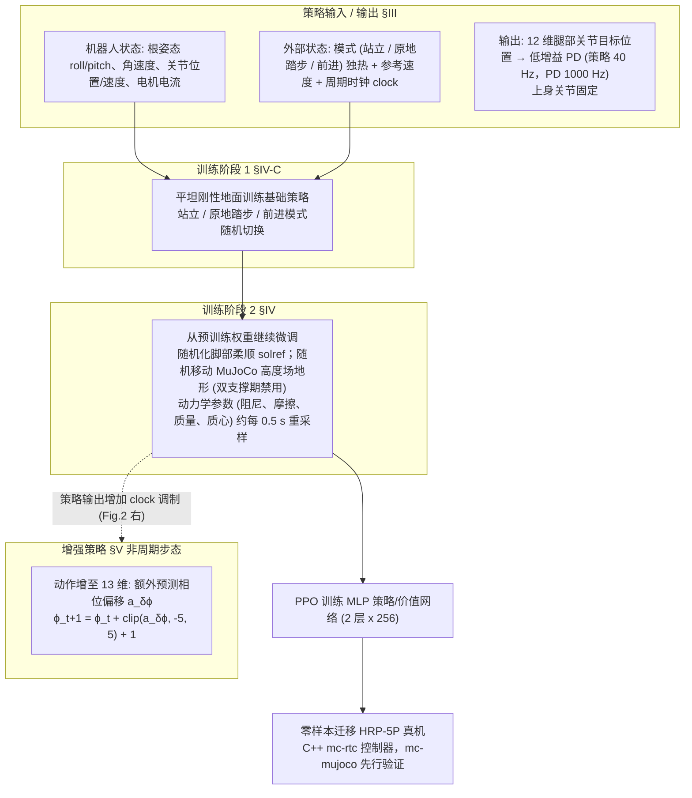

# Robust Humanoid Walking on Compliant and Uneven Terrain with Deep RL

**Robust Humanoid Walking on Compliant and Uneven Terrain with Deep RL** 已列入 [Robot Learning Paper Notebooks](https://imchong.github.io/Robot_Learning_Paper_Notebooks/index.html) 的 **PROGRESS.md 待深读** 清单（分类：05_Locomotion）。本页 **还没有深读笔记**：只给出这篇论文的分类位置与原文入口，方法细节与数据请直接看原文。

## 一句话定义

Robust Humanoid Walking on Compliant and Uneven Terrain with Deep RL 的人形机器人学习论文条目，当前处于 Paper Notebooks 阅读进度（待深读）阶段。

## 英文缩写速查

| 缩写 | 英文全称 | 简要说明 |
|------|----------|----------|
| RL | Reinforcement Learning | 通过与环境交互最大化长期回报来学习策略 |
| WBC | Whole-Body Control | 协调全身关节满足多任务/约束的控制基础设施 |
| Sim2Real | Simulation to Real | 把仿真中学到的策略迁移落地真机的工程主线 |

## 为什么重要

- 这篇已排进 Paper Notebooks 的待读清单，可以从 [机器人学习论文笔记总索引](../overview/humanoid-paper-notebooks-index.md) 与分类页找到同一批工作。
- 在深读笔记写出来之前，这里只保留分类位置与原文入口；方法流程见「流程总览」（依据论文方法部分），结论与指标以论文为准。

## 流程总览

图依据：论文 §III–§V / Fig.2（左：两阶段训练；右：预测 clock 调制的增强策略）。

## 核心信息

| 字段 | 内容 |
|------|------|
| 分类 | 05_Locomotion |
| 深读状态 | 待撰写（[PROGRESS.md](https://github.com/ImChong/Robot_Learning_Paper_Notebooks/blob/main/papers/PROGRESS.md)） |
| 计划文件夹 | `papers/05_Locomotion/robust-humanoid-walking-on-compliant-and-uneven` |
| arXiv | <https://arxiv.org/abs/2504.13619> |

## 实验与评测

- 深读笔记尚未完成；量化 benchmark、消融与实机指标待笔记撰写后补充。

## 结论

**本页是该论文的待读条目：标题锁定的问题——柔顺且不平地形上的鲁棒行走——本库已认可其归属，但方法与证据尚未消化。**

- 已确定的信息仅为分类 05_Locomotion 与 arXiv 2504.13619；「实验与评测」明确留空。
- 柔顺地形（compliant）与不平地形（uneven）本是两类不同扰动，标题把它们并列，但本页没有依据说明论文如何区分处理，引用时不要替它下结论。
- 当前用途是待读条目与路由：上溯 [05_Locomotion 分类页](../overview/paper-notebook-category-05-locomotion.md) 与 [总索引](../overview/humanoid-paper-notebooks-index.md)，指标一律以 arXiv 原文为准。

## 与其他页面的关系

- 分类页：[paper-notebook-category-05-locomotion](../overview/paper-notebook-category-05-locomotion.md)
- 总索引：[humanoid-paper-notebooks-index.md](../overview/humanoid-paper-notebooks-index.md)

## 参考来源

- [humanoid_pnb_robust-humanoid-walking-on-compliant-and-uneven.md](../../sources/papers/humanoid_pnb_robust-humanoid-walking-on-compliant-and-uneven.md)
- [Robot Learning Paper Notebooks · PROGRESS.md](https://github.com/ImChong/Robot_Learning_Paper_Notebooks/blob/main/papers/PROGRESS.md)
- 论文：<https://arxiv.org/abs/2504.13619>
- [arXiv PDF](https://arxiv.org/pdf/2504.13619)：已通读方法部分（实验与附录以略读为准）：§III–§V 环境、训练与非周期步态（Fig.2）；§VI 实验结果略读

## 推荐继续阅读

- [Paper Notebooks 阅读进度（PROGRESS.md）](https://github.com/ImChong/Robot_Learning_Paper_Notebooks/blob/main/papers/PROGRESS.md)
