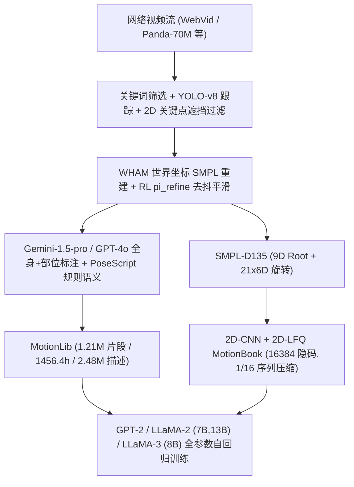

# Scaling Large Motion Models with Million-Level Human Motions (Being-M0)

## 一句话定义

**Being-M0** 是智在无界（BeingBeyond）团队发表于 ICML 2025（`arXiv:2410.03311`）的大规模文本驱动人体运动生成基座，通过构建百万级数据集 **MotionLib** 与 **2D-LFQ MotionBook** 离散分词器，首次系统性证明离散运动生成在大模型全参数微调下对域外未见动作的 Scaling Law。

## 英文缩写速查

| 缩写 | 英文全称 | 简要说明 |
|------|----------|----------|
| LMM | Large Motion Model | 基于大语言模型架构自回归生成离散人类运动序列的模型 |
| 2D-LFQ | 2D Lookup-Free Quantization | 将时空运动特征视作二维图像进行的无查表量化编码方法 |
| WHAM | World-grounded Humans with Accurate Motion | 从单目视频恢复世界坐标系下 3D SMPL 人体运动的工具链 |
| OOD | Out-of-Distribution | 未在训练分布中出现的新动作组合或场景泛化测试集 |

## 为什么重要

1. **打破运动数据稀缺上限**：此前主流数据集 HumanML3D（约 1.4 万条）与 Motion-X（约 8 万条）规模过小，导致大模型一旦扩参极易过拟合，难以响应自由开放指令。MotionLib 将可用运动-文本语料直接放大 ≥15 倍至百万量级。
2. **摆脱传统 HM3D263 逆运动学误差链**：直接在 SMPL-D135（9D 根部 + 21×6D 连续关节旋转）空间建立量化词表，避免由关节位置反解旋转带来的 IK 抖动与延迟。
3. **奠定后续全栈技术基座**：Being-M0 直接催生了实时可控多模态版本 [Being-M0.5](paper-notebook-being-m0-5-a-real-time-controllable-vision-langu.md) 与结合物理仿真奖励的 [RLPF](paper-notebook-rl-from-physical-feedback-aligning-large-motion.md)。

## 核心原理

1. **MotionLib 四阶段数据引擎**：
   - 视频过滤与人体切片：关键词初筛后用 YOLO-v8 逐人跟踪切段，依据 2D 关键点检测置信度与最小可视关键点数剔除严重遮挡与模糊片段；
   - 运动估计与物理精修：利用 **WHAM** 重建世界系 SMPL 轨迹后，接入类 PHC 的强化学习精修策略 `π_refine` 在物理仿真中消除穿模、滑步与高频抖动；
   - 多粒度文本标注：采用 Gemini-1.5-Pro / GPT-4o 生成整身与部位描述，结合 PoseScript 几何规则描述，共计 **1.21M 片段、1456.4 小时、2.48M 文本标注**。
2. **SMPL-D135 与 2D-LFQ MotionBook**：
   - 将运动帧表示为 **SMPL-D135**（3D 根位置速度+6D根旋转+21个关节 6D 旋转），支持直接前向运动学渲染或人形重定向；
   - 把 $T \times D$ 序列重塑为 $T \times D \times 1$ 二维单通道特征图输入 2D 卷积编码器，结合 **2D-LFQ**（$2^{16}=16384$ 二进制隐码直出索引，无最近邻查表坍塌），序列压缩至原长 1/16 并保持高词表利用率。
3. **LLM 骨干预训练与扩展律**：在 HumanML3D、KIT-ML、Motion-X 及自建 **UNSEEN-90K** 域外基准上对比发现：全参数微调明显优于 LoRA；参数规模（355M -> 7B/8B -> 13B）与 MotionLib 数据量协同增长时，UNSEEN-90K 域外 FID 从 HumanML3D 训练的 `82.674` 与 Motion-X 训练的 `70.547` 降至 `11.930`。

## 工程实践

- **骨干与微调选择**：研究结果表明对于离散运动词表与大语言模型对齐，**全参数微调**在动作保真与语义相关性上持续优于低秩适配（LoRA）。
- **表征接口复用**：SMPL-D135 参数可直接对接后置重定向模块映射至 Unitree G1/H1 等人形机器人（如 [RLPF](paper-notebook-rl-from-physical-feedback-aligning-large-motion.md) 所述流程）。
- **开源状态核查**：**源码运行时序图：不适用**（截至 2026-11-21，官方仓库 [BeingBeyond/Being-M0](https://github.com/BeingBeyond/Being-M0) commit `0ef4404` 仅包含占位 `README.md` 与 `docs/` 展示资源，README 声明 *"We will release our code and part of our dataset soon."*，尚未释出训练或分词源码）。

## 结论

**Being-M0 验证了「百万级互联网视频清洗 + 物理精修 + SMPL 直转离散码本 + 大模型全参预训练」能够实质性打通文本到开放世界人类运动的 OOD 泛化能力。**
- 数据引擎结合 WHAM 与 RL 物理精修，解决网盘视频重建抖动与脚滑问题；
- 2D-LFQ 在保持 16× 时间-维度压缩的同时以 16,384 码本容量避免经典 VQ 码本坍塌；
- UNSEEN-90K OOD FID 降至 `11.930`（降幅 >83%）证明大语料规模是泛化第一驱动力；
- 局限在于纯离线文本生成且缺乏部分控制精度与物理机器人闭环约束，后续由 Being-M0.5 与 RLPF 补齐。

## 实验与评测

- **数据规模对比（MotionLib）**：构建 **1.21M 片段、1456.4 小时、2.48M 分级文本标注**（body-level + part-level + PoseScript），规模较既有 HumanML3D（约 1.4 万条）与 Motion-X（约 8 万条）提升 **≥15×**。
- **离散分词压缩与保真（2D-LFQ MotionBook）**：将 SMPL-D135（9D 根特征 + 21 关节×6D 连续旋转）量化为 $2^{16}=16384$ 隐码，在将序列压缩至原长 **1/16** 的同时提升重建保真度与词汇利用率。
- **域内与域外扩展律（HumanML3D / KIT-ML / Motion-X / UNSEEN-90K）**：系统测试 GPT-2（355M）、LLaMA-2（7B、13B）与 LLaMA-3（8B）：
  - **微调策略**：全参数微调在动作保真与语义相关性上持续显著优于 LoRA；
  - **OOD 泛化（UNSEEN-90K）**：当模型规模（355M → 7B/8B → 13B）与 MotionLib 数据量协同扩展时，UNSEEN-90K 域外 FID 从基于 HumanML3D 训练的 **`82.674`** 与 Motion-X 训练的 **`70.547`** 降至 **`11.930`**（降幅 >83%）。

## 与其他工作对比

| 对比维度 | Being-M0 方案 | 既有基线与同族演进工作对照 |
|------|------|------|
| **数据规模与标注** | MotionLib（1.21M 片段 / 1456.4h / 2.48M 分级描述）+ `π_refine` 物理平滑 | 较 HumanML3D（~14K）与 Motion-X（~80K）扩大 ≥15×，在 UNSEEN-90K 上 OOD FID 从 `82.674` / `70.547` 降至 `11.930`；后续 [Being-M0.5](./paper-notebook-being-m0-5-a-real-time-controllable-vision-langu.md) 进一步扩充至 HuMo100M（500 万+ 序列 / 1 亿指令） |
| **动作表示与量化** | SMPL-D135（免逆运动学）+ 2D-LFQ MotionBook（16,384 隐码、1/16 压缩、无查表坍塌） | 摆脱传统 HM3D263 依赖离线 IK 反解关节旋转带来的抖动与延迟；后续 [Being-M0.5](./paper-notebook-being-m0-5-a-real-time-controllable-vision-langu.md) 升级为 5 部位解耦 PRQ 以支持逐部位控制与实时逐帧解码 |
| **训练与微调范式** | LLM（GPT-2 / LLaMA-2 / LLaMA-3）全参数自回归微调 | 实验验证全参微调持续优于 LoRA；仅在数据构建期用 `π_refine` 去抖，而后续 [RLPF](./paper-notebook-rl-from-physical-feedback-aligning-large-motion.md) 在后训练接入冻结 WBC + GRPO 物理反馈，使动作满足人形真机站立与跟踪约束 |

## 局限与风险

1. **缺乏物理动力学闭环约束**：生成的运动序列虽经过数据层 `π_refine` 去抖，但在开放指令下仍可能产生物理引擎上无法站稳的动作（由 [RLPF](paper-notebook-rl-from-physical-feedback-aligning-large-motion.md) 引入物理跟踪奖励解决）。
2. **局部部位与长时程控制较弱**：偏重整身级语义指令，尚未支持像 [Being-M0.5](paper-notebook-being-m0-5-a-real-time-controllable-vision-langu.md) 那样的 5 部位解耦 PRQ 控制与 Slerp/学习式长程拼接。
3. **源码与权重尚未公开**：仓库 `0ef4404` 仅含论文索引与项目图，尚无法直接运行复现。

## 关联页面

- 所属机构实体：[智在无界（BeingBeyond）](beingbeyond.md)
- 演进后续工作：[Being-M0.5：实时可控视觉-语言-运动模型](paper-notebook-being-m0-5-a-real-time-controllable-vision-langu.md)
- 物理对齐微调：[RL from Physical Feedback (RLPF)](paper-notebook-rl-from-physical-feedback-aligning-large-motion.md)
- [Robot Motion Retargeting Workflow · 机器人动作重定向流程](../methods/robot-motion-retargeting-workflow.md)：Being-M0 生成的百万级 SMPL-D135 连续人体运动语料可作为人形动作重定向与全身运动先验的上游数据来源。
- [机器人学习数据管线 · Robot Learning Data Pipelines](../methods/robot-learning-data-pipelines.md)：Being-M0 通过筛选、WHAM 世界坐标重建与多级标注构建百万级 MotionLib 数据管线，为规模化运动学习提供数据工程范例。

## 参考来源

- 一手论文：`arXiv:2410.03311v3`（ICML 2025）全文归档（[being-m0_arxiv_2410_03311.md](../../sources/papers/being-m0_arxiv_2410_03311.md)）
- 论文精读笔记摘要：[humanoid_pnb_scaling-large-motion-models-with-million-level-h.md](../../sources/papers/humanoid_pnb_scaling-large-motion-models-with-million-level-h.md)

## 继续阅读

- [arXiv:2410.03311 论文页面](https://arxiv.org/abs/2410.03311)
- [Being-M0 官方项目主页](https://beingbeyond.github.io/Being-M0)
- [BeingBeyond/Being-M0 GitHub 仓库](https://github.com/BeingBeyond/Being-M0)
