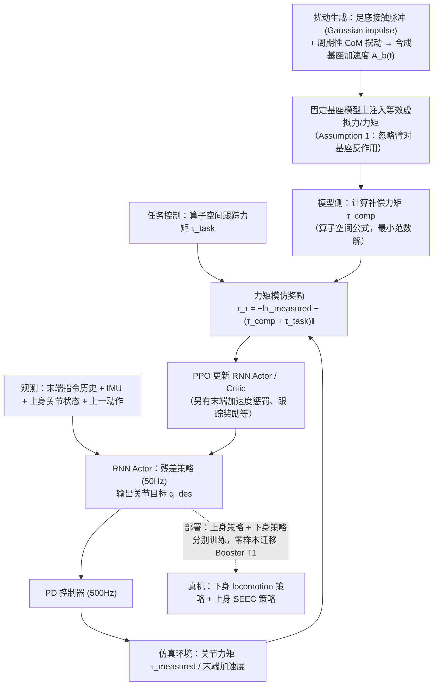

# SEEC

**SEEC: Stable End-Effector Control with Model-Enhanced Residual Learning for Humanoid Loco-Manipulation** 已列入 [Robot Learning Paper Notebooks](https://imchong.github.io/Robot_Learning_Paper_Notebooks/index.html) 的 **progress 待深读** 清单（分类：04_Loco-Manipulation_and_WBC）。本页 **还没有深读笔记**：只给出这篇论文的分类位置与原文入口，方法细节与数据请直接看原文。

## 一句话定义

SEEC 的人形机器人学习论文条目，当前处于 Paper Notebooks 阅读进度（待深读）阶段。

## 英文缩写速查

| 缩写 | 英文全称 | 简要说明 |
|------|----------|----------|
| RL | Reinforcement Learning | 通过与环境交互最大化长期回报来学习策略 |
| WBC | Whole-Body Control | 协调全身关节满足多任务/约束的控制基础设施 |
| Sim2Real | Simulation to Real | 把仿真中学到的策略迁移落地真机的工程主线 |

## 为什么重要

- 这篇已排进 Paper Notebooks 的待读清单，可以从 [机器人学习论文笔记总索引](../overview/humanoid-paper-notebooks-index.md) 与分类页找到同一批工作。
- 在笔记写出来之前，这里只保留分类位置与原文入口；方法流程见下方「流程总览」，不含实验结论。

## 流程总览

图依据：论文 §III-A（Fig.2、式 1–4）；部署连接依据 Fig.2 图注与 §III 开头。

## 核心信息

| 字段 | 内容 |
|------|------|
| 分类 | 04_Loco-Manipulation_and_WBC |
| 深读状态 | 待撰写（[progress.json](https://github.com/ImChong/Robot_Learning_Paper_Notebooks/blob/main/progress.json)） |
| 计划文件夹 | `papers/04_Loco-Manipulation_and_WBC/SEEC__Stable_End-Effector_Control_with_Model-Enhanced_Residual_Learning_for_Huma` |

## 实验与评测

- 深读笔记尚未完成；量化 benchmark、消融与实机指标待笔记撰写后补充。

## 结论

**本页目前是待读条目而非内容实体：SEEC 已进入 Paper Notebooks 待深读清单，但页面尚未承载任何机制级归纳。**

- 现阶段可确认的只有策展元数据：分类 04_Loco-Manipulation_and_WBC、深读笔记待撰写、计划文件夹已预留。
- 从标题可读出的定位是「模型增强的残差学习用于人形 loco-manipulation 末端稳定控制」，但残差如何与模型项耦合、稳定性如何度量，本页均未展开。
- 页面的作用是让你能按分类找到它；机制、实验与适用边界须等深读笔记完成后回填。

## 与其他页面的关系

- 分类页：[paper-notebook-category-04-loco-manipulation-and-wbc](../overview/paper-notebook-category-04-loco-manipulation-and-wbc.md)
- 总索引：[humanoid-paper-notebooks-index.md](../overview/humanoid-paper-notebooks-index.md)

## 参考来源

- [humanoid_pnb_seec.md](../../sources/papers/humanoid_pnb_seec.md)
- [Robot Learning Paper Notebooks · progress.json](https://github.com/ImChong/Robot_Learning_Paper_Notebooks/blob/main/progress.json)
- [arXiv PDF](https://arxiv.org/pdf/2509.21231)：已通读方法部分（实验与附录以略读为准）：摘要、§I 引言、§II 相关工作、§III 方法（III-A.1–3）

## 推荐继续阅读

- [Paper Notebooks 阅读进度（PROGRESS.md）](https://github.com/ImChong/Robot_Learning_Paper_Notebooks/blob/main/papers/PROGRESS.md)
