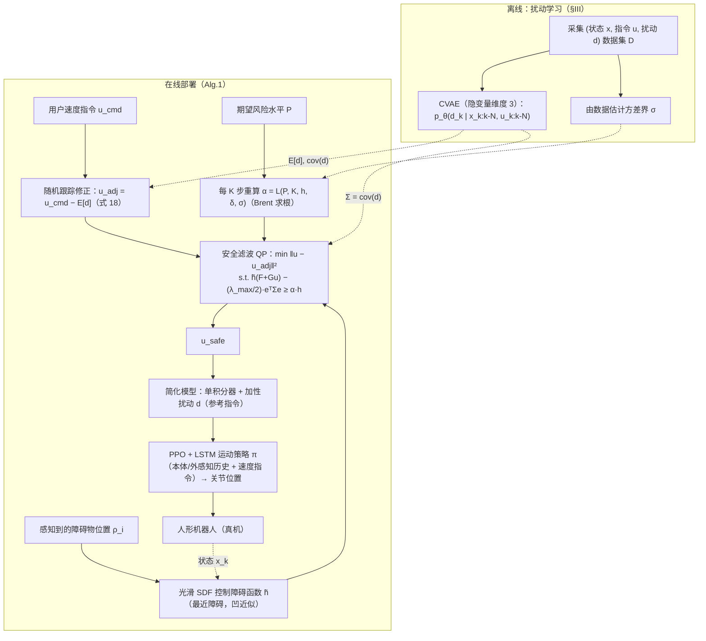

# SHIELD

**SHIELD: Safety on Humanoids via CBFs In Expectation on Learned Dynamics** 已列入 [Robot Learning Paper Notebooks](https://imchong.github.io/Robot_Learning_Paper_Notebooks/index.html) 的 **PROGRESS.md 待深读** 清单（分类：05_Locomotion）。本页 **还没有深读笔记**：只给出这篇论文的分类位置与原文入口，方法细节与数据请直接看原文。

## 一句话定义

SHIELD 的人形机器人学习论文条目，当前处于 Paper Notebooks 阅读进度（待深读）阶段。

## 英文缩写速查

| 缩写 | 英文全称 | 简要说明 |
|------|----------|----------|
| RL | Reinforcement Learning | 通过与环境交互最大化长期回报来学习策略 |
| WBC | Whole-Body Control | 协调全身关节满足多任务/约束的控制基础设施 |
| Sim2Real | Simulation to Real | 把仿真中学到的策略迁移落地真机的工程主线 |

## 为什么重要

- 这篇已排进 Paper Notebooks 的待读清单，可以从 [机器人学习论文笔记总索引](../overview/humanoid-paper-notebooks-index.md) 与分类页找到同一批工作。
- 在深读笔记写出来之前，本页只保留分类位置与原文入口；方法模块与数据流见下方「流程总览」（仅依据论文方法部分，不含实验结论）。

## 流程总览

图依据：论文 §III 扰动学习、§IV 动态避障（式 17-24）、Algorithm 1、Fig.1

## 核心信息

| 字段 | 内容 |
|------|------|
| 分类 | 05_Locomotion |
| 深读状态 | 待撰写（[PROGRESS.md](https://github.com/ImChong/Robot_Learning_Paper_Notebooks/blob/main/papers/PROGRESS.md)） |
| 计划文件夹 | `papers/05_Locomotion/shield-safety-on-humanoids-via-cbfs-in-expectati` |
| arXiv | <https://arxiv.org/abs/2505.11494> |

## 实验与评测

- 深读笔记尚未完成；量化 benchmark、消融与实机指标待笔记撰写后补充。

## 结论

**本页是 SHIELD 的待读条目：一条「在学习到的动力学上、以期望意义施加 CBF」的人形安全路线，但本库尚未深读其安全保证的强度与成立前提。**

- 可确认的只有分类归属（05_Locomotion）与 arXiv 出处；核心机制、量化指标与真机验证全部待深读补齐。
- 值得追问的正是标题里的两个限定词——**learned dynamics** 与 **in expectation**：保证既建立在学习模型之上，又只在期望意义成立，其边界需要论文原文来界定。
- 当前价值只是可检索；深读笔记完成前，不宜把本页当作安全性结论的来源。

## 与其他页面的关系

- 分类页：[paper-notebook-category-05-locomotion](../overview/paper-notebook-category-05-locomotion.md)
- 总索引：[humanoid-paper-notebooks-index.md](../overview/humanoid-paper-notebooks-index.md)

## 参考来源

- [humanoid_pnb_shield-safety-on-humanoids-via-cbfs-in-expectati.md](../../sources/papers/humanoid_pnb_shield-safety-on-humanoids-via-cbfs-in-expectati.md)
- [Robot Learning Paper Notebooks · PROGRESS.md](https://github.com/ImChong/Robot_Learning_Paper_Notebooks/blob/main/papers/PROGRESS.md)
- 论文：<https://arxiv.org/abs/2505.11494>
- [arXiv PDF](https://arxiv.org/pdf/2505.11494)：已通读方法部分（实验与附录以略读为准）：§I 引言、§III Disturbance Learning、§IV Dynamic Obstacle Avoidance on Stochastic Reduced-Order Models、Algorithm 1；§II 背景与 §V 实验略读

## 推荐继续阅读

- [Paper Notebooks 阅读进度（PROGRESS.md）](https://github.com/ImChong/Robot_Learning_Paper_Notebooks/blob/main/papers/PROGRESS.md)
