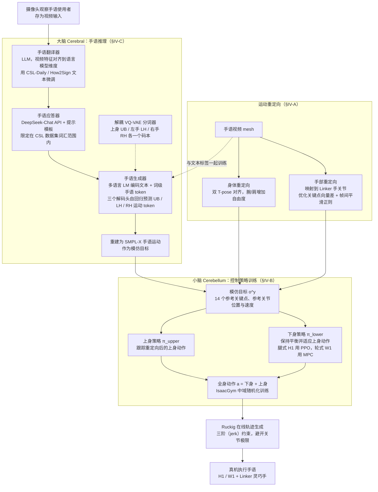

# SignBot

**SignBot: Learning Human-to-Humanoid Sign Language Interaction** 已列入 [Robot Learning Paper Notebooks](https://imchong.github.io/Robot_Learning_Paper_Notebooks/index.html) 的 **progress 待深读** 清单（分类：04_Loco-Manipulation_and_WBC）。本页 **还没有深读笔记**：只给出这篇论文的分类位置与原文入口，方法细节与数据请直接看原文。

## 一句话定义

SignBot 的人形机器人学习论文条目，当前处于 Paper Notebooks 阅读进度（待深读）阶段。

## 英文缩写速查

| 缩写 | 英文全称 | 简要说明 |
|------|----------|----------|
| RL | Reinforcement Learning | 通过与环境交互最大化长期回报来学习策略 |
| WBC | Whole-Body Control | 协调全身关节满足多任务/约束的控制基础设施 |
| Sim2Real | Simulation to Real | 把仿真中学到的策略迁移落地真机的工程主线 |

## 为什么重要

- 这篇已排进 Paper Notebooks 的待读清单，可以从 [机器人学习论文笔记总索引](../overview/humanoid-paper-notebooks-index.md) 与分类页找到同一批工作。
- 在笔记写出来之前，这里只保留分类位置与原文入口，不给方法结论；论文方法的模块流程见下方「流程总览」。

## 流程总览

图依据：论文 §IV-A / §IV-B / §IV-C / Fig. 2

## 核心信息

| 字段 | 内容 |
|------|------|
| 分类 | 04_Loco-Manipulation_and_WBC |
| 深读状态 | 待撰写（[progress.json](https://github.com/ImChong/Robot_Learning_Paper_Notebooks/blob/main/progress.json)） |
| 计划文件夹 | `papers/04_Loco-Manipulation_and_WBC/SignBot__Learning_Human-to-Humanoid_Sign_Language_Interaction` |

## 实验与评测

- 深读笔记尚未完成；量化 benchmark、消融与实机指标待笔记撰写后补充。

## 结论

**本页是 SignBot 的待读条目；目前可确认的主要是一个归类判断——「人到人形的手语交互」被放进 04_Loco-Manipulation_and_WBC，而不是纯感知或语言类目。**

- 标题界定的问题是双向的手语交互，即以表达为目的的上肢/全身动作，这解释了它落在全身控制类目下的原因。
- 深读笔记尚未撰写、「实验与评测」明确留空，本页不可作为任何量化指标或实机结论的出处。
- 核心信息表未给 arXiv 行，深读状态与计划文件夹以 progress.json 为准；上溯路径为 [04_Loco-Manipulation_and_WBC 分类页](../overview/paper-notebook-category-04-loco-manipulation-and-wbc.md) 与 [总索引](../overview/humanoid-paper-notebooks-index.md)。

## 与其他页面的关系

- 分类页：[paper-notebook-category-04-loco-manipulation-and-wbc](../overview/paper-notebook-category-04-loco-manipulation-and-wbc.md)
- 总索引：[humanoid-paper-notebooks-index.md](../overview/humanoid-paper-notebooks-index.md)

## 参考来源

- [humanoid_pnb_signbot.md](../../sources/papers/humanoid_pnb_signbot.md)
- [Robot Learning Paper Notebooks · progress.json](https://github.com/ImChong/Robot_Learning_Paper_Notebooks/blob/main/progress.json)
- [arXiv PDF](https://arxiv.org/pdf/2505.24266)：已通读方法部分（实验与附录以略读为准）：§III 问题定义、§IV SignBot（§IV-A 运动重定向、§IV-B 小脑控制策略训练、§IV-C 大脑手语推理与 Sim-to-Real 部署）；§V 实验与附录略读

## 推荐继续阅读

- [Paper Notebooks 阅读进度（PROGRESS.md）](https://github.com/ImChong/Robot_Learning_Paper_Notebooks/blob/main/papers/PROGRESS.md)
