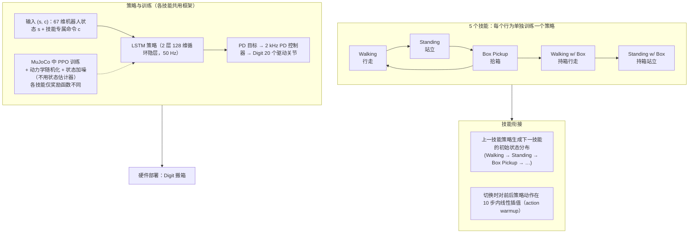

# Sim-to-Real Learning for Humanoid Box Loco-Manipulation

**Sim-to-Real Learning for Humanoid Box Loco-Manipulation** 已列入 [Robot Learning Paper Notebooks](https://imchong.github.io/Robot_Learning_Paper_Notebooks/index.html) 的 **progress 待深读** 清单（分类：04_Loco-Manipulation_and_WBC）。本页 **还没有深读笔记**：只给出这篇论文的分类位置与原文入口，方法细节与数据请直接看原文。

## 一句话定义

Sim-to-Real Learning for Humanoid Box Loco-Manipulation 的人形机器人学习论文条目，当前处于 Paper Notebooks 阅读进度（待深读）阶段。

## 英文缩写速查

| 缩写 | 英文全称 | 简要说明 |
|------|----------|----------|
| RL | Reinforcement Learning | 通过与环境交互最大化长期回报来学习策略 |
| WBC | Whole-Body Control | 协调全身关节满足多任务/约束的控制基础设施 |
| Sim2Real | Simulation to Real | 把仿真中学到的策略迁移落地真机的工程主线 |

## 为什么重要

- 这篇已排进 Paper Notebooks 的待读清单，可以从 [机器人学习论文笔记总索引](../overview/humanoid-paper-notebooks-index.md) 与分类页找到同一批工作。
- 方法流程见上方「流程总览」（依据论文方法部分）；深读笔记写出来之前，这里不给更多方法结论。

## 流程总览

图依据：论文 §III、§IV-A–D / Fig.2。

## 核心信息

| 字段 | 内容 |
|------|------|
| 分类 | 04_Loco-Manipulation_and_WBC |
| 深读状态 | 待撰写（[progress.json](https://github.com/ImChong/Robot_Learning_Paper_Notebooks/blob/main/progress.json)） |
| 计划文件夹 | `papers/04_Loco-Manipulation_and_WBC/Sim-to-Real_Learning_for_Humanoid_Box_Loco-Manipulation` |

## 实验与评测

- 深读笔记尚未完成；量化 benchmark、消融与实机指标待笔记撰写后补充。

## 结论

**本页是这篇搬箱子 loco-manipulation 工作的待读条目：它确定的只是分类归属与待读状态，Sim2Real 的具体做法与代价仍待笔记补齐。**

- 页面上唯一确定的信息是归类与计划路径：分类 04_Loco-Manipulation_and_WBC、计划文件夹 `papers/04_Loco-Manipulation_and_WBC/Sim-to-Real_Learning_for_Humanoid_Box_Loco-Manipulation`，深读状态仍为「待撰写」。
- 适用边界：可用于分类检索与交叉链接，不可当作方法或指标依据——本页未给出训练设置、迁移手段与任何量化结果。
- 主要风险是被误当成已消化的笔记：本页「实验与评测」已明确 benchmark、消融与实机指标待补，引用前应回到 progress.json 与原论文。

## 与其他页面的关系

- 分类页：[paper-notebook-category-04-loco-manipulation-and-wbc](../overview/paper-notebook-category-04-loco-manipulation-and-wbc.md)
- 总索引：[humanoid-paper-notebooks-index.md](../overview/humanoid-paper-notebooks-index.md)

## 参考来源

- [humanoid_pnb_sim-to-real-learning-for-humanoid-box-loco-manip.md](../../sources/papers/humanoid_pnb_sim-to-real-learning-for-humanoid-box-loco-manip.md)
- [Robot Learning Paper Notebooks · progress.json](https://github.com/ImChong/Robot_Learning_Paper_Notebooks/blob/main/progress.json)
- [arXiv PDF](https://arxiv.org/pdf/2310.03191)：已通读方法部分（实验与附录以略读为准）：§III 系统概览、§IV 技能学习（A–D）

## 推荐继续阅读

- [Paper Notebooks 阅读进度（PROGRESS.md）](https://github.com/ImChong/Robot_Learning_Paper_Notebooks/blob/main/papers/PROGRESS.md)
