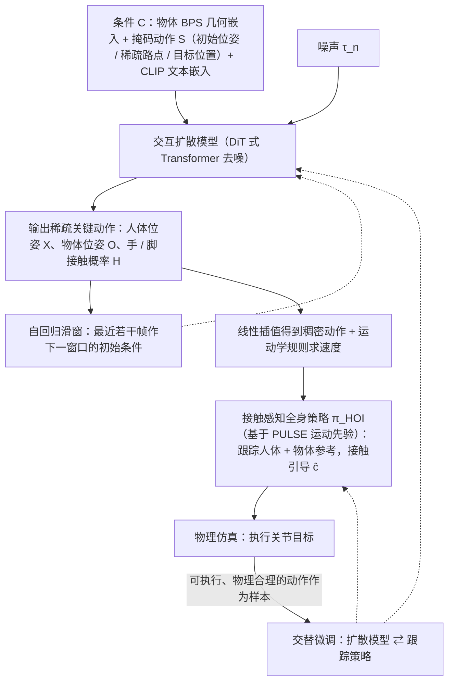

# SimGenHOI

**SimGenHOI: Physically Realistic Whole-Body Humanoid-Object Interaction via Generative Modeling and RL** 已列入 [Robot Learning Paper Notebooks](https://imchong.github.io/Robot_Learning_Paper_Notebooks/index.html) 的 **PROGRESS.md 待深读** 清单（分类：13_Physics-Based_Animation）。本页 **还没有深读笔记**：只给出这篇论文的分类位置与原文入口，方法细节与数据请直接看原文。

## 一句话定义

SimGenHOI 的人形机器人学习论文条目，当前处于 Paper Notebooks 阅读进度（待深读）阶段。

## 英文缩写速查

| 缩写 | 英文全称 | 简要说明 |
|------|----------|----------|
| RL | Reinforcement Learning | 通过与环境交互最大化长期回报来学习策略 |
| WBC | Whole-Body Control | 协调全身关节满足多任务/约束的控制基础设施 |
| Sim2Real | Simulation to Real | 把仿真中学到的策略迁移落地真机的工程主线 |

## 为什么重要

- 这篇已排进 Paper Notebooks 的待读清单，可以从 [机器人学习论文笔记总索引](../overview/humanoid-paper-notebooks-index.md) 与分类页找到同一批工作。
- 在笔记写出来之前，这里只保留分类位置与原文入口，不给方法结论。

## 流程总览

图依据：论文 Methods 节 / Fig. 2、Fig. 3、式 (1)–(10) 与 Algorithm 1（SimGen-HOI Inference）。

## 核心信息

| 字段 | 内容 |
|------|------|
| 分类 | 13_Physics-Based_Animation |
| 深读状态 | 待撰写（[PROGRESS.md](https://github.com/ImChong/Robot_Learning_Paper_Notebooks/blob/main/papers/PROGRESS.md)） |
| 计划文件夹 | `papers/13_Physics-Based_Animation/simgenhoi-physically-realistic-whole-body-humano` |
| arXiv | <https://arxiv.org/abs/2508.14120> |

## 实验与评测

- 深读笔记尚未完成；量化 benchmark、消融与实机指标待笔记撰写后补充。

## 结论

**SimGenHOI 在本库尚处待读阶段：本页只固定了它「生成式建模 + RL 做全身人–物交互」的坐标，并未给出可引用的机制或指标。**

- 可确认的仅索引层信息——arXiv 2508.14120、分类 13_Physics-Based_Animation 与计划中的笔记文件夹；标题点出的取舍是「生成动作」与「物理可行」两侧要同时兼顾，但具体如何配合页内未展开。
- 归类落在物理动画而非真机 locomotion 一侧，说明它与本库[分类页](../overview/paper-notebook-category-13-physics-based-animation.md)下的仿真/角色动画工作同栈；把它直接当作 Sim2Real 落地方案是误用。
- 主要风险是把待读条目当结论：量化 benchmark、消融与实机指标全部缺失，深读进度以 PROGRESS.md 为准，判断请回到 arXiv 原文。

## 与其他页面的关系

- 分类页：[paper-notebook-category-13-physics-based-animation](../overview/paper-notebook-category-13-physics-based-animation.md)
- 总索引：[humanoid-paper-notebooks-index.md](../overview/humanoid-paper-notebooks-index.md)

## 参考来源

- [humanoid_pnb_simgenhoi-physically-realistic-whole-body-humano.md](../../sources/papers/humanoid_pnb_simgenhoi-physically-realistic-whole-body-humano.md)
- [Robot Learning Paper Notebooks · PROGRESS.md](https://github.com/ImChong/Robot_Learning_Paper_Notebooks/blob/main/papers/PROGRESS.md)
- 论文：<https://arxiv.org/abs/2508.14120>
- [arXiv PDF](https://arxiv.org/pdf/2508.14120)：已通读方法部分（实验与附录以略读为准）：Methods 节（HOI 生成、接触感知全身策略、仿真中微调 / 自回归）与 Algorithm 1

## 推荐继续阅读

- [机器人论文阅读笔记：SimGenHOI](https://imchong.github.io/Robot_Learning_Paper_Notebooks/papers/13_Physics-Based_Animation/SimGenHOI__Physically_Realistic_Whole-Body_Humanoid-Object_Interaction/SimGenHOI__Physically_Realistic_Whole-Body_Humanoid-Object_Interaction.html)
- [Paper Notebooks 阅读进度（PROGRESS.md）](https://github.com/ImChong/Robot_Learning_Paper_Notebooks/blob/main/papers/PROGRESS.md)
