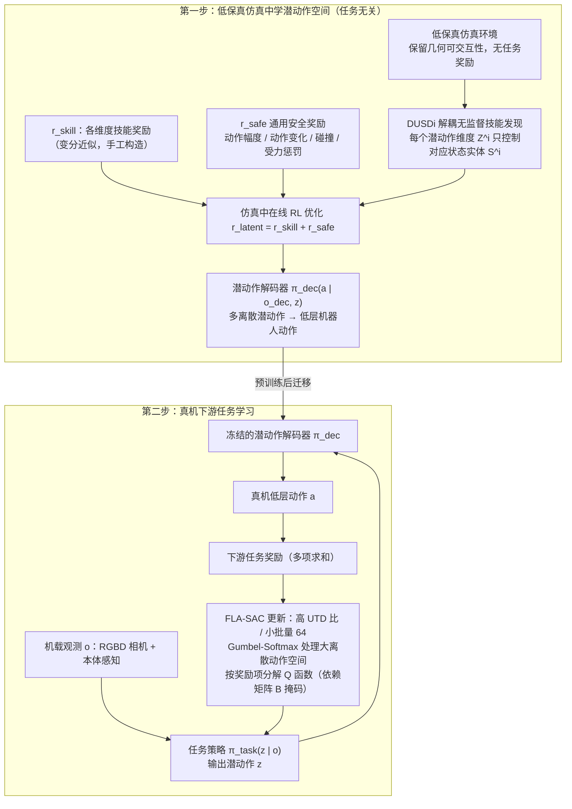

# SLAC

**SLAC: Simulation-Pretrained Latent Action Space for Whole-Body Real-World Reinforcement Learning** 已列入 [Robot Learning Paper Notebooks](https://imchong.github.io/Robot_Learning_Paper_Notebooks/index.html) 的 **progress 待深读** 清单（分类：04_Loco-Manipulation_and_WBC）。本页 **还没有深读笔记**：只给出这篇论文的分类位置与原文入口，方法细节与数据请直接看原文。

## 一句话定义

SLAC 的人形机器人学习论文条目，当前处于 Paper Notebooks 阅读进度（待深读）阶段。（arXiv 当前版本 v5 题为《SLAC: Safe and Efficient Real-Robot Reinforcement Learning via Unsupervised Simulation Pre-Training》，v1 题为《SLAC: Simulation-Pretrained Latent Action Space for Whole-Body Real-World RL》；同一篇论文改名，本页沿用清单所列题名。）

## 英文缩写速查

| 缩写 | 英文全称 | 简要说明 |
|------|----------|----------|
| RL | Reinforcement Learning | 通过与环境交互最大化长期回报来学习策略 |
| WBC | Whole-Body Control | 协调全身关节满足多任务/约束的控制基础设施 |
| Sim2Real | Simulation to Real | 把仿真中学到的策略迁移落地真机的工程主线 |

## 为什么重要

- 这篇已排进 Paper Notebooks 的待读清单，可以从 [机器人学习论文笔记总索引](../overview/humanoid-paper-notebooks-index.md) 与分类页找到同一批工作。
- 在笔记写出来之前，这里只保留分类位置与原文入口，不给方法结论；论文自述的方法流程见下方「流程总览」。

## 流程总览

图依据：论文 v1 §3（含 §3.1、§3.2）/ Fig. 2；v5 摘要对该两步结构的描述一致。

## 核心信息

| 字段 | 内容 |
|------|------|
| 分类 | 04_Loco-Manipulation_and_WBC |
| 深读状态 | 待撰写（[progress.json](https://github.com/ImChong/Robot_Learning_Paper_Notebooks/blob/main/progress.json)） |
| 计划文件夹 | `papers/04_Loco-Manipulation_and_WBC/SLAC__Simulation-Pretrained_Latent_Action_Space_for_Whole-Body_Real-World_Reinfo` |

## 实验与评测

- 深读笔记尚未完成；量化 benchmark、消融与实机指标待笔记撰写后补充。

## 结论

**本页是 SLAC 的待读条目：一条「先在仿真里预训练潜动作空间，再拿到真机上做全身 RL」的路线，但本库尚未深读其潜空间设计与真机代价。**

- 可确认的只有分类归属（04_Loco-Manipulation_and_WBC）与计划文件夹路径；方法流程见「流程总览」，量化指标与真机结果待深读补齐。
- 标题已点出这条路线的赌注——用仿真预训练的 **潜动作空间** 压缩真机 RL 的探索维度——而这一压缩是否损失可达动作集，正是深读时该追问的。
- 当前价值只是可检索；深读笔记完成前，不宜把本页当作方法结论的来源。

## 与其他页面的关系

- 分类页：[paper-notebook-category-04-loco-manipulation-and-wbc](../overview/paper-notebook-category-04-loco-manipulation-and-wbc.md)
- 总索引：[humanoid-paper-notebooks-index.md](../overview/humanoid-paper-notebooks-index.md)

## 参考来源

- [humanoid_pnb_slac.md](../../sources/papers/humanoid_pnb_slac.md)
- [Robot Learning Paper Notebooks · progress.json](https://github.com/ImChong/Robot_Learning_Paper_Notebooks/blob/main/progress.json)
- [arXiv PDF](https://arxiv.org/pdf/2506.04147v1)：已通读方法部分（实验与附录以略读为准）：v1 §3 方法（含 §3.1 潜动作空间、§3.2 FLA-SAC）与 Fig. 2；v5（当前版本）仅核对摘要。arXiv 版本史：v1（2025-06-04）题为 SLAC: Simulation-Pretrained Latent Action Space…，v5（2026-07-17）改题为 SLAC: Safe and Efficient Real-Robot RL via Unsupervised Simulation Pre-Training。

## 推荐继续阅读

- [Paper Notebooks 阅读进度（PROGRESS.md）](https://github.com/ImChong/Robot_Learning_Paper_Notebooks/blob/main/papers/PROGRESS.md)
