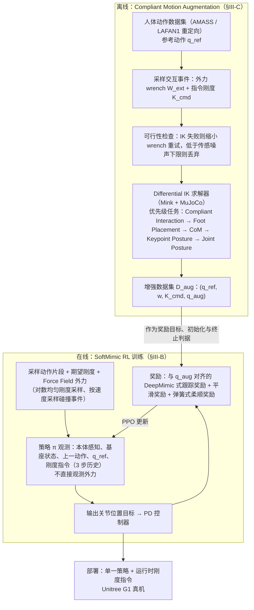

# SoftMimic

**SoftMimic: Learning Compliant Whole-body Control from Examples** 已列入 [Robot Learning Paper Notebooks](https://imchong.github.io/Robot_Learning_Paper_Notebooks/index.html) 的 **PROGRESS.md 待深读** 清单（分类：14_Human_Motion）。本页 **还没有深读笔记**：只给出这篇论文的分类位置与原文入口，方法细节与数据请直接看原文。

## 一句话定义

SoftMimic 的人形机器人学习论文条目，当前处于 Paper Notebooks 阅读进度（待深读）阶段。

## 英文缩写速查

| 缩写 | 英文全称 | 简要说明 |
|------|----------|----------|
| RL | Reinforcement Learning | 通过与环境交互最大化长期回报来学习策略 |
| WBC | Whole-Body Control | 协调全身关节满足多任务/约束的控制基础设施 |
| Sim2Real | Simulation to Real | 把仿真中学到的策略迁移落地真机的工程主线 |

## 为什么重要

- 在 [运动小脑 64 篇技术地图](../overview/humanoid-motion-cerebellum-technology-map.md) 中归类为 **I 柔顺与接触**（60/64）：接触：柔顺全身控制也在成为 tracking 条件。
- 这篇已排进 Paper Notebooks 的待读清单，可以从 [机器人学习论文笔记总索引](../overview/humanoid-paper-notebooks-index.md) 与分类页找到同一批工作。
- 笔记尚未写出；方法流程见下方「流程总览」（依据论文方法部分），实验结论以论文为准。

## 流程总览

图依据：论文 §III-A 至 §III-D / Fig.2

## 核心信息

| 字段 | 内容 |
|------|------|
| 分类 | 14_Human_Motion |
| 深读状态 | 待撰写（[PROGRESS.md](https://github.com/ImChong/Robot_Learning_Paper_Notebooks/blob/main/papers/PROGRESS.md)） |
| 计划文件夹 | `papers/14_Human_Motion/softmimic-learning-compliant-whole-body-control` |
| arXiv | <https://arxiv.org/abs/2510.17792> |

## 实验与评测

- 深读笔记尚未完成；量化 benchmark、消融与实机指标待笔记撰写后补充。

## 结论

**本页目前是双索引下的待读条目：SoftMimic 在运动小脑技术地图里已有明确定位，但论文自身的机制归纳仍待深读笔记补齐。**

- 已确认的定位是：[运动小脑 64 篇技术地图](../overview/humanoid-motion-cerebellum-technology-map.md) 将其归入 **I 柔顺与接触**（60/64），对应「柔顺全身控制也在成为 tracking 条件」这一趋势判断。
- 其余均为策展元数据：分类 14_Human_Motion、arXiv 2510.17792、深读笔记待撰写。
- 页面的作用是让你能按分类找到它；机制、实验与适用边界须等深读笔记完成后回填，此前不宜作为技术结论引用。

## 与其他页面的关系

- 分类页：[paper-notebook-category-14-human-motion](../overview/paper-notebook-category-14-human-motion.md)
- 总索引：[humanoid-paper-notebooks-index.md](../overview/humanoid-paper-notebooks-index.md)

## 关联页面

- [磁驱动双稳态软跳跃机器人](./paper-bistable-soft-jumper-magnetic.md)

## 参考来源

- [humanoid_pnb_softmimic-learning-compliant-whole-body-control.md](../../sources/papers/humanoid_pnb_softmimic-learning-compliant-whole-body-control.md)
- [Robot Learning Paper Notebooks · PROGRESS.md](https://github.com/ImChong/Robot_Learning_Paper_Notebooks/blob/main/papers/PROGRESS.md)
- 论文：<https://arxiv.org/abs/2510.17792>
- [arXiv PDF](https://arxiv.org/pdf/2510.17792)：已通读方法部分（实验与附录以略读为准）：§I 引言、§II 相关工作、§III Method（§III-A–D）与 Fig.2（§IV 结果与附录仅略读）

## 推荐继续阅读

- [Paper Notebooks 阅读进度（PROGRESS.md）](https://github.com/ImChong/Robot_Learning_Paper_Notebooks/blob/main/papers/PROGRESS.md)
