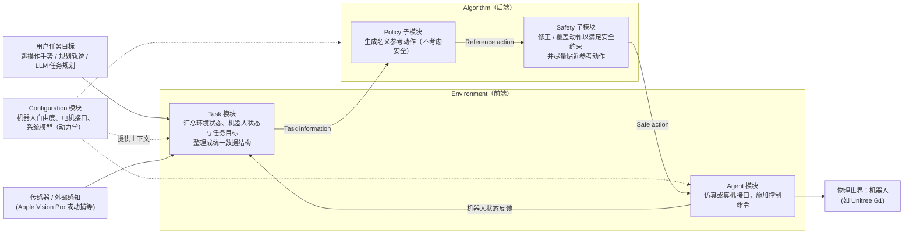

# SPARK（安全自主工具箱 · Paper Notebooks 待读）

**SPARK: A Toolbox for Safe Humanoid Autonomy and Teleoperation** 已列入 [Robot Learning Paper Notebooks](https://imchong.github.io/Robot_Learning_Paper_Notebooks/index.html) 的 **progress 待深读** 清单（分类：04_Loco-Manipulation_and_WBC）。本页 **还没有深读笔记**：只给出这篇论文的分类位置与原文入口，方法细节与数据请直接看原文。

> **同名消歧：** 动力学重定向论文 [SPARK: Skeleton-Parameter Aligned Retargeting](./paper-spark-skeleton-aligned-retargeting.md)（arXiv:2603.11480）是另一工作，见该实体页。

## 一句话定义

SPARK 的人形机器人学习论文条目，当前处于 Paper Notebooks 阅读进度（待深读）阶段。

## 英文缩写速查

| 缩写 | 英文全称 | 简要说明 |
|------|----------|----------|
| RL | Reinforcement Learning | 通过与环境交互最大化长期回报来学习策略 |
| WBC | Whole-Body Control | 协调全身关节满足多任务/约束的控制基础设施 |
| Sim2Real | Simulation to Real | 把仿真中学到的策略迁移落地真机的工程主线 |

## 为什么重要

- 这篇已排进 Paper Notebooks 的待读清单，可以从 [机器人学习论文笔记总索引](../overview/humanoid-paper-notebooks-index.md) 与分类页找到同一批工作。
- 在深读笔记写出来之前，这里只保留分类位置与原文入口，不给方法结论；论文自述的框架模块与数据流见下方「流程总览」。

## 流程总览

图依据：论文 §III-A 安全关键机器人场景的组成与依赖（Fig.2）、§III-B Framework of SPARK（Fig.3）。

## 核心信息

| 字段 | 内容 |
|------|------|
| 分类 | 04_Loco-Manipulation_and_WBC |
| 深读状态 | 待撰写（[progress.json](https://github.com/ImChong/Robot_Learning_Paper_Notebooks/blob/main/progress.json)） |
| 计划文件夹 | `papers/04_Loco-Manipulation_and_WBC/SPARK__A_Toolbox_for_Safe_Humanoid_Autonomy_and_Teleoperation` |

## 实验与评测

- 深读笔记尚未完成；量化 benchmark、消融与实机指标待笔记撰写后补充。

## 结论

**本页是 SPARK 的待读条目：它标记的是一个「工具箱」类条目——安全自主与遥操作的工程基础设施，而非一篇给出新方法结论的论文页。**

- 页面上唯一确定的信息是归类与计划路径：分类 04_Loco-Manipulation_and_WBC、计划文件夹 `papers/04_Loco-Manipulation_and_WBC/SPARK__A_Toolbox_for_Safe_Humanoid_Autonomy_and_Teleoperation`，深读状态仍为「待撰写」。
- 适用边界：可用于分类检索与交叉链接，不可当作工具箱能力、接口或安全保证的依据——本页仅在「流程总览」依据论文 §III 给出框架模块与数据流，未给出量化结果。
- 主要风险是被误当成已消化的笔记：本页「实验与评测」已明确 benchmark、消融与实机指标待补，引用前应回到 progress.json 与原论文。

## 与其他页面的关系

- 分类页：[paper-notebook-category-04-loco-manipulation-and-wbc](../overview/paper-notebook-category-04-loco-manipulation-and-wbc.md)
- 总索引：[humanoid-paper-notebooks-index.md](../overview/humanoid-paper-notebooks-index.md)
- 同名消歧：[SPARK（骨架对齐重定向）](./paper-spark-skeleton-aligned-retargeting.md)

## 参考来源

- [humanoid_pnb_spark.md](../../sources/papers/humanoid_pnb_spark.md)
- [Robot Learning Paper Notebooks · progress.json](https://github.com/ImChong/Robot_Learning_Paper_Notebooks/blob/main/progress.json)
- [arXiv PDF](https://arxiv.org/pdf/2502.03132)：已通读方法部分（实验与附录以略读为准）：摘要、§III SPARK 框架（A–C）、§IV 套件选项略读；PDF 标题为「SPARK: Safe Protective and Assistive Robot Kit」，与页面计划文件夹名中的副标题不同，arXiv 编号一致

## 推荐继续阅读

- [Paper Notebooks 阅读进度（PROGRESS.md）](https://github.com/ImChong/Robot_Learning_Paper_Notebooks/blob/main/papers/PROGRESS.md)
