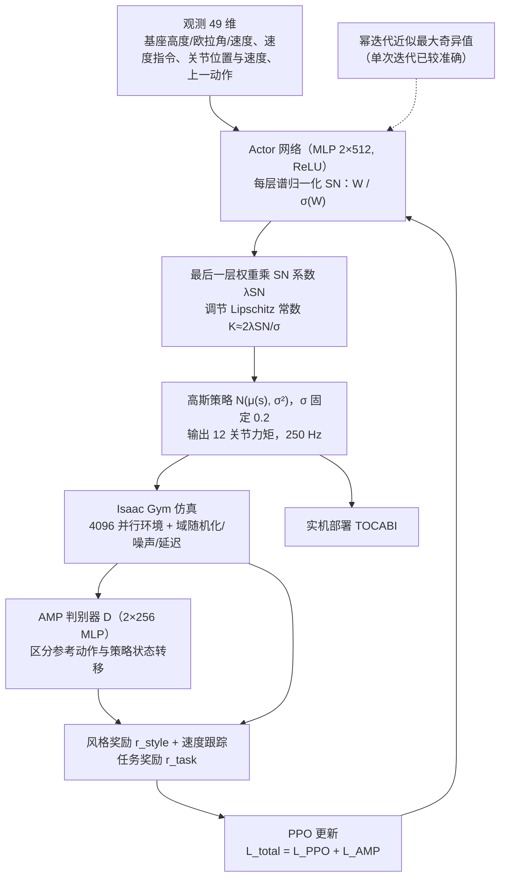

# Spectral Normalization for Lipschitz-Constrained Policies on Learning Humanoid Locomotion

**Spectral Normalization for Lipschitz-Constrained Policies on Learning Humanoid Locomotion** 已列入 [Robot Learning Paper Notebooks](https://imchong.github.io/Robot_Learning_Paper_Notebooks/index.html) 的 **PROGRESS.md 待深读** 清单（分类：05_Locomotion）。本页 **还没有深读笔记**：除分类位置与原文入口外，仅给出依据论文方法部分的「流程总览」图，方法细节与数据请直接看原文。

## 一句话定义

Spectral Normalization for Lipschitz-Constrained Policies on Learning Humanoid Locomotion 的人形机器人学习论文条目，当前处于 Paper Notebooks 阅读进度（待深读）阶段。

## 英文缩写速查

| 缩写 | 英文全称 | 简要说明 |
|------|----------|----------|
| RL | Reinforcement Learning | 通过与环境交互最大化长期回报来学习策略 |
| WBC | Whole-Body Control | 协调全身关节满足多任务/约束的控制基础设施 |
| Sim2Real | Simulation to Real | 把仿真中学到的策略迁移落地真机的工程主线 |

## 为什么重要

- 这篇已排进 Paper Notebooks 的待读清单，可以从 [机器人学习论文笔记总索引](../overview/humanoid-paper-notebooks-index.md) 与分类页找到同一批工作。
- 在笔记写出来之前，这里只保留分类位置与原文入口，不给方法结论。

## 流程总览

图依据：论文 §IV-A（Fig. 2、Eq. 5–8）、§V（训练设置）

## 核心信息

| 字段 | 内容 |
|------|------|
| 分类 | 05_Locomotion |
| 深读状态 | 待撰写（[PROGRESS.md](https://github.com/ImChong/Robot_Learning_Paper_Notebooks/blob/main/papers/PROGRESS.md)） |
| 计划文件夹 | `papers/05_Locomotion/spectral-normalization-for-lipschitz-constrained` |
| arXiv | <https://arxiv.org/abs/2504.08246> |

## 实验与评测

- 深读笔记尚未完成；量化 benchmark、消融与实机指标待笔记撰写后补充。

## 结论

**本页是该工作的待读条目：标题给出的路线很明确——用谱归一化给策略加 Lipschitz 约束来学人形行走——但这个约束带来的收益与代价，本库尚无依据评判。**

- 已确定的信息仅为分类 05_Locomotion 与 arXiv 2504.08246；「实验与评测」明确留空。
- 谱归一化是手段、Lipschitz 约束是性质、行走是任务，三者之间的因果链需要原文实验支撑，本页替代不了。
- 当前用途是待读条目与路由：上溯 [05_Locomotion 分类页](../overview/paper-notebook-category-05-locomotion.md) 与 [总索引](../overview/humanoid-paper-notebooks-index.md)；深读笔记完成后补成完整摘要。

## 与其他页面的关系

- 分类页：[paper-notebook-category-05-locomotion](../overview/paper-notebook-category-05-locomotion.md)
- 总索引：[humanoid-paper-notebooks-index.md](../overview/humanoid-paper-notebooks-index.md)

## 参考来源

- [humanoid_pnb_spectral-normalization-for-lipschitz-constrained.md](../../sources/papers/humanoid_pnb_spectral-normalization-for-lipschitz-constrained.md)
- [Robot Learning Paper Notebooks · PROGRESS.md](https://github.com/ImChong/Robot_Learning_Paper_Notebooks/blob/main/papers/PROGRESS.md)
- 论文：<https://arxiv.org/abs/2504.08246>
- [arXiv PDF](https://arxiv.org/pdf/2504.08246)：已通读方法部分（实验与附录以略读为准）：§IV-A 谱归一化与 Lipschitz 约束策略、§V 训练设置（观测动作、AMP 奖励、PPO 与随机化）；§VI 实验与实机部署仅略读

## 推荐继续阅读

- [Paper Notebooks 阅读进度（PROGRESS.md）](https://github.com/ImChong/Robot_Learning_Paper_Notebooks/blob/main/papers/PROGRESS.md)
