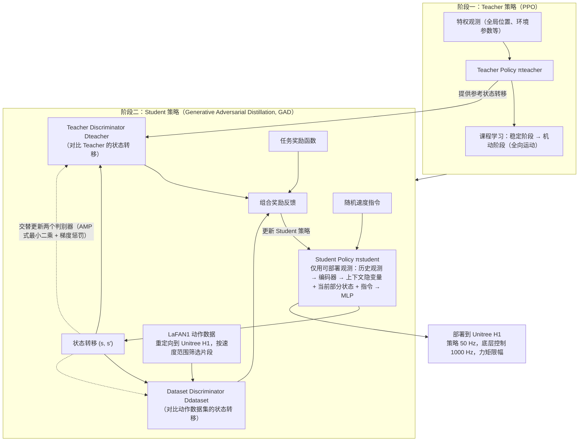

# StyleLoco

**StyleLoco: Generative Adversarial Distillation for Natural Humanoid Robot Locomotion** 已列入 [Robot Learning Paper Notebooks](https://imchong.github.io/Robot_Learning_Paper_Notebooks/index.html) 的 **PROGRESS.md 待深读** 清单（分类：05_Locomotion）。本页 **还没有深读笔记**：只给出这篇论文的分类位置与原文入口，方法细节与数据请直接看原文。

## 一句话定义

StyleLoco 的人形机器人学习论文条目，当前处于 Paper Notebooks 阅读进度（待深读）阶段。

## 英文缩写速查

| 缩写 | 英文全称 | 简要说明 |
|------|----------|----------|
| RL | Reinforcement Learning | 通过与环境交互最大化长期回报来学习策略 |
| WBC | Whole-Body Control | 协调全身关节满足多任务/约束的控制基础设施 |
| Sim2Real | Simulation to Real | 把仿真中学到的策略迁移落地真机的工程主线 |

## 为什么重要

- 这篇已排进 Paper Notebooks 的待读清单，可以从 [机器人学习论文笔记总索引](../overview/humanoid-paper-notebooks-index.md) 与分类页找到同一批工作。
- 深读笔记尚未写出；方法流程见下方「流程总览」（依据论文方法部分），其余结论以论文为准。

## 流程总览

图依据：论文 §III-B Generative Adversarial Distillation、§III-C Training Process、§III-D Implementation and Deployment Details / Fig.2。

## 核心信息

| 字段 | 内容 |
|------|------|
| 分类 | 05_Locomotion |
| 深读状态 | 待撰写（[PROGRESS.md](https://github.com/ImChong/Robot_Learning_Paper_Notebooks/blob/main/papers/PROGRESS.md)） |
| 计划文件夹 | `papers/05_Locomotion/styleloco-generative-adversarial-distillation-fo` |
| arXiv | <https://arxiv.org/abs/2503.15082> |

## 实验与评测

- 深读笔记尚未完成；量化 benchmark、消融与实机指标待笔记撰写后补充。

## 结论

**本页目前只是一条待读记录，而不是对 StyleLoco 方法的判断：它记录的是「这篇 05_Locomotion 论文已进入待深读队列」这一状态。**

- 页面可确证的信息只有分类归属（05_Locomotion）、待深读状态与 arXiv 入口，标题层面的线索是「生成对抗蒸馏用于自然人形运动」，机制细节尚未展开。
- 「实验与评测」明确留空，因此任何 benchmark、消融或实机指标都应直接查原文，不要引用本页。
- 深读笔记完成后本页应补成完整摘要，届时再补齐机制与取舍判断。

## 与其他页面的关系

- 分类页：[paper-notebook-category-05-locomotion](../overview/paper-notebook-category-05-locomotion.md)
- 总索引：[humanoid-paper-notebooks-index.md](../overview/humanoid-paper-notebooks-index.md)

## 参考来源

- [humanoid_pnb_styleloco-generative-adversarial-distillation-fo.md](../../sources/papers/humanoid_pnb_styleloco-generative-adversarial-distillation-fo.md)
- [Robot Learning Paper Notebooks · PROGRESS.md](https://github.com/ImChong/Robot_Learning_Paper_Notebooks/blob/main/papers/PROGRESS.md)
- 论文：<https://arxiv.org/abs/2503.15082>
- [arXiv PDF](https://arxiv.org/pdf/2503.15082)：已通读方法部分（实验与附录以略读为准）：§III Method（A 背景、B GAD、C 训练流程、D 实现与部署）、§IV 实验设定

## 推荐继续阅读

- [Paper Notebooks 阅读进度（PROGRESS.md）](https://github.com/ImChong/Robot_Learning_Paper_Notebooks/blob/main/papers/PROGRESS.md)
