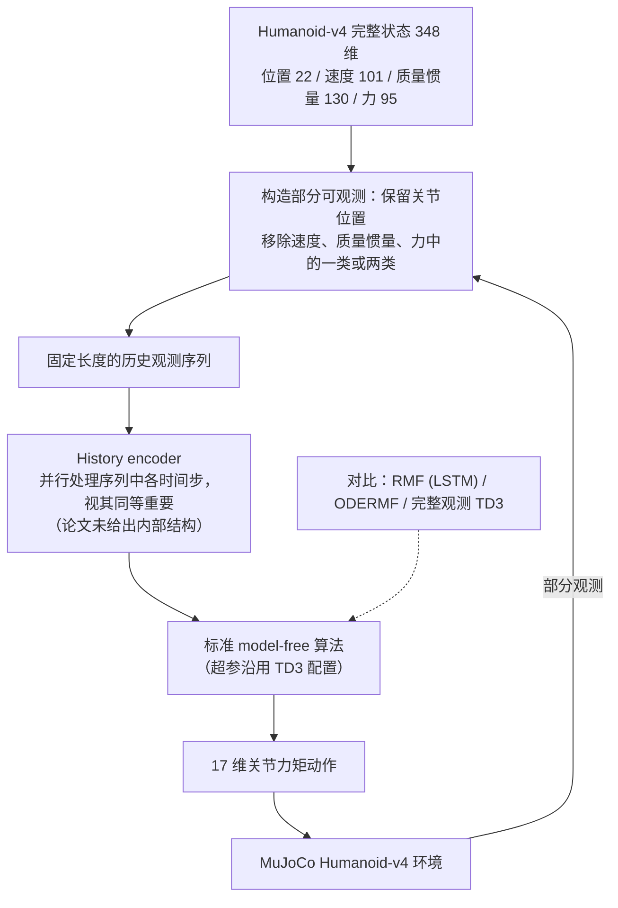

# Success in Humanoid Reinforcement Learning under Partial Observation

**Success in Humanoid Reinforcement Learning under Partial Observation** 已列入 [Robot Learning Paper Notebooks](https://imchong.github.io/Robot_Learning_Paper_Notebooks/index.html) 的 **PROGRESS.md 待深读** 清单（分类：05_Locomotion）。本页 **还没有深读笔记**：只给出这篇论文的分类位置与原文入口，方法细节与数据请直接看原文。

## 一句话定义

Success in Humanoid Reinforcement Learning under Partial Observation 的人形机器人学习论文条目，当前处于 Paper Notebooks 阅读进度（待深读）阶段。

## 英文缩写速查

| 缩写 | 英文全称 | 简要说明 |
|------|----------|----------|
| RL | Reinforcement Learning | 通过与环境交互最大化长期回报来学习策略 |
| WBC | Whole-Body Control | 协调全身关节满足多任务/约束的控制基础设施 |
| Sim2Real | Simulation to Real | 把仿真中学到的策略迁移落地真机的工程主线 |

## 为什么重要

- 这篇已排进 Paper Notebooks 的待读清单，可以从 [机器人学习论文笔记总索引](../overview/humanoid-paper-notebooks-index.md) 与分类页找到同一批工作。
- 在笔记写出来之前，这里只保留分类位置与原文入口；论文自述的流程见上方「流程总览」（依据论文原文，非深读笔记）。

## 流程总览

图依据：论文 Abstract、Introduction、Results 实验设置与 Table 1（encoder 内部结构论文未给出）

## 核心信息

| 字段 | 内容 |
|------|------|
| 分类 | 05_Locomotion |
| 深读状态 | 待撰写（[PROGRESS.md](https://github.com/ImChong/Robot_Learning_Paper_Notebooks/blob/main/papers/PROGRESS.md)） |
| 计划文件夹 | `papers/05_Locomotion/success-in-humanoid-reinforcement-learning-under` |
| arXiv | <https://arxiv.org/abs/2507.18883> |

## 实验与评测

- 深读笔记尚未完成；量化 benchmark、消融与实机指标待笔记撰写后补充。

## 结论

**本页当前的价值是待读条目与检索锚点，而不是对这篇论文的技术判断——真正的结论要等深读笔记落地后重写。**

- 页面能确定的只有元信息：分类 05_Locomotion、PROGRESS.md 标记为待深读、计划文件夹路径与 arXiv 入口；量化 benchmark、消融与实机指标均尚未编译（核心流程见「流程总览」）。
- 因此不应把本页当作引用该工作的技术依据；需要结论时请回到 arXiv 原文，或等待笔记站的深读页。
- 适用边界很窄：本页只服务于 [机器人学习论文笔记总索引](../overview/humanoid-paper-notebooks-index.md) 与分类页之间的交叉检索，方便你按分类找到它。
- 深读笔记完成后，本页会补上笔记链接与实质要点。

## 与其他页面的关系

- 分类页：[paper-notebook-category-05-locomotion](../overview/paper-notebook-category-05-locomotion.md)
- 总索引：[humanoid-paper-notebooks-index.md](../overview/humanoid-paper-notebooks-index.md)

## 参考来源

- [humanoid_pnb_success-in-humanoid-reinforcement-learning-under.md](../../sources/papers/humanoid_pnb_success-in-humanoid-reinforcement-learning-under.md)
- [Robot Learning Paper Notebooks · PROGRESS.md](https://github.com/ImChong/Robot_Learning_Paper_Notebooks/blob/main/papers/PROGRESS.md)
- 论文：<https://arxiv.org/abs/2507.18883>
- [arXiv PDF](https://arxiv.org/pdf/2507.18883)：已通读方法部分（实验与附录以略读为准）：Introduction 与 Results 开头的实验设置（观测属性划分、对比方法、训练设置）；论文仅 8 页，无详细方法章节，encoder 内部结构未给出

## 推荐继续阅读

- [Paper Notebooks 阅读进度（PROGRESS.md）](https://github.com/ImChong/Robot_Learning_Paper_Notebooks/blob/main/papers/PROGRESS.md)
