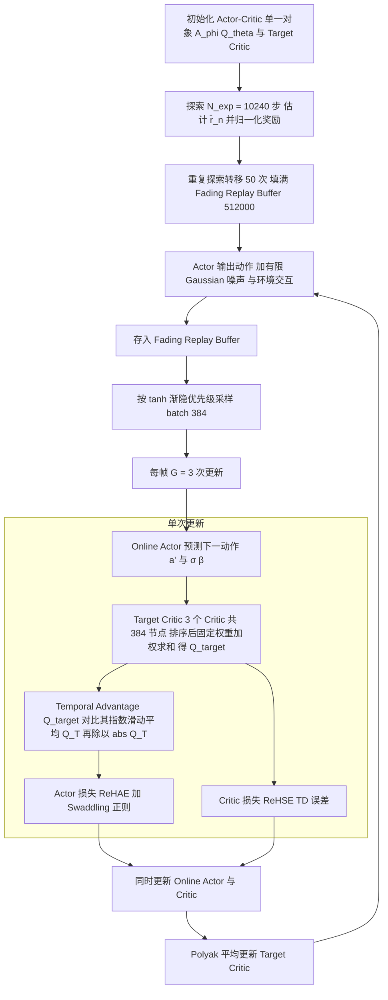

# Symphony

**Symphony: A Heuristic Normalized Calibrated Advantage Actor and Critic Algorithm in application for Humanoid Robots** 已列入 [Robot Learning Paper Notebooks](https://imchong.github.io/Robot_Learning_Paper_Notebooks/index.html) 的 **PROGRESS.md 待深读** 清单（分类：05_Locomotion）。本页 **还没有深读笔记**：只给出这篇论文的分类位置与原文入口，方法细节与数据请直接看原文。

## 一句话定义

Symphony 的人形机器人学习论文条目，当前处于 Paper Notebooks 阅读进度（待深读）阶段。

## 英文缩写速查

| 缩写 | 英文全称 | 简要说明 |
|------|----------|----------|
| RL | Reinforcement Learning | 通过与环境交互最大化长期回报来学习策略 |
| WBC | Whole-Body Control | 协调全身关节满足多任务/约束的控制基础设施 |
| Sim2Real | Simulation to Real | 把仿真中学到的策略迁移落地真机的工程主线 |

## 为什么重要

- 这篇已排进 Paper Notebooks 的待读清单，可以从 [机器人学习论文笔记总索引](../overview/humanoid-paper-notebooks-index.md) 与分类页找到同一批工作。
- 在笔记写出来之前，这里只保留分类位置与原文入口；方法流程见下方「流程总览」，指标与结论以论文为准。

## 流程总览

图依据：论文 §III Foundation 与 Symphony: Pseudo-code（箭头按伪代码与正文归纳）

## 核心信息

| 字段 | 内容 |
|------|------|
| 分类 | 05_Locomotion |
| 深读状态 | 待撰写（[PROGRESS.md](https://github.com/ImChong/Robot_Learning_Paper_Notebooks/blob/main/papers/PROGRESS.md)） |
| 计划文件夹 | `papers/05_Locomotion/symphony-a-heuristic-normalized-calibrated-advan` |
| arXiv | <https://arxiv.org/abs/2512.10477> |

## 实验与评测

- 深读笔记尚未完成；量化 benchmark、消融与实机指标待笔记撰写后补充。

## 结论

**Symphony 在本库还只是一个待读条目：条目已归到 05_Locomotion 分类下，但「启发式归一化校准优势」的 actor-critic 究竟改了什么、换来什么，本页给不出答案。**

- 本页可确认的只有条目级信息：分类 05_Locomotion、arXiv 2512.10477、深读状态「待撰写」。
- 算法改动点、与标准 actor-critic 的差异、在人形上的量化收益均未涉及，不应据此页做方法选型或效果判断。
- 当前唯一职责是方便你按分类找到它，并维持与 [分类页](../overview/paper-notebook-category-05-locomotion.md) / [总索引](../overview/humanoid-paper-notebooks-index.md) 的交叉检索；深读笔记完成后本节应重写。

## 与其他页面的关系

- 分类页：[paper-notebook-category-05-locomotion](../overview/paper-notebook-category-05-locomotion.md)
- 总索引：[humanoid-paper-notebooks-index.md](../overview/humanoid-paper-notebooks-index.md)

## 参考来源

- [humanoid_pnb_symphony-a-heuristic-normalized-calibrated-advan.md](../../sources/papers/humanoid_pnb_symphony-a-heuristic-normalized-calibrated-advan.md)
- [Robot Learning Paper Notebooks · PROGRESS.md](https://github.com/ImChong/Robot_Learning_Paper_Notebooks/blob/main/papers/PROGRESS.md)
- 论文：<https://arxiv.org/abs/2512.10477>
- [arXiv PDF](https://arxiv.org/pdf/2512.10477)：已通读方法部分（实验与附录以略读为准）：Preliminary、§III Foundation（Target Critic、Temporal Advantage、Fading Replay Buffer、ReSine、ReHSE/ReHAE、Swaddling）与伪代码

## 推荐继续阅读

- [Paper Notebooks 阅读进度（PROGRESS.md）](https://github.com/ImChong/Robot_Learning_Paper_Notebooks/blob/main/papers/PROGRESS.md)
