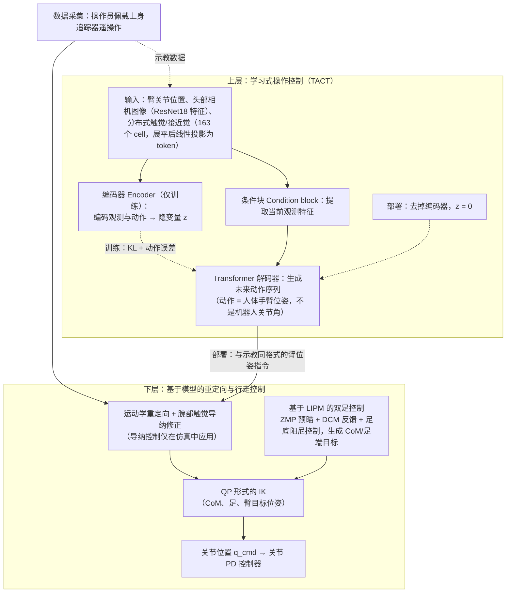

# TACT

**TACT: Humanoid Whole-body Contact Manipulation through Deep Imitation Learning with Tactile Modality** 已列入 [Robot Learning Paper Notebooks](https://imchong.github.io/Robot_Learning_Paper_Notebooks/index.html) 的 **progress 待深读** 清单（分类：04_Loco-Manipulation_and_WBC）。本页 **还没有深读笔记**：只给出这篇论文的分类位置与原文入口，方法细节与数据请直接看原文。

## 一句话定义

TACT 的人形机器人学习论文条目，当前处于 Paper Notebooks 阅读进度（待深读）阶段。

## 英文缩写速查

| 缩写 | 英文全称 | 简要说明 |
|------|----------|----------|
| RL | Reinforcement Learning | 通过与环境交互最大化长期回报来学习策略 |
| WBC | Whole-Body Control | 协调全身关节满足多任务/约束的控制基础设施 |
| Sim2Real | Simulation to Real | 把仿真中学到的策略迁移落地真机的工程主线 |

## 为什么重要

- 这篇已排进 Paper Notebooks 的待读清单，可以从 [机器人学习论文笔记总索引](../overview/humanoid-paper-notebooks-index.md) 与分类页找到同一批工作。
- 深读笔记写出来之前，这里只保留分类位置、原文入口与依据论文方法部分绘制的 [流程总览](#流程总览)，不给实验结论。

## 流程总览

图依据：论文 §III / Fig.2（两层控制架构）、§IV / Fig.3（重定向与 LIPM 行走控制）、§V-A–B / Fig.4（TACT 模型结构、训练与部署）。

## 核心信息

| 字段 | 内容 |
|------|------|
| 分类 | 04_Loco-Manipulation_and_WBC |
| 深读状态 | 待撰写（[progress.json](https://github.com/ImChong/Robot_Learning_Paper_Notebooks/blob/main/progress.json)） |
| 计划文件夹 | `papers/04_Loco-Manipulation_and_WBC/TACT__Humanoid_Whole-body_Contact_Manipulation_through_Deep_Imitation_Learning_w` |

## 实验与评测

- 深读笔记尚未完成；量化 benchmark、消融与实机指标待笔记撰写后补充。

## 结论

**本页当前的价值不在内容而在待读：TACT 已被标题定位为「用带触觉模态的深度模仿学习做人形全身接触操作」，但深读笔记未撰写，页面仅有依据论文方法部分的流程总览，尚不承载可引用的指标。**

- 从题名可确定的定位是 **全身接触操作 + 触觉模态 + 模仿学习** 三者结合，被归入 04_Loco-Manipulation_and_WBC 分类。
- 当前状态为 Paper Notebooks 的 **progress 待深读**，除流程总览外，本页的 benchmark 与实机结论都应视为缺失，而非「已确认为无」。
- 使用方式：仅作分类入口；需要实质内容时请直接走 [参考来源](#参考来源) 中的 progress.json 与原始论文。

## 与其他页面的关系

- 分类页：[paper-notebook-category-04-loco-manipulation-and-wbc](../overview/paper-notebook-category-04-loco-manipulation-and-wbc.md)
- 总索引：[humanoid-paper-notebooks-index.md](../overview/humanoid-paper-notebooks-index.md)

## 参考来源

- [humanoid_pnb_tact.md](../../sources/papers/humanoid_pnb_tact.md)
- [Robot Learning Paper Notebooks · progress.json](https://github.com/ImChong/Robot_Learning_Paper_Notebooks/blob/main/progress.json)
- [arXiv PDF](https://arxiv.org/pdf/2506.15146)：已通读方法部分（实验与附录以略读为准）：§III 控制系统概览、§IV 重定向与行走控制、§V 学习式操作控制、§VI-A 实现。

## 推荐继续阅读

- [Paper Notebooks 阅读进度（PROGRESS.md）](https://github.com/ImChong/Robot_Learning_Paper_Notebooks/blob/main/papers/PROGRESS.md)
