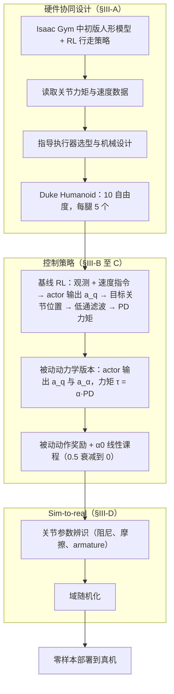

# The Duke Humanoid

**The Duke Humanoid: Design and Control For Energy Efficient Bipedal Locomotion Using Passive Dynamics** 已列入 [Robot Learning Paper Notebooks](https://imchong.github.io/Robot_Learning_Paper_Notebooks/index.html) 的 **PROGRESS.md 待深读** 清单（分类：12_Hardware_Design）。本页 **还没有深读笔记**：只给出这篇论文的分类位置与原文入口，方法流程见 [流程总览](#流程总览)，数据与指标请直接看原文。

## 一句话定义

The Duke Humanoid 的人形机器人学习论文条目，当前处于 Paper Notebooks 阅读进度（待深读）阶段。

## 英文缩写速查

| 缩写 | 英文全称 | 简要说明 |
|------|----------|----------|
| RL | Reinforcement Learning | 通过与环境交互最大化长期回报来学习策略 |
| WBC | Whole-Body Control | 协调全身关节满足多任务/约束的控制基础设施 |
| Sim2Real | Simulation to Real | 把仿真中学到的策略迁移落地真机的工程主线 |

## 为什么重要

- 这篇已排进 Paper Notebooks 的待读清单，可以从 [机器人学习论文笔记总索引](../overview/humanoid-paper-notebooks-index.md) 与分类页找到同一批工作。
- 在笔记写出来之前，这里只保留分类位置、原文入口与依据论文方法部分绘制的 [流程总览](#流程总览)，不给性能结论。

## 流程总览

图依据：论文 §III（A 硬件设计、B 基线 RL、C 节能策略、D sim-to-real）。

## 核心信息

| 字段 | 内容 |
|------|------|
| 分类 | 12_Hardware_Design |
| 深读状态 | 待撰写（[PROGRESS.md](https://github.com/ImChong/Robot_Learning_Paper_Notebooks/blob/main/papers/PROGRESS.md)） |
| 计划文件夹 | `papers/12_Hardware_Design/the-duke-humanoid-design-and-control-for-energy` |
| arXiv | <https://arxiv.org/abs/2409.19795> |

## 实验与评测

- 深读笔记尚未完成；量化 benchmark、消融与实机指标待笔记撰写后补充。

## 结论

**这是一条硬件路线的待读条目：Duke Humanoid 走的是「用被动动力学换能效」的本体设计思路，而非控制算法创新；但深读笔记未撰写，设计细节与数值请以论文为准，本页仅在 [流程总览](#流程总览) 中给出方法流程。**

- 从题名可确定的定位是 **本体设计 + 控制协同**，目标变量是 **双足行走的能量效率**，手段是 **利用被动动力学**——因此它被归入 12_Hardware_Design 而不是运动控制分类。
- 当前处于 PROGRESS.md **待深读** 阶段，能效数值、样机参数与实机对比均缺失，不能据本页做能效横向比较。
- 使用方式：把本页当作硬件设计脉络下的入口节点，实质内容请走 arXiv 原文与 [参考来源](#参考来源)。

## 与其他页面的关系

- 分类页：[paper-notebook-category-12-hardware-design](../overview/paper-notebook-category-12-hardware-design.md)
- 总索引：[humanoid-paper-notebooks-index.md](../overview/humanoid-paper-notebooks-index.md)

## 参考来源

- [humanoid_pnb_the-duke-humanoid-design-and-control-for-energy.md](../../sources/papers/humanoid_pnb_the-duke-humanoid-design-and-control-for-energy.md)
- [Robot Learning Paper Notebooks · PROGRESS.md](https://github.com/ImChong/Robot_Learning_Paper_Notebooks/blob/main/papers/PROGRESS.md)
- 论文：<https://arxiv.org/abs/2409.19795>
- [arXiv PDF](https://arxiv.org/pdf/2409.19795)：已通读方法部分（实验与附录以略读为准）：§III 方法（硬件设计、基线 RL、被动动力学节能策略、sim-to-real）

## 推荐继续阅读

- [Paper Notebooks 阅读进度（PROGRESS.md）](https://github.com/ImChong/Robot_Learning_Paper_Notebooks/blob/main/papers/PROGRESS.md)
