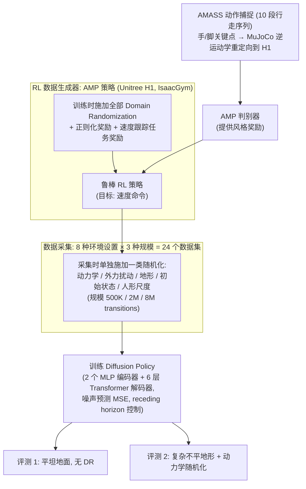

# The Role of Domain Randomization in Training Diffusion Policies for Whole-Body Humanoid Control

**The Role of Domain Randomization in Training Diffusion Policies for Whole-Body Humanoid Control** 已列入 [Robot Learning Paper Notebooks](https://imchong.github.io/Robot_Learning_Paper_Notebooks/index.html) 的 **PROGRESS.md 待深读** 清单（分类：14_Human_Motion）。本页 **还没有深读笔记**：只给出这篇论文的分类位置与原文入口，方法细节与数据请直接看原文。

## 一句话定义

The Role of Domain Randomization in Training Diffusion Policies for Whole-Body Humanoid Control 的人形机器人学习论文条目，当前处于 Paper Notebooks 阅读进度（待深读）阶段。

## 英文缩写速查

| 缩写 | 英文全称 | 简要说明 |
|------|----------|----------|
| RL | Reinforcement Learning | 通过与环境交互最大化长期回报来学习策略 |
| WBC | Whole-Body Control | 协调全身关节满足多任务/约束的控制基础设施 |
| Sim2Real | Simulation to Real | 把仿真中学到的策略迁移落地真机的工程主线 |

## 为什么重要

- 这篇已排进 Paper Notebooks 的待读清单，可以从 [机器人学习论文笔记总索引](../overview/humanoid-paper-notebooks-index.md) 与分类页找到同一批工作。
- 在笔记写出来之前，这里只保留分类位置与原文入口，不给方法结论（论文方法流程见下方「流程总览」）。

## 流程总览

图依据：论文 §3 Framework for Offline Dataset Generation / §3.1–3.2（环境与各类随机化）/ §4 Diffusion Models for Whole-Body Humanoid Control / Fig.1 / §5 评测设置。

## 核心信息

| 字段 | 内容 |
|------|------|
| 分类 | 14_Human_Motion |
| 深读状态 | 待撰写（[PROGRESS.md](https://github.com/ImChong/Robot_Learning_Paper_Notebooks/blob/main/papers/PROGRESS.md)） |
| 计划文件夹 | `papers/14_Human_Motion/the-role-of-domain-randomization-in-training-dif` |
| arXiv | <https://arxiv.org/abs/2411.01349> |

## 实验与评测

- 深读笔记尚未完成；量化 benchmark、消融与实机指标待笔记撰写后补充。

## 结论

**这条目前只是待读条目：标题指向「域随机化在全身人形控制扩散策略训练中到底扮演什么角色」这一问题，而本页尚未给出任何答案。**

- 本页可确认的只有条目级信息：分类 14_Human_Motion、arXiv 2411.01349、深读状态「待撰写」。
- 域随机化的具体设置、扩散策略结构与任何量化结果均未涉及，不能据此页判断 DR 在该设定下是否有效、代价几何。
- 定位是 **待读条目**，作用是让你能从 [分类页](../overview/paper-notebook-category-14-human-motion.md) / [总索引](../overview/humanoid-paper-notebooks-index.md) 的交叉检索；实质结论待深读笔记完成后回填。

## 与其他页面的关系

- 分类页：[paper-notebook-category-14-human-motion](../overview/paper-notebook-category-14-human-motion.md)
- 总索引：[humanoid-paper-notebooks-index.md](../overview/humanoid-paper-notebooks-index.md)

## 参考来源

- [humanoid_pnb_the-role-of-domain-randomization-in-training-dif.md](../../sources/papers/humanoid_pnb_the-role-of-domain-randomization-in-training-dif.md)
- [Robot Learning Paper Notebooks · PROGRESS.md](https://github.com/ImChong/Robot_Learning_Paper_Notebooks/blob/main/papers/PROGRESS.md)
- 论文：<https://arxiv.org/abs/2411.01349>
- [arXiv PDF](https://arxiv.org/pdf/2411.01349)：已通读方法部分（实验与附录以略读为准）：§3 Framework for Offline Dataset Generation（3.1–3.2）、§4 Diffusion Models for Whole-Body Humanoid Control、§5 评测设置

## 推荐继续阅读

- [Paper Notebooks 阅读进度（PROGRESS.md）](https://github.com/ImChong/Robot_Learning_Paper_Notebooks/blob/main/papers/PROGRESS.md)
