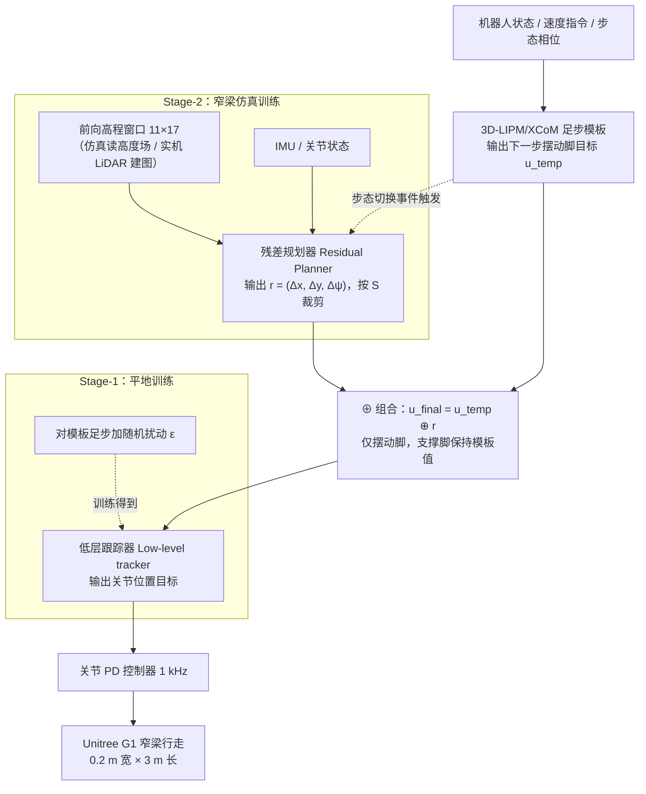

# Traversing Narrow Paths

**Traversing Narrow Paths: A Two-Stage RL Framework for Robust and Safe Humanoid Walking** 已列入 [Robot Learning Paper Notebooks](https://imchong.github.io/Robot_Learning_Paper_Notebooks/index.html) 的 **PROGRESS.md 待深读** 清单（分类：05_Locomotion）。本页 **还没有深读笔记**：只给出这篇论文的分类位置与原文入口，方法细节与数据请直接看原文。

## 一句话定义

Traversing Narrow Paths 的人形机器人学习论文条目，当前处于 Paper Notebooks 阅读进度（待深读）阶段。（arXiv 当前版本 v5 题为《Physics-Guided Residual Reinforcement Learning for Humanoid Narrow-Path Traversal》，v1 题为《Traversing the Narrow Path: A Two-Stage Reinforcement Learning Framework for Humanoid Beam Walking》；同一篇论文改名，本页沿用清单所列题名。）

## 英文缩写速查

| 缩写 | 英文全称 | 简要说明 |
|------|----------|----------|
| RL | Reinforcement Learning | 通过与环境交互最大化长期回报来学习策略 |
| WBC | Whole-Body Control | 协调全身关节满足多任务/约束的控制基础设施 |
| Sim2Real | Simulation to Real | 把仿真中学到的策略迁移落地真机的工程主线 |

## 为什么重要

- 这篇已排进 Paper Notebooks 的待读清单，可以从 [机器人学习论文笔记总索引](../overview/humanoid-paper-notebooks-index.md) 与分类页找到同一批工作。
- 在笔记写出来之前，这里只保留分类位置与原文入口，不给方法结论；论文自述的方法流程见下方「流程总览」。

## 流程总览

图依据：论文 v1 §III-A / Fig. 2、§III-B、§III-C（v5 §III / Fig. 2 结构一致，v5 中残差规划器称 foothold modifier）。

## 核心信息

| 字段 | 内容 |
|------|------|
| 分类 | 05_Locomotion |
| 深读状态 | 待撰写（[PROGRESS.md](https://github.com/ImChong/Robot_Learning_Paper_Notebooks/blob/main/papers/PROGRESS.md)） |
| 计划文件夹 | `papers/05_Locomotion/traversing-narrow-paths-a-two-stage-rl-framework` |
| arXiv | <https://arxiv.org/abs/2508.20661> |

## 实验与评测

- 深读笔记尚未完成；量化 benchmark、消融与实机指标待笔记撰写后补充。

## 结论

**本页当前的价值是待读条目与检索锚点，而不是对 Traversing Narrow Paths 的技术判断——真正的结论要等深读笔记落地后重写。**

- 页面能确定的只有元信息：分类 05_Locomotion、PROGRESS.md 标记为待深读、计划文件夹路径与 arXiv 入口；两阶段框架的方法流程见「流程总览」，量化 benchmark、消融与实机指标尚未编译。
- 因此不应把本页当作引用该工作的技术依据；需要结论时请回到 arXiv 原文，或等待笔记站的深读页。
- 适用边界很窄：本页只服务于 [机器人学习论文笔记总索引](../overview/humanoid-paper-notebooks-index.md) 与分类页之间的交叉检索，方便你按分类找到它。
- 深读笔记完成后，本页会补上笔记链接与实质要点。

## 与其他页面的关系

- 分类页：[paper-notebook-category-05-locomotion](../overview/paper-notebook-category-05-locomotion.md)
- 总索引：[humanoid-paper-notebooks-index.md](../overview/humanoid-paper-notebooks-index.md)

## 参考来源

- [humanoid_pnb_traversing-narrow-paths-a-two-stage-rl-framework.md](../../sources/papers/humanoid_pnb_traversing-narrow-paths-a-two-stage-rl-framework.md)
- [Robot Learning Paper Notebooks · PROGRESS.md](https://github.com/ImChong/Robot_Learning_Paper_Notebooks/blob/main/papers/PROGRESS.md)
- 论文：<https://arxiv.org/abs/2508.20661>
- [arXiv PDF](https://arxiv.org/pdf/2508.20661v1)：已通读方法部分（实验与附录以略读为准）：v1 摘要、§III 方法（A 系统概览、B 模板与 Stage-1、C 残差规划器）；v5（当前版本）对照了 §III 与 Fig. 2。arXiv 版本史：v1（2025-08-28）题为 Traversing the Narrow Path，v5（2026-09-24）改题为 Physics-Guided Residual RL for Humanoid Narrow-Path Traversal，作者增补。

## 推荐继续阅读

- [Paper Notebooks 阅读进度（PROGRESS.md）](https://github.com/ImChong/Robot_Learning_Paper_Notebooks/blob/main/papers/PROGRESS.md)
