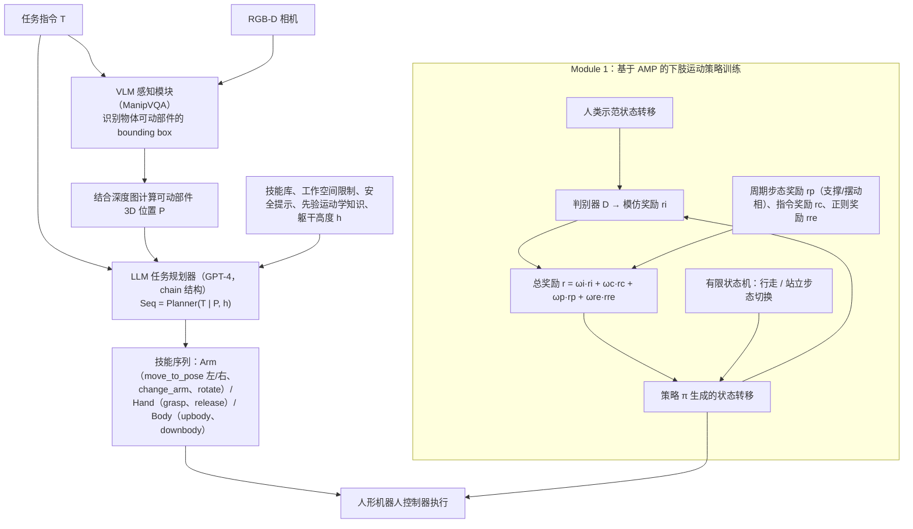

# Trinity

**Trinity: A Modular Humanoid Robot AI System** 已列入 [Robot Learning Paper Notebooks](https://imchong.github.io/Robot_Learning_Paper_Notebooks/index.html) 的 **progress 待深读** 清单（分类：04_Loco-Manipulation_and_WBC）。本页 **还没有深读笔记**：只给出这篇论文的分类位置与原文入口，方法细节与数据请直接看原文。

## 一句话定义

Trinity 的人形机器人学习论文条目，当前处于 Paper Notebooks 阅读进度（待深读）阶段。

## 英文缩写速查

| 缩写 | 英文全称 | 简要说明 |
|------|----------|----------|
| RL | Reinforcement Learning | 通过与环境交互最大化长期回报来学习策略 |
| WBC | Whole-Body Control | 协调全身关节满足多任务/约束的控制基础设施 |
| Sim2Real | Simulation to Real | 把仿真中学到的策略迁移落地真机的工程主线 |

## 为什么重要

- 这篇已排进 Paper Notebooks 的待读清单，可以从 [机器人学习论文笔记总索引](../overview/humanoid-paper-notebooks-index.md) 与分类页找到同一批工作。
- 深读笔记尚未写出；方法流程见下方「流程总览」（依据论文方法部分），其余结论以论文为准。

## 流程总览

图依据：论文 §III-A Module 1（AMP 运动策略）、§III-B Module 2（VLM 感知）、§III-C Module 3（LLM 任务规划）/ Fig.1、Fig.2。

## 核心信息

| 字段 | 内容 |
|------|------|
| 分类 | 04_Loco-Manipulation_and_WBC |
| 深读状态 | 待撰写（[progress.json](https://github.com/ImChong/Robot_Learning_Paper_Notebooks/blob/main/progress.json)） |
| 计划文件夹 | `papers/04_Loco-Manipulation_and_WBC/Trinity__A_Modular_Humanoid_Robot_AI_System` |

## 实验与评测

- 深读笔记尚未完成；量化 benchmark、消融与实机指标待笔记撰写后补充。

## 结论

**本页是「Trinity: A Modular Humanoid Robot AI System」的待读条目：题名摆出的立场是模块化系统而非端到端单体模型，但这一取舍在本页尚无任何展开。**

- 本页可确认的只有条目级信息：分类 04_Loco-Manipulation_and_WBC、arXiv 2503.08338、发表 2025.03、深读状态「待撰写」。
- 模块如何切分、接口如何定义、模块化相对端到端方案的代价，本页均未涉及；量化 benchmark 与实机指标同样待补。
- 当前职责是待读条目，维持与 [分类页](../overview/paper-notebook-category-04-loco-manipulation-and-wbc.md) / [总索引](../overview/humanoid-paper-notebooks-index.md) 的交叉检索；深读笔记完成后应链向笔记站并重写本节。

## 与其他页面的关系

- 分类页：[paper-notebook-category-04-loco-manipulation-and-wbc](../overview/paper-notebook-category-04-loco-manipulation-and-wbc.md)
- 总索引：[humanoid-paper-notebooks-index.md](../overview/humanoid-paper-notebooks-index.md)

## 参考来源

- [humanoid_pnb_trinity.md](../../sources/papers/humanoid_pnb_trinity.md)
- [Robot Learning Paper Notebooks · progress.json](https://github.com/ImChong/Robot_Learning_Paper_Notebooks/blob/main/progress.json)
- [arXiv PDF](https://arxiv.org/pdf/2503.08338)：已通读方法部分（实验与附录以略读为准）：§III Method（A 运动策略、B VLM 感知、C LLM 任务规划）、Fig.1–2 图注

## 推荐继续阅读

- [Paper Notebooks 阅读进度（PROGRESS.md）](https://github.com/ImChong/Robot_Learning_Paper_Notebooks/blob/main/papers/PROGRESS.md)
