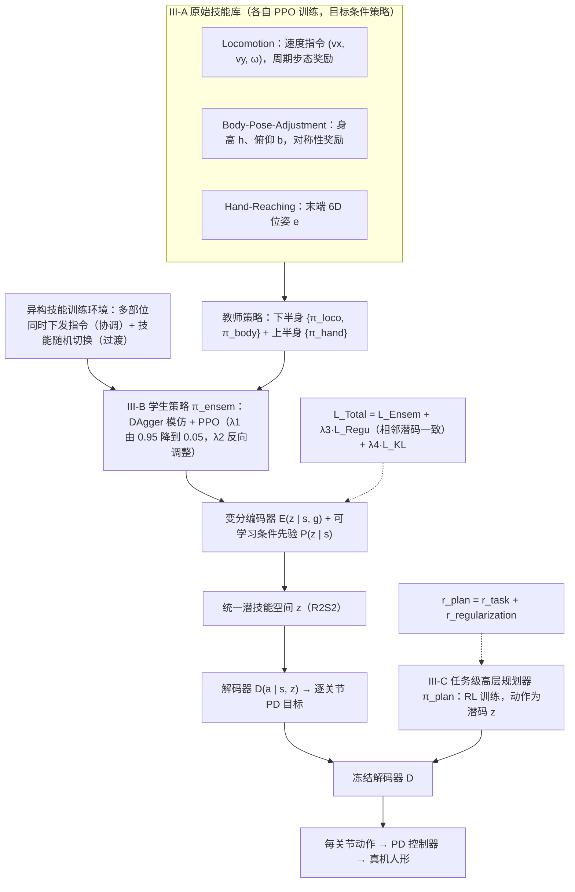

# Unleashing Humanoid Reaching Potential via Real-world-Ready Skill Space

**Unleashing Humanoid Reaching Potential via Real-world-Ready Skill Space** 已列入 [Robot Learning Paper Notebooks](https://imchong.github.io/Robot_Learning_Paper_Notebooks/index.html) 的 **progress 待深读** 清单（分类：04_Loco-Manipulation_and_WBC）。本页 **还没有深读笔记**：只给出这篇论文的分类位置与原文入口，方法细节与数据请直接看原文。

## 一句话定义

Unleashing Humanoid Reaching Potential via Real-world-Ready Skill Space 的人形机器人学习论文条目，当前处于 Paper Notebooks 阅读进度（待深读）阶段。

## 英文缩写速查

| 缩写 | 英文全称 | 简要说明 |
|------|----------|----------|
| RL | Reinforcement Learning | 通过与环境交互最大化长期回报来学习策略 |
| WBC | Whole-Body Control | 协调全身关节满足多任务/约束的控制基础设施 |
| Sim2Real | Simulation to Real | 把仿真中学到的策略迁移落地真机的工程主线 |

## 为什么重要

- 这篇已排进 Paper Notebooks 的待读清单，可以从 [机器人学习论文笔记总索引](../overview/humanoid-paper-notebooks-index.md) 与分类页找到同一批工作。
- 在深读笔记写出来之前，本页只保留分类位置与原文入口；方法模块与数据流见下方「流程总览」（仅依据论文方法部分，不含实验结论）。

## 流程总览

图依据：论文 §III-A / §III-B / §III-C、Fig.2

## 核心信息

| 字段 | 内容 |
|------|------|
| 分类 | 04_Loco-Manipulation_and_WBC |
| 深读状态 | 待撰写（[progress.json](https://github.com/ImChong/Robot_Learning_Paper_Notebooks/blob/main/progress.json)） |
| 计划文件夹 | `papers/04_Loco-Manipulation_and_WBC/Unleashing_Humanoid_Reaching_Potential_via_Real-world-Ready_Skill_Space` |

## 实验与评测

- 深读笔记尚未完成；量化 benchmark、消融与实机指标待笔记撰写后补充。

## 结论

**本页是一个尚未展开的待读条目：题名把技能空间限定为「real-world-ready」，暗示其取舍在于放弃仿真中好看但不可迁移的技能，但深读笔记未撰写，机制无从核实。**

- 从题名可确定的定位是 **以技能空间（skill space）为中介释放人形 reaching 能力**，且强调该空间需对真机可用，被归入 04_Loco-Manipulation_and_WBC 分类。
- 当前处于 Paper Notebooks **progress 待深读** 阶段，技能空间的构造方式、reaching 成功率与实机结果均缺失。
- 使用方式：仅作分类子节点入口；实质内容请走 [参考来源](#参考来源) 中的 progress.json 与原始论文。

## 与其他页面的关系

- 分类页：[paper-notebook-category-04-loco-manipulation-and-wbc](../overview/paper-notebook-category-04-loco-manipulation-and-wbc.md)
- 总索引：[humanoid-paper-notebooks-index.md](../overview/humanoid-paper-notebooks-index.md)

## 参考来源

- [humanoid_pnb_unleashing-humanoid-reaching-potential-via-real.md](../../sources/papers/humanoid_pnb_unleashing-humanoid-reaching-potential-via-real.md)
- [Robot Learning Paper Notebooks · progress.json](https://github.com/ImChong/Robot_Learning_Paper_Notebooks/blob/main/progress.json)
- [arXiv PDF](https://arxiv.org/pdf/2505.10918)：已通读方法部分（实验与附录以略读为准）：§III 全部（原始技能库、异构技能集成、潜技能空间高层规划）；§IV 实验与 §V 遥操作略读

## 推荐继续阅读

- [Paper Notebooks 阅读进度（PROGRESS.md）](https://github.com/ImChong/Robot_Learning_Paper_Notebooks/blob/main/papers/PROGRESS.md)
