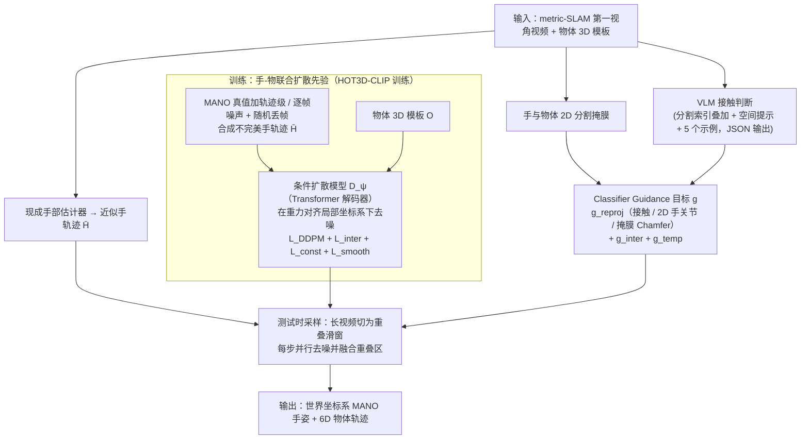

# WHOLE

**WHOLE: World-Grounded Hand-Object Lifted from Egocentric Videos** 收录于 [Robot Learning Paper Notebooks](https://imchong.github.io/Robot_Learning_Paper_Notebooks/index.html)（分类：14_Human_Motion）。本页为 **清单索引实体**，链向深读笔记与原始论文；详细机制待从笔记消化后补充。

## 一句话定义

第一视角视频里手和物体动不动就互相遮挡、还会出画——WHOLE 训练一个手-物联合扩散先验，再用 VLM 抠出来的接触线索 + 物体/手分割掩膜做测试时引导，一次性给出世界坐标系下的 MANO 手姿 + 6D 物体轨迹，比"分头估 + 后处理"显著更稳。

## 英文缩写速查

| 缩写 | 英文全称 | 简要说明 |
|------|----------|----------|
| RL | Reinforcement Learning | 通过与环境交互最大化长期回报来学习策略 |
| WBC | Whole-Body Control | 协调全身关节满足多任务/约束的控制基础设施 |
| Sim2Real | Simulation to Real | 把仿真中学到的策略迁移落地真机的工程主线 |

## 为什么重要

- 列入 Paper Notebooks 策展清单，便于与全库 [机器人学习论文笔记总索引](../overview/humanoid-paper-notebooks-index.md) 及分类父节点交叉检索。
- 深读笔记提供比摘要更贴近实现的阅读路径，适合作为后续 ingest 深化起点。

## 流程总览

图依据：论文 §3（Fig. 2 总览；3.1 手-物扩散先验与训练目标、3.2 作为引导生成的重建、长视频融合）

## 核心信息

| 字段 | 内容 |
|------|------|
| 分类 | 14_Human_Motion |
| 深读笔记 | <https://imchong.github.io/Robot_Learning_Paper_Notebooks/papers/14_Human_Motion/WHOLE__World-Grounded_Hand-Object_Lifted_from_Egocentric_Videos/WHOLE__World-Grounded_Hand-Object_Lifted_from_Egocentric_Videos.html> |
| arXiv | <https://arxiv.org/abs/2602.22209> |

## 实验与评测

- 本页为 **策展清单索引** 摘要；量化 benchmark、消融与实机指标以 **深读笔记与论文 PDF** 为准（链接见 [参考来源](#参考来源)）。

## 结论

**WHOLE 的关键选择是把手和物体放进同一个扩散先验里联合解，而不是分头估计再后处理——遮挡与出画正是「分头估」最先崩掉的地方。**

- 起作用的是「联合先验 + 测试时引导」这对组合：先验负责在互相遮挡、目标出画时补全合理的手–物构型，VLM 抽出的接触线索与手/物分割掩膜则在采样时把结果拉回观测。
- 产物是世界坐标系下的 MANO 手姿与 6D 物体轨迹，一次性给出而非拼接对齐，这也是它相对「分头估 + 后处理」更稳的直接原因。
- 依赖链较长是主要风险：引导质量取决于 VLM 接触线索与分割掩膜是否可靠，本页未给出这些上游失效时的退化表现。
- 本页仍是清单索引实体；量化 benchmark、消融与实机指标以深读笔记与论文 PDF 为准。

## 与其他页面的关系

- 分类父节点：[paper-notebook-category-14-human-motion](../overview/paper-notebook-category-14-human-motion.md)
- 总索引：[humanoid-paper-notebooks-index.md](../overview/humanoid-paper-notebooks-index.md)

## 参考来源

- [humanoid_pnb_whole.md](../../sources/papers/humanoid_pnb_whole.md)
- 深读笔记：<https://imchong.github.io/Robot_Learning_Paper_Notebooks/papers/14_Human_Motion/WHOLE__World-Grounded_Hand-Object_Lifted_from_Egocentric_Videos/WHOLE__World-Grounded_Hand-Object_Lifted_from_Egocentric_Videos.html>
- 论文：<https://arxiv.org/abs/2602.22209>
- [arXiv PDF](https://arxiv.org/pdf/2602.22209)：已通读方法部分（实验与附录以略读为准）：摘要、§1 引言、§3 方法（扩散先验、训练目标、VLM 接触分配、Test-Time Guidance、长视频融合）；§4 实验与附录略读

## 推荐继续阅读

- [机器人论文阅读笔记：WHOLE](https://imchong.github.io/Robot_Learning_Paper_Notebooks/papers/14_Human_Motion/WHOLE__World-Grounded_Hand-Object_Lifted_from_Egocentric_Videos/WHOLE__World-Grounded_Hand-Object_Lifted_from_Egocentric_Videos.html)
